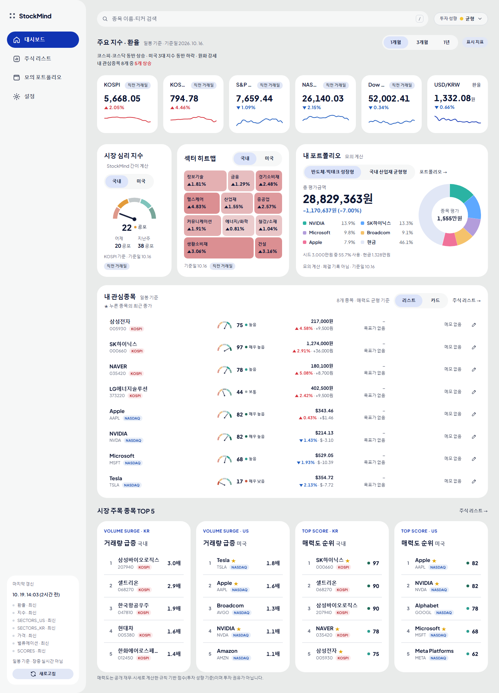
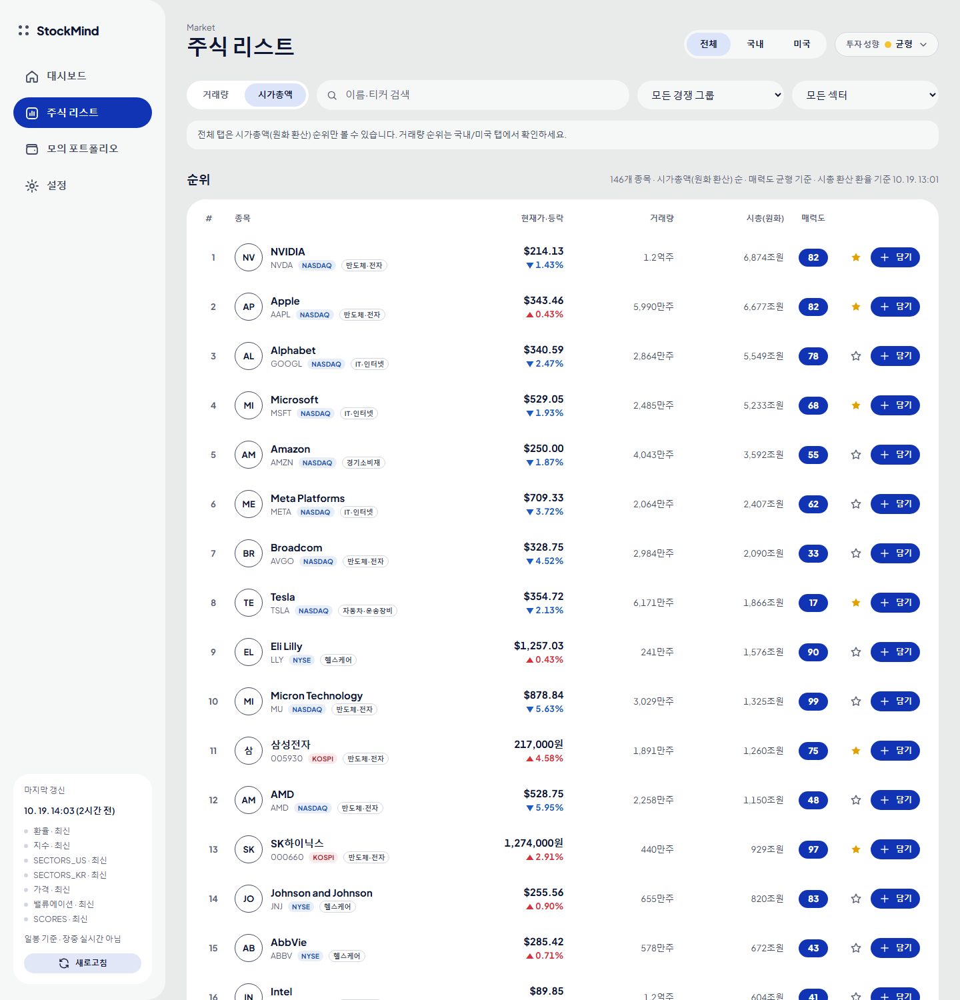
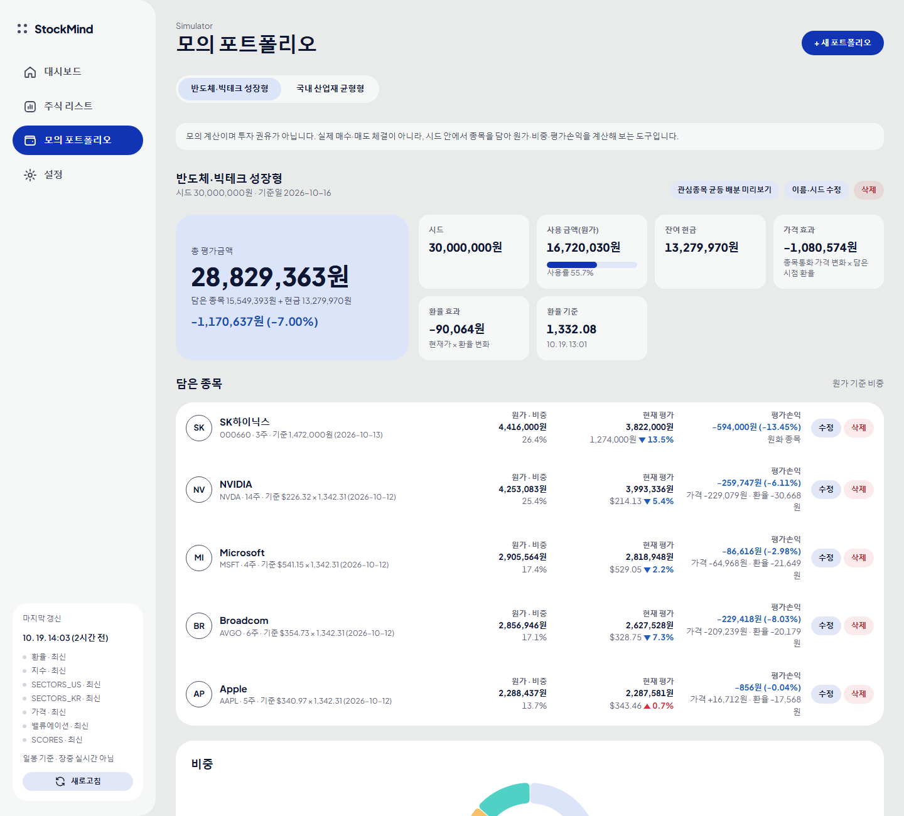

# StockMind

국내(KOSPI·KOSDAQ)·미국(NASDAQ·NYSE) 주식의 시세·지수·환율·밸류에이션·재무·공시를 한 DB에 모아, 한 화면에서 같은 기준(원화 환산·일봉)으로 비교해 보는 **주식 분석 대시보드**입니다.

- 흩어진 원천 데이터(pykrx·yfinance·OpenDART·SEC EDGAR)를 수집·전처리해 PostgreSQL 정규화 스키마에 적재하고, 서버가 떠 있는 동안 4시간 주기로 갱신합니다.
- 공개 재무·시세로 계산한 **투자 매력도**(투자 성향별 다중 팩터 점수)와 시장·섹터 점수, 경쟁 종목 비교, 통계를 제공합니다.
- FastAPI 조회 API와 바닐라 HTML/CSS/JS 화면으로 보여 줍니다. 조회 API는 외부 소스를 직접 부르지 않고 DB 값만 씁니다.
- 4인 팀(시니어 1 · 주니어 3)이 6단계(Stage 0~6)로 만들었고, 지금은 추가 기능(수집 확장·화면 개선)을 이어서 넣고 있습니다.

> 시세는 일봉 기준이며 장중 실시간이 아닙니다. 매력도는 규칙 기반 계산값이며, 이 프로젝트의 어떤 정보도 투자 권유가 아닙니다.

## 화면

화면은 **라이트 모드(흰 바탕 + 코발트 블루)** 가 기본이고, 사이드바의 `설정`에서 다크 모드로 바꿀 수 있습니다.

### 대시보드 홈
- **상단 바**: 종목 검색(이름·영문명·티커 자동완성, `/` 단축키)과 투자 성향(위험·성장·균형·가치) 선택
- **주요 지수·환율**: KOSPI·KOSDAQ·S&P 500·NASDAQ·Dow Jones·USD/KRW의 최신값·등락·스파크라인(1개월·3개월·1년). 장이 열리지 않은 시장은 `직전 거래일` 배지, 한 줄 시장 요약
- **시장 심리 지수**(StockMind 간이 계산) · **섹터 히트맵**(국내·미국) · **내 포트폴리오**(총 평가금액·손익, 종목·현금 비중 도넛)
- **내 관심종목**: 리스트(매력도 게이지·현재가·전일 대비·목표가 괴리율·메모) / 카드(요약) 보기
- **시장 주목 종목 TOP 5**: 거래량 급증(직전 20거래일 평균 대비 배수)·매력도 순위를 국내·미국 카드 4장으로 한눈에



### 주식 리스트
노출 종목과 매력도 비교군(146개)을 거래량·시가총액 순위로 25개씩 보여 줍니다. 전체·국내·미국 탭, 이름·티커 검색, 경쟁 그룹·업종 섹터 필터를 지원하고, 행마다 매력도 점수·★(관심종목)·`담기`(모의 포트폴리오) 버튼이 있습니다. `전체` 탭은 시장마다 거래량 단위가 달라 시가총액(원화 환산) 순위만 제공합니다.



### 종목 상세
- **가격 차트**: 1M·3M·6M·1Y 종가 추이와 거래량
- **투자 매력도**: 투자 성향별 점수·국가 내 순위, 5요소(저평가·수익성·성장성·안정성·주가 흐름) 레이더(경쟁 그룹 평균·시장 중앙 50과 비교), 요소별 설명, 계산 근거(팩터 기여도·지표 원값/Z)
- **시장·섹터 점수**: 시장 심리와 같은 섹터 종목의 최근 흐름으로 본 지금의 시장 분위기
- **투자 지표·재무 추이·월별 요약·경쟁 종목 비교**: 처음 펼칠 때 불러오는 접이식 영역. 재무는 국내 OpenDART(K-IFRS 연결), 미국 SEC EDGAR(US-GAAP) FY 추이
- **최근 공시**: 원문 링크 포함 최근 5건


### 모의 포트폴리오 — 시드 안에서 담아 보는 계산기
정해 둔 시드(원화) 안에서 국내·미국 종목을 담아 보는 화면입니다. 실제 거래 기록이 아니라 "담아 보는 계산기 겸 장바구니"입니다.

- 포트폴리오를 여러 개 만들고 이름·시드를 고치거나 지울 수 있습니다.
- 담기 팝업에서 **수량·금액·비중** 중 하나로 입력하면 몇 주가 되는지 미리 보여 주고, 시드를 넘으면 담을 수 있는 최대 수량을 안내합니다.
- 담는 순간의 가격·환율을 항목에 함께 저장해, 지금 평가손익을 **가격 효과**와 **환율 효과**로 나눠 보여 줍니다.
- 사용·잔여 시드, 비중 차트, 담은 종목 표(수정·삭제), 관심종목 균등 배분 미리보기를 제공합니다.



### 설정
화면 테마(라이트 / 다크)를 고릅니다. 선택은 이 브라우저에만 저장되고, 다음에 열 때 화면이 그려지기 전에 적용됩니다.

## 기술 스택

| 구분 | 사용 기술 |
|---|---|
| 백엔드 | Python 3.12 · FastAPI · Pydantic v2 · SQLAlchemy 2.x (동기, 원문 SQL `backend/app/queries/*.sql` + `text()`) |
| DB | PostgreSQL 16 — 테이블 25 · VIEW 3 · 마이그레이션 001~009 |
| 수집 | pykrx(국내 시세·지수·밸류에이션, 장애 시 KIS Open API로 전환), yfinance(미국 시세·지수·밸류에이션, USD/KRW), OpenDART(국내 재무·공시), SEC EDGAR(미국 재무·공시) |
| 갱신 | 앱 안 스케줄러(asyncio) + PostgreSQL advisory lock — 시세 4시간 TTL, 비교군 07:00, 백그라운드 재무 08:00 (KST) |
| 프론트엔드 | 바닐라 HTML/CSS/JS (ES Modules, 빌드 없음) · Chart.js (CDN) · CSS 변수 디자인 토큰(라이트·다크) |
| 실행·테스트 | Docker Compose · pytest |

## 아키텍처

```
pykrx · yfinance ─┐
OpenDART · SEC ───┴▶ providers/ ──▶ ingest/ (전처리·이상 행 격리·upsert) ──▶ PostgreSQL
                          ▲                                                  │
   services/refresh (4시간 TTL) · benchmark (07:00) · background (08:00)    │
              ▲ 스케줄러 · POST /market/refresh · python -m app.ingest       │
                                                                             │
              브라우저 (frontend/) ◀── FastAPI /api/v1 (queries/*.sql) ◀──────┘
```

- **수집과 조회 분리**: 외부 호출은 수집 작업(스케줄러·`python -m app.ingest`)에서만 합니다. 화면이 부르는 API는 DB만 읽습니다.
- **재적재 안전(멱등)**: 같은 데이터를 다시 적재해도 행 수가 늘지 않도록 upsert로 넣습니다.
- **주기적 갱신과 호출 절약**: 환율·지수·일봉·밸류에이션은 작업별 TTL(기본 4시간) 안이면 외부를 부르지 않습니다. 일부 종목만 실패하면 30분 뒤 실패한 종목만 다시 받고, 여러 프로세스가 동시에 돌려도 DB 잠금(advisory lock)으로 한 번만 실행됩니다.
- **재무 수집 부하 분산**: 재무·공시는 회사 단위로 잠그고 20개 회사씩 묶어 저장합니다. 상장 종목 전체(listed)는 첫 적재를 파일(OpenDART 일괄 다운로드)·SEC frames로 한 번에 넣고, 이후에는 새 사업보고서를 낸 회사만 다시 받거나 하루 예산(DART 2,000 · SEC 1,000행) 안에서 우선순위대로 받습니다.
- **이상 행 격리**: 고가<저가, 음수 거래량 같은 행은 DB에 넣지 않고 `backend/data/quarantine/`에 사유와 함께 남깁니다.
- **금액은 `Decimal`/`NUMERIC`**: 가격·비율 계산에 float을 쓰지 않습니다. 해외 종목은 원화 환산값을 함께 제공합니다.
- **담는 순간 값 복사(의도적 비정규화)**: 포트폴리오 항목에는 담은 날의 가격·환율·날짜를 복사해 둡니다. 시세가 나중에 바뀌어도 "얼마에 담았는지"가 남아 손익을 계산할 수 있습니다.
- **요청 사용자는 서버가 정함**: 로그인은 아직 없습니다. 로컬은 데모 사용자 한 명, 배포는 브라우저별 게스트 세션으로 나누고, 남의 포트폴리오·관심종목은 404로 막습니다.
- **일관된 에러 형식**: 모든 오류는 `{"error": {"code", "message", "detail"}}`로 응답합니다.

자세한 구성도와 요청 흐름은 [개발산출물/architecture.md](개발산출물/architecture.md)에 있습니다.

## 빠르게 실행하기

필요한 것: Docker Desktop

```bash
# 1) 환경 변수 파일 준비
cp .env.example .env

# 2) DB + API 서버 실행 (개발 모드: 소스 수정 시 자동 재시작)
docker compose -f compose.yml -f compose.dev.yml up -d --build

# 3) 스키마 생성 → 종목·지수 마스터 → 샘플 시세 적재 (외부 계정 없이 바로 보기)
docker compose run --rm api python -m app.ingest init-db
docker compose run --rm api python -m app.ingest master --offline
docker compose run --rm api python -m app.ingest import-sample

# 4) (선택) 데모 관심종목 8건 + 모의 포트폴리오 2개 넣기
docker compose run --rm api python -m app.ingest seed-demo
```

브라우저에서 http://localhost:8000 을 열면 대시보드가 보입니다. `seed-demo`를 실행했으면 홈에 관심종목이, http://localhost:8000/portfolio 에 데모 포트폴리오가 보입니다. 시세가 없는 종목은 건너뜁니다. API 문서는 http://localhost:8000/docs 에 있습니다.

이미 만든 DB에 새 스키마 변경을 적용할 때는 `python -m app.ingest migrate <이름>`(예: `009_cap_rank`)으로 `backend/db/migrations/`의 파일을 차례로 실행합니다.

### 실제 데이터로 수집하기 (선택)

샘플 대신 실제 데이터를 받으려면 `.env`에 아래 환경변수(KRX 계정·DART 키·SEC User-Agent)를 넣고 `all`을 한 번 실행합니다. pykrx가 막히면 `PRICE_SOURCE_KR=kis`(한국투자증권 Open API, 아래 `KIS_API_KEY`·`KIS_API_SECRET` 필요)로 바꿉니다. `yfinance`(`.KS`/`.KQ` 심볼)도 쓸 수 있지만 밸류에이션이 DART 파생값으로 대체됩니다.

```bash
docker compose run --rm api python -m app.ingest all   # master → prices → indices → fx → financials → valuation → disclosures
```

| 명령 (`python -m app.ingest …`) | 하는 일 |
|---|---|
| `master [--offline]` | 종목·지수 마스터 + DART corp_code·SEC CIK 매핑 |
| `prices` · `indices` · `fx` · `valuation` `[--full]` | 종목 일봉 · 지수 일봉 · USD/KRW 일별 환율 · PER·PBR·시가총액 |
| `financials [--years 5]` · `disclosures [--days 365]` | FY 재무 · 최근 공시 (`--tickers 005930 AAPL`로 일부만) |
| `scores` · `benchmark [--reselect]` | 매력도 점수 재계산 · 비교군 선정(30일마다)·평시 데이터·점수 |
| `listing` · `hydrate <티커>` | 상장 보통주 목록(검색용) · 비교군 종목 상세 데이터 받기 |
| `dart-bulk --as-of <날짜>` · `us-bulk` | 국내 listed 재무 첫 적재(OpenDART 일괄 파일) · 미국 listed 재무 첫 적재(SEC frames) |
| `dart-feed` · `background` | 새 사업보고서 낸 회사만 증분 · listed 재무를 하루 예산만큼 우선순위대로 |
| `refresh` · `status` · `explain` | TTL 갱신(cron용) · 테이블별 행 수·최근 실패 · 인덱스 전후 EXPLAIN |

모든 명령은 다시 실행해도 행 수가 늘지 않습니다. 대상 종목·지수와 백그라운드 예산은 [`backend/config/universe.yaml`](backend/config/universe.yaml)에서 정합니다.

#### 환경변수
| 변수 | 필수/선택 | 설명 |
|---|---|---|
| `KRX_ID`, `KRX_PW` | **필수**(국내 소스 pykrx 사용 시) | pykrx 1.2.x의 시총·PER/PBR·지수 조회에 필요한 KRX 정보데이터시스템 계정. 없으면 시총·펀더멘털·지수가 빈 결과([troubleshooting 1](개발산출물/troubleshooting.md)) |
| `KIS_API_KEY`, `KIS_API_SECRET` | 선택 (`PRICE_SOURCE_KR=kis`일 때 필수) | 한국투자증권 Open API 앱키·시크릿. 국내 일봉·지수·밸류에이션을 KIS로 받습니다(날짜별 전 종목 조회가 없어 비교군도 종목별 수집, 배당은 마지막 값 유지). 기존 DB는 `python -m app.ingest migrate 010_kis_source` 1회 |
| `DART_API_KEY` | **필수**(국내 재무·공시) | OpenDART 인증키 |
| `SEC_USER_AGENT` | **필수**(미국 재무·공시) | 연락처(이메일)가 들어간 User-Agent |
| `REFRESH_TTL_HOURS` | 선택 | 같은 종류 외부 호출 최소 간격(시간, 3~4, 기본 4) |
| `SCHEDULER_ENABLED` | 선택 | 앱 안 스케줄러 사용 여부 (기본 true) |
| `SCHEDULER_CHECK_MINUTES` | 선택 | 스케줄러가 할 일을 확인하는 간격(분, 기본 5) |
| `EXTRA_CA_DIR` | 선택 (compose) | 추가 CA 인증서 폴더(아래 TLS 검사 환경) |
| `GUEST_SESSION_ENABLED` | 선택 (배포) | 브라우저별 게스트 세션 사용 여부 (기본 false = 단일 데모 사용자). 쿠키가 HTTPS 전용이라 로컬 http에서는 false |
| `SESSION_SECRET` | **필수**(`GUEST_SESSION_ENABLED=true`일 때) | 세션 쿠키 서명 키 — 인스턴스끼리 같아야 하므로 Cloud Run에서는 Secret Manager로 주입. 생성: `python -c "import secrets; print(secrets.token_hex(32))"` |

- **TLS 검사(백신·사내 프록시) 환경**: 호스트에서 HTTPS가 가로채져 인증서 오류가 나면, 그 루트 인증서(`*.pem`·`*.crt`)를 `certs/`에 두거나 `.env`에 `EXTRA_CA_DIR=<폴더>`를 지정합니다. entrypoint가 시스템 CA 번들에 합쳐 requests·curl_cffi(yfinance)·ssl 모두에 적용합니다. 예) Norton: `C:/ProgramData/Norton/Antivirus/wscert.pem`

#### 자동 갱신 (앱 안 스케줄러, 기본 켜짐)
| 작업 | 시점 | 내용 |
|---|---|---|
| 시세 갱신 | 5분마다 확인, 작업별 4시간 TTL | 환율·지수·일봉·밸류에이션·섹터 등락·매력도 점수. 일부 실패 시 30분 뒤 실패 종목만 |
| 비교군 갱신 | 매일 07:00 KST 이후 1회 | 공시 증분 → 비교군 선정(30일마다) → 평시 데이터 → 점수 |
| 백그라운드 재무 | 매일 08:00 KST 이후 1회 | listed 종목 재무를 하루 예산 안에서 우선순위대로 |

화면의 `새로고침` 버튼은 `POST /api/v1/market/refresh`, 사이드바의 마지막 갱신 시각은 `GET /api/v1/market/refresh/status`(외부 호출 없음)입니다. 서버를 띄우지 않을 때는 `SCHEDULER_ENABLED=false`로 두고 `refresh`·`benchmark`·`background`를 cron 등으로 직접 실행합니다.

### 테스트

```bash
docker compose run --rm api pytest -q
```

스키마 제약·ORM↔DDL 일치, 재적재 시 행 수 불변, API 응답·오류 형식, 관심종목·포트폴리오 계산(시드 초과·환율 효과·균등 배분), 매력도·분석 SQL 손계산, 홈 위젯(순위·섹터·심리 지수), 갱신·스케줄러(TTL 이내 외부 호출 0·동시 요청 직렬화·실패 종목만 재시도), 재무 수집(회사 단위 잠금·묶음 저장·일괄 파일·증분·하루 예산), 남의 데이터 접근 차단·게스트 세션, 화면 제공을 검증합니다. 외부 소스는 가짜 Provider로 바꿔 네트워크 없이 돌고, 테스트는 별도 DB(`stockdb_test`)에서 돌아갑니다(2026-10-19 기준 496개 통과). GitHub Actions(`.github/workflows/test.yml`)가 PR마다 같은 테스트를 돌립니다.

## API

모든 경로는 `/api/v1` 아래입니다(헬스체크 제외). 요청·응답 예시와 에러 코드는 [개발산출물/06_기능_API_정의서.md](개발산출물/06_기능_API_정의서.md)에 있습니다.

| 구분 | Method · URL | 기능 |
|---|---|---|
| 헬스 | GET `/health`, `/health/db` | 프로세스·DB 연결 확인 |
| 시장 | GET `/market/indices` · `/market/fx` | 지수별·USD/KRW 최신값·등락·최근 1년·52주 범위 |
| | POST `/market/refresh` · GET `/market/refresh/status` | TTL 갱신 실행 · 작업별 마지막 갱신 상태 |
| 종목 | GET `/stocks` | 주식 리스트 (`country`, `sort`, `order`, `group`, `sector`, `q`, `limit`, `offset`) |
| | GET `/stocks/search` | 상단 검색 자동완성 (상장 보통주 전체) |
| | GET `/stocks/{market}/{ticker}` | 종목 기본 정보 + 최신 시세·밸류에이션·매력도·시장·섹터 점수 |
| | GET `/stocks/{market}/{ticker}/candles` · `/financials` · `/disclosures` | 기간 일봉 · FY 재무 추이 · 최근 공시 |
| | GET `/stocks/{market}/{ticker}/analysis` | 투자 지표 수치 분석 |
| | GET `/stocks/{market}/{ticker}/peers` · `/peers/chart` | 경쟁 종목 비교 표 · 비교 차트 |
| | GET `/peer-groups` · `/scoring/presets` | 경쟁 그룹 목록 · 투자 성향 프리셋과 팩터 가중치 |
| 홈 | GET `/home/ranking` · `/home/sectors` · `/home/sentiment` | 시장 주목 종목(거래량 급증·매력도) · 섹터 히트맵 · 시장 심리 지수 |
| 통계 | GET `/statistics/overview` · `/market-valuation` · `/peer-group-valuation` · `/monthly` · `/ranking` · `/data-quality` · `/disclosure-frequency` | 데이터 개요 · 시장별·그룹별 지표 · 월별 집계 · 지표별 TOP N · 데이터 품질 · 공시 빈도 |
| 관심종목 | GET · POST `/watchlist` | 관심종목 목록 · 추가 |
| | PUT · DELETE `/watchlist/{market}/{ticker}` · PATCH `/watchlist/order` | 메모·목표가 수정 · 삭제 · 순서 변경 |
| 포트폴리오 | GET · POST `/portfolios` · GET · PUT · DELETE `/portfolios/{id}` | 목록·생성 · 단건·이름·시드 수정·삭제 |
| | GET · POST `/portfolios/{id}/items` · PUT · DELETE `/portfolios/{id}/items/{item_id}` | 담은 종목·담기(`mode=quantity·amount·weight`) · 수정·삭제 |
| | GET `/portfolios/{id}/summary` · POST `/portfolios/{id}/preview/equal-weight` | 요약(가격 효과·환율 효과) · 균등 배분 미리보기 |

## 폴더 구조

```
ax_stockmind/
├─ backend/
│  ├─ app/
│  │  ├─ api/          라우터 (market, stocks, analysis, home, watchlist, portfolios, health)
│  │  ├─ core/         설정·DB 연결·에러·로깅
│  │  ├─ ingest/       수집·적재 CLI (python -m app.ingest) — 일괄 파일·증분·백그라운드 적재 포함
│  │  ├─ providers/    외부 데이터 소스 어댑터 (pykrx, KIS, yfinance, OpenDART, SEC EDGAR)
│  │  ├─ services/     환율(TTL)·갱신·스케줄러·매력도·시장 심리·섹터·포트폴리오·게스트 세션
│  │  ├─ queries/      조회용 원문 SQL
│  │  ├─ models/       ORM (schema.sql과 1:1)
│  │  └─ schemas/      API 요청·응답 모델
│  ├─ db/              schema.sql · indexes.sql · views.sql · migrations/
│  ├─ config/          universe.yaml (대상 종목·지수·비교군·백그라운드 예산)
│  ├─ sample_data/     오프라인 실행용 샘플 CSV
│  └─ tests/
├─ frontend/           index · stocks · stock · portfolio · settings 화면, css/(tokens = 라이트·다크 색), js/
├─ 개발산출물/               기획서·요구사항·데이터 조사·도메인 모델·ERD·API 정의서·매력도 정의서·아키텍처·트러블슈팅
└─ team/               팀 작업 가이드·로드맵·추가 기능 계획·추가 기능 API 정의서
```

## 문서

| 문서 | 내용 |
|---|---|
| [01 프로젝트 기획서](개발산출물/01_프로젝트_기획서.md) | 배경·문제 정의·주요 기능 |
| [02 요구사항 정의서](개발산출물/02_요구사항_정의서.md) | 기능·비기능 요구사항과 구현 상태 |
| [03 데이터 조사 정의서](개발산출물/03_데이터_조사_정의서.md) | 데이터 소스·수집 범위·이용 조건 |
| [04 도메인 모델 정의서](개발산출물/04_도메인_모델_정의서.md) | 핵심 개념과 관계 |
| [05 ERD 및 DB 설계서](개발산출물/05_ERD_및_DB설계서.md) | ERD·테이블 정의·인덱스·VIEW·검증 결과 |
| [06 기능·API 정의서](개발산출물/06_기능_API_정의서.md) | 엔드포인트·요청/응답 예시·화면 연결·에러 코드 |
| [09 매력도 점수 정의서](개발산출물/09_매력도_점수_정의서.md) | 다중 팩터 점수 계산 방식·투자 성향 프리셋 |
| [아키텍처](개발산출물/architecture.md) | 구성도·데이터 적재 흐름·요청 흐름·주요 설계 결정 |
| [EXPLAIN 결과](개발산출물/explain_result.md) | 인덱스 전후 실행 계획 비교 |
| [트러블슈팅](개발산출물/troubleshooting.md) | KRX 로그인·TLS 인증서 등 수집 환경 문제와 해결 |
| [추가 기능 계획](team/기능구현_계획.md) · [추가 기능 API 정의서](team/추가기능_API_정의서.md) | Stage 6 이후 추가 기능의 단계·결정 사항(D1~D12)·계약 |

## 개발 로드맵

| 단계 | 결과물 | 상태 |
|---|---|---|
| Stage 0 | 뼈대·개발 환경 | ✅ v0.1 |
| Stage 1 | MVP — 지수·환율·주요 종목 홈, 주식 리스트, 종목 상세, 시세 수집 | ✅ v1.0.1 |
| Stage 2 | 사용자 기능 — 관심종목·모의 포트폴리오 | ✅ v2.0 |
| Stage 3 | 실데이터 — 재무·공시 포함 4개 소스 수집, 주기적 갱신 | ✅ v3.0 |
| Stage 4 | 분석 — 매력도·경쟁 비교·통계 | ✅ v4.0 |
| Stage 5 | 고도화 — 메모·목표가·통계 확장 | ✅ v5.0 |
| Stage 6 | 홈 대시보드 개편·상단 검색·최종 문서 | ✅ |
| 추가 기능 | 안정성 팩터 개편, 재무 수집 부하 분산, 시장·섹터 점수, listed 재무 일괄·증분·백그라운드 적재, 리스트 확장, 라이트 모드·설정 | ✅ (2026-10-19) |
| 다음 | 장중 시세(KIS), Cloud Run 배포, 매매 일지·투자 통계 | 계획 |

팀 작업 방식(브랜치·PR 규칙, Claude Code 사용법)은 [team/00_팀_작업_가이드.md](team/00_팀_작업_가이드.md)를 보세요. 추가 기능 아이디어는 [team/기능구현_아이디어.md](team/기능구현_아이디어.md)에 모아 두었습니다.

## 데이터 이용 조건

- **pykrx**: KRX 정보데이터시스템 비공식 라이브러리입니다. 1.2.x는 시총·펀더멘털·지수 조회에 KRX 회원 로그인이 필요합니다.
- **KIS Open API**(한국투자증권): `PRICE_SOURCE_KR=kis`일 때 국내 일봉·지수·밸류에이션. 시세 조회 API만 호출하고(주문·계좌 API 없음), 호출 한도는 계좌(앱키) 단위라 모의투자 기준 초당 1건으로 호출합니다([troubleshooting 2](개발산출물/troubleshooting.md)).
- **yfinance**: Yahoo Finance 비공식 라이브러리입니다. 개인·학습 목적으로만 쓰고 원본 데이터를 재배포하지 않습니다. 저장소에는 소량 샘플만 포함합니다.
- **OpenDART**(금융감독원): 국내 재무(연결)·공시. 인증키가 필요하고, 분당 호출 제한을 넘지 않도록 프로세스마다 60초에 45회 이하로 호출합니다.
- **SEC EDGAR**: 미국 재무(XBRL companyfacts·frames)·공시. API 키는 없지만 연락처(이메일)가 들어간 User-Agent가 필수입니다.
