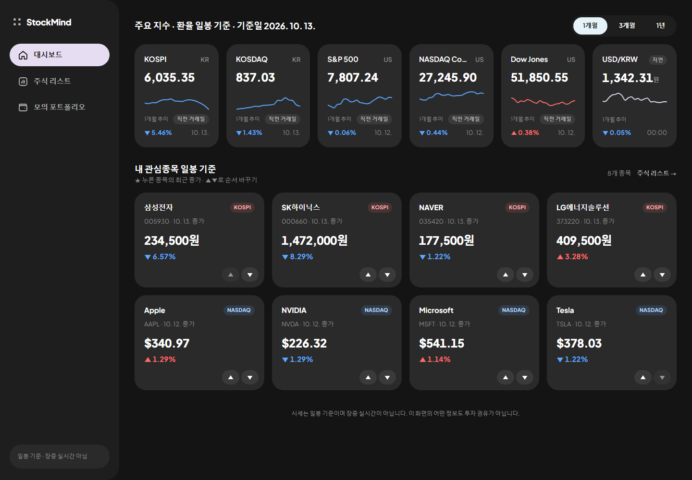
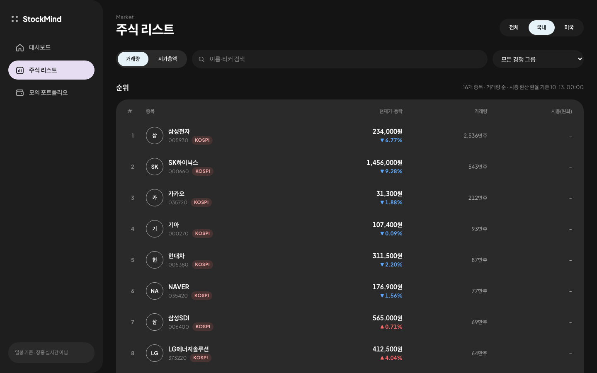
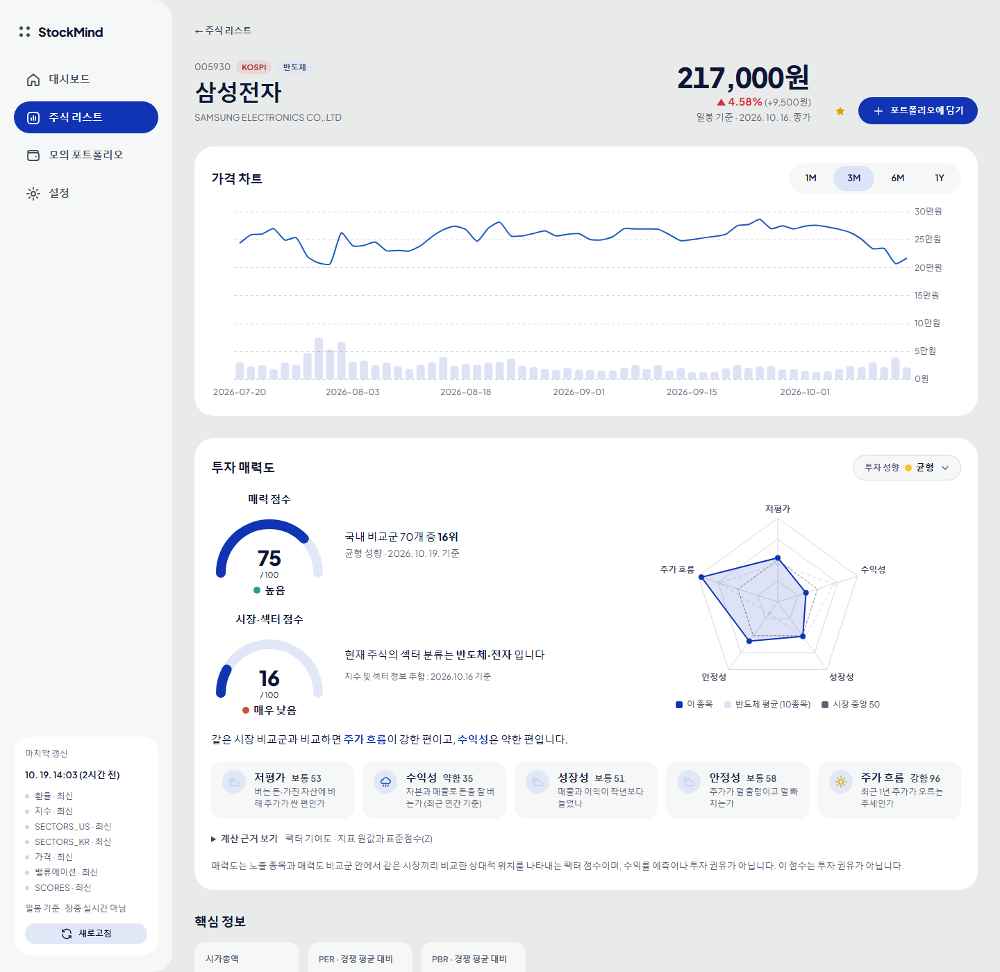
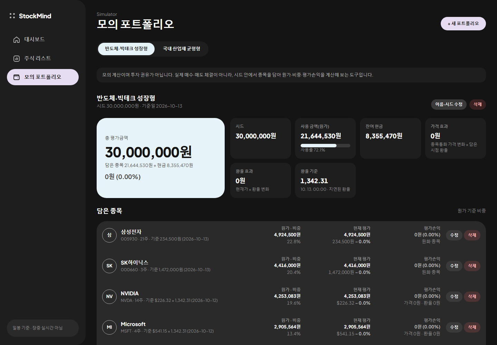

# StockMind

국내(KOSPI·KOSDAQ)·미국(NASDAQ·NYSE) 주식의 시세·지수·환율·밸류에이션·재무·공시를 한 DB에 모아, 한 화면에서 같은 기준(원화 환산·일봉)으로 비교해 보는 **주식 분석 대시보드**입니다.

- 흩어진 원천 데이터(pykrx·yfinance·OpenDART·SEC EDGAR)를 수집·전처리해 PostgreSQL 정규화 스키마에 적재하고, 서버가 떠 있는 동안 4시간 주기로 갱신합니다.
- FastAPI 조회 API와 바닐라 HTML/CSS/JS 화면으로 보여 줍니다. 조회 API는 외부 소스를 직접 부르지 않고 DB 값만 씁니다.
- 4인 팀(시니어 1 · 주니어 3)이 6단계로 나눠 만들고 있으며, 현재 **Stage 3(실데이터 — 재무·공시 포함 4개 소스 수집, 주기적 갱신, v3.0)** 까지 완료됐습니다.

> 시세는 일봉 기준이며 장중 실시간이 아닙니다. 이 프로젝트의 어떤 정보도 투자 권유가 아닙니다.

## 화면

### 대시보드 홈 — 주요 지수·환율 + 관심종목
위쪽은 KOSPI·KOSDAQ·S&P 500·NASDAQ·Dow Jones와 USD/KRW의 최신값, 전일 대비 등락, 1개월·3개월·1년 스파크라인입니다. 그날 장이 열리지 않은 시장은 `직전 거래일` 배지로 구분합니다.

아래쪽은 사용자가 ★로 고른 관심종목 카드입니다. 최근 종가·등락을 보여 주고, 미국 종목은 원화 환산가와 적용 환율을 함께 보여 줍니다. ▲▼ 버튼으로 카드 순서를 바꿀 수 있고, 카드를 누르면 종목 상세로 이동합니다.

왼쪽 사이드바 아래에는 모든 화면 공통으로 **마지막 갱신 시각**과 작업별(환율·지수·가격·밸류에이션) 상태 점이 있습니다. 오래된 작업은 강조되고, `새로고침`을 누르면 TTL이 지난 작업만 다시 받은 뒤 지금 화면을 다시 불러옵니다.



### 주식 리스트 — 거래량·시가총액 순위
국내·미국 탭, 거래량/시가총액 정렬, 이름·티커 검색, 경쟁 그룹 필터를 지원합니다. `전체` 탭은 시장마다 거래량 단위가 달라 시가총액(원화 환산) 순위만 제공합니다. 행마다 ★(관심종목 추가·해제)와 `담기`(모의 포트폴리오에 담기) 버튼이 있습니다.



### 종목 상세 — 가격 차트·핵심 정보·재무 추이·최근 공시
1M·3M·6M·1Y 기간의 종가 추이와 거래량, 시가총액·PER·PBR(국내 pykrx 일별, 미국 yfinance)을 보여 줍니다. 여기서도 ★와 `포트폴리오에 담기`를 쓸 수 있습니다.

- **재무 추이**: 최근 FY 5개년의 매출·영업이익·순이익 막대 차트와 영업이익률 표. 국내는 OpenDART(K-IFRS 연결), 미국은 SEC EDGAR(US-GAAP)에서 받고 출처·회계기준·통화를 함께 표시합니다.
- **최근 공시**: 최근 공시 5건과 원문 링크. 국내는 지분공시(임원·주요주주 소유 보고)를 빼고, 미국은 10-K·10-Q·8-K 등 SEC 제출 문서를 보여 줍니다.



### 모의 포트폴리오 — 시드 안에서 담아 보는 계산기
정해 둔 시드(원화) 안에서 국내·미국 종목을 담아 보는 화면입니다. 실제 거래 기록이 아니라 "담아 보는 계산기 겸 장바구니"입니다.

- 포트폴리오를 여러 개 만들고 이름·시드를 고치거나 지울 수 있습니다.
- 담기 팝업에서 **수량·금액·비중** 중 하나로 입력하면 몇 주가 되는지 미리 보여 주고, 시드를 넘으면 담을 수 있는 최대 수량을 안내합니다.
- 담는 순간의 가격·환율을 항목에 함께 저장해, 지금 평가손익을 **가격 효과**와 **환율 효과**로 나눠 보여 줍니다.
- 사용·잔여 시드, 시장·그룹 비중 차트, 담은 종목 표(수정·삭제)를 제공합니다.



## 기술 스택

| 구분 | 사용 기술 |
|---|---|
| 백엔드 | Python 3.12 · FastAPI · Pydantic v2 · SQLAlchemy 2.x (동기, 원문 SQL `backend/app/queries/*.sql` + `text()`) |
| DB | PostgreSQL 16 — 테이블 16 · VIEW 2 · 보조 인덱스 10 (Stage 3) |
| 수집 | pykrx(국내 시세·지수·밸류에이션), yfinance(미국 시세·지수·밸류에이션, USD/KRW), OpenDART(국내 재무·공시), SEC EDGAR(미국 재무·공시) |
| 갱신 | 앱 안 스케줄러(asyncio) + PostgreSQL advisory lock — 작업별 4시간 TTL |
| 프론트엔드 | 바닐라 HTML/CSS/JS (ES Modules, 빌드 없음) · Chart.js (CDN) |
| 실행·테스트 | Docker Compose · pytest |

## 아키텍처

```
pykrx · yfinance ─┐
OpenDART · SEC ───┴▶ providers/ ──▶ ingest/ (전처리·이상 행 격리·upsert) ──▶ PostgreSQL
                          ▲                                                  │
            services/refresh (4시간 TTL, advisory lock)                       │
              ▲ 스케줄러 · POST /market/refresh · ingest refresh             │
                                                                             │
              브라우저 (frontend/) ◀── FastAPI /api/v1 (queries/*.sql) ◀──────┘
```

- **수집과 조회 분리**: 외부 호출은 `python -m app.ingest` 명령에서만 합니다. 화면이 부르는 API는 DB만 읽습니다.
- **재적재 안전(멱등)**: 같은 데이터를 다시 적재해도 행 수가 늘지 않도록 upsert로 넣습니다.
- **주기적 갱신과 호출 절약**: 환율·지수·일봉·밸류에이션은 작업별 TTL(기본 4시간) 안이면 외부를 부르지 않습니다. 일부 종목만 실패하면 30분 뒤 실패한 종목만 다시 받고, 여러 프로세스가 동시에 돌려도 DB 잠금(advisory lock)으로 한 번만 실행됩니다.
- **이상 행 격리**: 고가<저가, 음수 거래량 같은 행은 DB에 넣지 않고 `backend/data/quarantine/`에 사유와 함께 남깁니다.
- **금액은 `Decimal`/`NUMERIC`**: 가격·비율 계산에 float을 쓰지 않습니다. 해외 종목은 원화 환산값을 함께 제공합니다.
- **담는 순간 값 복사(의도적 비정규화)**: 포트폴리오 항목에는 담은 날의 가격·환율·날짜를 복사해 둡니다. 시세가 나중에 바뀌어도 "얼마에 담았는지"가 남아 손익을 계산할 수 있습니다.
- **요청 사용자 고정**: 로그인은 아직 없고, 모든 관심종목·포트폴리오 API는 서버가 정한 데모 사용자 기준으로 동작합니다. 남의 포트폴리오·항목은 404로 막습니다.
- **일관된 에러 형식**: 모든 오류는 `{"error": {"code", "message", "detail"}}`로 응답합니다.

## 빠르게 실행하기

필요한 것: Docker Desktop

```bash
# 1) 환경 변수 파일 준비
cp .env.example .env

# 2) DB + API 서버 실행 (개발 모드: 소스 수정 시 자동 재시작)
docker compose -f compose.yml -f compose.dev.yml up -d --build

# 3) 스키마 생성 → 종목·지수 마스터 → 샘플 시세 적재 (외부 계정 없이 바로 보기)
docker compose run --rm api python -m app.ingest init-db
docker compose run --rm api python -m app.ingest master --offline
docker compose run --rm api python -m app.ingest import-sample

# 4) (선택) 데모 관심종목 8건 + 모의 포트폴리오 2개 넣기
docker compose run --rm api python -m app.ingest seed-demo
```

브라우저에서 http://localhost:8000 을 열면 대시보드가 보입니다. `seed-demo`를 실행했으면 홈에 관심종목 카드가, http://localhost:8000/portfolio 에 데모 포트폴리오가 보입니다. 시세가 없는 종목은 건너뜁니다. API 문서는 http://localhost:8000/docs 에 있습니다.

### 실제 데이터로 수집하기 (선택)

샘플 대신 실제 데이터를 받으려면 `.env`에 아래 환경변수(KRX 계정·DART 키·SEC User-Agent)를 넣고 `all`을 한 번 실행합니다. pykrx가 막히면 `PRICE_SOURCE_KR=yfinance`로 바꿔 `.KS`/`.KQ` 심볼로 받습니다.

```bash
docker compose run --rm api python -m app.ingest all   # master → prices → indices → fx → financials → valuation → disclosures

# 하나씩 받을 때 (특정 종목만: --tickers 005930 AAPL)
docker compose run --rm api python -m app.ingest master              # 종목·지수 마스터 + DART corp_code·SEC CIK 매핑
docker compose run --rm api python -m app.ingest prices --full       # 종목 일봉
docker compose run --rm api python -m app.ingest indices --full      # 지수 일봉
docker compose run --rm api python -m app.ingest fx --full           # USD/KRW 일별 환율
docker compose run --rm api python -m app.ingest valuation --full    # PER·PBR·시가총액
docker compose run --rm api python -m app.ingest financials          # FY 재무 5개년 (--years)
docker compose run --rm api python -m app.ingest disclosures         # 최근 1년 공시 (--days)
```

모든 명령은 다시 실행해도 행 수가 늘지 않습니다. 이후에는 서버가 떠 있는 동안 아래 자동 갱신이 시세·지수·환율·밸류에이션을 이어서 받습니다.

대상 종목·지수 목록은 [`backend/config/universe.yaml`](backend/config/universe.yaml)에서 정합니다.

#### 환경변수 (Stage 3)
| 변수 | 필수/선택 | 설명 |
|---|---|---|
| `KRX_ID`, `KRX_PW` | **필수**(국내 소스 pykrx 사용 시) | pykrx 1.2.x의 시총·PER/PBR·지수 조회에 필요한 KRX 정보데이터시스템 계정. 없으면 시총·펀더멘털·지수가 빈 결과([troubleshooting 1](docs/troubleshooting.md)) |
| `DART_API_KEY` | **필수**(국내 재무·공시) | OpenDART 인증키 |
| `SEC_USER_AGENT` | **필수**(미국 재무·공시) | 연락처(이메일)가 들어간 User-Agent |
| `REFRESH_TTL_HOURS` | 선택 | 같은 종류 외부 호출 최소 간격(시간, 3~4, 기본 4) |
| `SCHEDULER_ENABLED` | 선택 | 앱 안 스케줄러 사용 여부 (기본 true — 4시간 갱신) |
| `SCHEDULER_CHECK_MINUTES` | 선택 | 스케줄러가 할 일을 확인하는 간격(분, 기본 5) |
| `EXTRA_CA_DIR` | 선택 (compose) | 추가 CA 인증서 폴더(아래 TLS 검사 환경) |

- **TLS 검사(백신·사내 프록시) 환경**: 호스트에서 HTTPS가 가로채져 인증서 오류가 나면, 그 루트 인증서(`*.pem`·`*.crt`)를 `certs/`에 두거나 `.env`에 `EXTRA_CA_DIR=<폴더>`를 지정합니다. entrypoint가 시스템 CA 번들에 합쳐 requests·curl_cffi(yfinance)·ssl 모두에 적용합니다. 예) Norton: `C:/ProgramData/Norton/Antivirus/wscert.pem`

#### 자동 갱신
- **앱 안 스케줄러**(`SCHEDULER_ENABLED=true`, 기본): 서버가 떠 있는 동안 5분마다 확인해 환율·지수·일봉·밸류에이션을 4시간 TTL로 갱신합니다. 일부 종목만 실패한 작업은 30분 뒤 실패한 종목만 다시 받고, 여러 프로세스가 동시에 돌려도 DB 잠금으로 한 번만 실행됩니다.
- 화면의 갱신 버튼은 `POST /api/v1/market/refresh`, 사이드바의 마지막 갱신 시각은 `GET /api/v1/market/refresh/status`(외부 호출 없음)입니다.
- 서버를 띄우지 않을 때는 `SCHEDULER_ENABLED=false`로 두고 `python -m app.ingest refresh`를 직접(cron 등) 실행합니다.

### 테스트

```bash
docker compose run --rm api pytest -q
```

스키마 제약(잘못된 행 거부·CASCADE), ORM↔DDL 일치, 재적재 시 행 수 불변, API 응답·오류 형식, 관심종목 추가·중복·정렬·삭제, 포트폴리오 담기 계산(시드 초과·수량 0·환율 효과), 환율 서비스(TTL·저장값 사용), 남의 데이터 접근 차단, 재무·공시 적재(DART 대체 계정·보충 병합)와 조회, 갱신 서비스(TTL 이내 외부 호출 0·동시 요청 직렬화·실패 종목만 재시도)를 검증합니다. 외부 소스는 가짜 Provider로 바꿔 네트워크 없이 돌고, 테스트는 별도 DB(`stockdb_test`)에서 돌아갑니다. (v3.0 기준 194개 통과)

## API (Stage 3)

| Method | URL | 기능 |
|---|---|---|
| GET | `/health`, `/health/db` | 프로세스·DB 연결 확인 |
| GET | `/api/v1/market/indices` | 지수별 최신값·등락·최근 1년 스파크라인 |
| GET | `/api/v1/market/fx` | USD/KRW 최신값·전일 대비·최근 1년 추이 (갱신 실패 시 마지막 저장값 + `fx_stale`) |
| POST | `/api/v1/market/refresh` | 환율·지수·증분 일봉·밸류에이션 갱신 (작업별 TTL 이내면 SKIPPED) |
| GET | `/api/v1/market/refresh/status` | 작업별 마지막 갱신 시각·상태 (외부 호출 없음) |
| GET | `/api/v1/peer-groups` | 경쟁 그룹 목록 |
| GET | `/api/v1/stocks` | 주식 리스트 (`country`, `sort`, `order`, `group`, `q`, `limit`, `offset`) |
| GET | `/api/v1/stocks/{market}/{ticker}` | 종목 기본 정보 + 최신 시세·밸류에이션 |
| GET | `/api/v1/stocks/{market}/{ticker}/candles` | 기간 일봉 (`range=1m·3m·6m·1y`) |
| GET | `/api/v1/stocks/{market}/{ticker}/financials` | FY 재무 추이 (최근 `limit`개, 영업이익률·ROE 포함) |
| GET | `/api/v1/stocks/{market}/{ticker}/disclosures` | 최근 공시 (`limit`, 최신순) |
| GET · POST | `/api/v1/watchlist` | 관심종목 카드 목록 · 추가 |
| PATCH | `/api/v1/watchlist/order` | 관심종목 순서 변경 |
| DELETE | `/api/v1/watchlist/{market}/{ticker}` | 관심종목 삭제 |
| GET · POST | `/api/v1/portfolios` | 포트폴리오 목록 · 생성 |
| GET · PUT · DELETE | `/api/v1/portfolios/{id}` | 포트폴리오 단건 · 이름·시드 수정 · 삭제 |
| GET · POST | `/api/v1/portfolios/{id}/items` | 담은 종목과 현재 평가 · 종목 담기(`mode=quantity·amount·weight`) |
| PUT · DELETE | `/api/v1/portfolios/{id}/items/{item_id}` | 담은 종목 수정 · 삭제 |
| GET | `/api/v1/portfolios/{id}/summary` | 사용·잔여 시드, 비중, 평가손익(가격 효과·환율 효과) |

요청·응답 예시와 에러 코드는 [docs/06_기능_API_정의서.md](docs/06_기능_API_정의서.md)에 있습니다.

## 폴더 구조

```
ax_stockmind/
├─ backend/
│  ├─ app/
│  │  ├─ api/          라우터 (market, stocks, watchlist, portfolios, health)
│  │  ├─ core/         설정·DB 연결·에러·로깅
│  │  ├─ ingest/       수집·적재·데모 데이터 CLI (python -m app.ingest)
│  │  ├─ providers/    외부 데이터 소스 어댑터 (pykrx, yfinance, OpenDART, SEC EDGAR)
│  │  ├─ services/     환율(TTL)·모의 포트폴리오 계산·갱신(refresh)·스케줄러
│  │  ├─ queries/      조회용 원문 SQL
│  │  ├─ models/       ORM (schema.sql과 1:1)
│  │  └─ schemas/      API 요청·응답 모델
│  ├─ db/              schema.sql · indexes.sql · views.sql
│  ├─ config/          universe.yaml (대상 종목·지수)
│  ├─ sample_data/     오프라인 실행용 샘플 CSV
│  └─ tests/
├─ frontend/           index · stocks · stock · portfolio 화면, css/, js/
├─ docs/               기획서·요구사항·데이터 조사·도메인 모델·ERD·API 정의서·트러블슈팅
└─ team/               팀 작업 가이드·역할 분담·로드맵·단계별 프롬프트
```

## 문서

| 문서 | 내용 |
|---|---|
| [01 프로젝트 기획서](docs/01_프로젝트_기획서.md) | 배경·문제 정의·주요 기능 |
| [02 요구사항 정의서](docs/02_요구사항_정의서.md) | 기능·비기능 요구사항 |
| [03 데이터 조사 정의서](docs/03_데이터_조사_정의서.md) | 데이터 소스·수집 범위·이용 조건 |
| [04 도메인 모델 정의서](docs/04_도메인_모델_정의서.md) | 핵심 개념과 관계 |
| [05 ERD 및 DB 설계서](docs/05_ERD_및_DB설계서.md) | ERD·테이블 정의·인덱스·VIEW·검증 결과 |
| [06 기능·API 정의서](docs/06_기능_API_정의서.md) | 엔드포인트·요청/응답 예시·에러 코드 |
| [트러블슈팅](docs/troubleshooting.md) | KRX 로그인·TLS 인증서 등 수집 환경 문제와 해결 |

## 개발 로드맵

| 단계 | 결과물 | 상태 |
|---|---|---|
| Stage 0 | 뼈대·개발 환경 | ✅ v0.1 |
| Stage 1 | MVP — 지수·환율·주요 종목 홈, 주식 리스트, 종목 상세, 시세 수집 | ✅ v1.0.1 |
| Stage 2 | 사용자 기능 — 관심종목·모의 포트폴리오 | ✅ v2.0 |
| Stage 3 | 실데이터 — 재무·공시 포함 4개 소스 수집, 주기적 갱신 | ✅ v3.0 |
| Stage 4 | 분석 — 매력도·경쟁 비교·통계 | |
| Stage 5 | 고도화 — 메모·목표가·통계 확장 | |
| Stage 6 | 홈 대시보드 개편·상단 검색·최종 문서 | |

팀 작업 방식(브랜치·PR 규칙, Claude Code 사용법)은 [team/00_팀_작업_가이드.md](team/00_팀_작업_가이드.md)를 보세요.

## 데이터 이용 조건

- **pykrx**: KRX 정보데이터시스템 비공식 라이브러리입니다. 1.2.x는 시총·펀더멘털·지수 조회에 KRX 회원 로그인이 필요합니다.
- **yfinance**: Yahoo Finance 비공식 라이브러리입니다. 개인·학습 목적으로만 쓰고 원본 데이터를 재배포하지 않습니다. 저장소에는 소량 샘플만 포함합니다.
- **OpenDART**(금융감독원): 국내 재무(연결)·공시. 인증키가 필요하고, 분당 100회 이상 호출하면 이용이 제한될 수 있어 60초에 90회 이하로 호출합니다.
- **SEC EDGAR**: 미국 재무(XBRL companyfacts)·공시. API 키는 없지만 연락처(이메일)가 들어간 User-Agent가 필수입니다.
