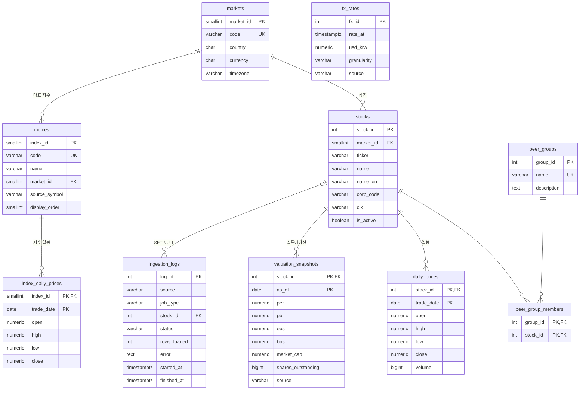

# 05. ERD 및 DB 설계서 (초안 — Stage 1 범위)

> **상태: Stage 0 초안.** Stage 1 테이블 10개만 담았다. 이후 단계에서 D가 테이블을 추가할 때 이 문서의 해당 절을 함께 확장한다.
> (Stage 2: 사용자·관심종목·포트폴리오 / Stage 3: 재무·공시 / Stage 4+: 매력도·비교군·섹터 — 의도적 비정규화 2건, 트리거, VIEW, EXPLAIN 비교도 그때 채운다.)

- DDL 원문: `backend/db/schema.sql` → `backend/db/indexes.sql` 순서로 실행 (`views.sql`은 Stage 1-B에서 추가)
- DBMS: PostgreSQL 16 / 테이블 10개, 보조 인덱스 6개
- 금액·가격은 모두 `NUMERIC` (float 사용 안 함), 시각은 모두 `TIMESTAMPTZ`
- ORM(`backend/app/models/__init__.py`)은 `schema.sql`과 1:1이며 `tests/test_schema.py`가 일치를 검증한다.

## 1. ERD

`fx_rates`는 FK 관계가 없는 독립 테이블이다(조회 시점에 참조하며, 담은 시점 환율의 복사본은 Stage 2의 `portfolio_items`가 갖는다).

## 2. 테이블 목록

| 영역 | 테이블 | 설명 | PK |
|---|---|---|---|
| 마스터 | markets | 시장(통화·국가·시간대) | market_id |
| 마스터 | stocks | 종목 | stock_id, UQ (market_id, ticker) |
| 마스터 | peer_groups | 경쟁 그룹 | group_id |
| 마스터 | peer_group_members | 종목↔그룹 N:M | (group_id, stock_id) |
| 시계열 | daily_prices | 종목 일봉(수정주가) | (stock_id, trade_date) |
| 시계열 | valuation_snapshots | PER·PBR·시총 스냅샷 | (stock_id, as_of) |
| 배경 | indices | 지수 정의 | index_id |
| 배경 | index_daily_prices | 지수 일봉 | (index_id, trade_date) |
| 배경 | fx_rates | USD/KRW | fx_id, UQ (granularity, rate_at) |
| 운영 | ingestion_logs | 적재·갱신 로그 | log_id |

## 3. 테이블 정의서

#### `markets`

| 컬럼 | 타입 | NULL | 기본값 | 키 | 설명 |
|---|---|---|---|---|---|
| market_id | smallint | N | 자동 증가 | PK | 시장 ID |
| code | varchar(10) | N |  | UQ | KOSPI / KOSDAQ / NASDAQ / NYSE |
| country | char(2) | N |  |  | 국가 (KR/US) |
| currency | char(3) | N |  |  | 통화 (KRW/USD) |
| timezone | varchar(40) | N |  |  | Asia/Seoul / America/New_York |

제약: `CHECK (country IN ('KR','US'))` / `CHECK (currency IN ('KRW','USD'))`

#### `stocks`

| 컬럼 | 타입 | NULL | 기본값 | 키 | 설명 |
|---|---|---|---|---|---|
| stock_id | integer | N | 자동 증가 | PK | 종목 ID |
| market_id | smallint | N |  | UQ(복합), FK→markets | 시장 ID |
| ticker | varchar(16) | N |  | UQ(복합) | 거래소 종목 코드 |
| name | varchar(128) | N |  |  | 이름 |
| name_en | varchar(128) | Y |  |  | 영문 이름 |
| corp_code | varchar(16) | Y |  |  | OpenDART 고유번호 (KR, Stage 3에서 채움) |
| cik | varchar(10) | Y |  |  | SEC CIK 10자리 (US, Stage 3에서 채움) |
| is_active | boolean | N | true |  | 수집·점수 계산 대상 여부 (false면 데이터만 보존) |

제약: `UNIQUE (market_id, ticker)` — 같은 티커라도 시장이 다르면 다른 종목

#### `peer_groups`

| 컬럼 | 타입 | NULL | 기본값 | 키 | 설명 |
|---|---|---|---|---|---|
| group_id | integer | N | 자동 증가 | PK | 경쟁 그룹 ID |
| name | varchar(64) | N |  | UQ | 이름 |
| description | text | Y |  |  | 설명 |

#### `peer_group_members`

| 컬럼 | 타입 | NULL | 기본값 | 키 | 설명 |
|---|---|---|---|---|---|
| group_id | integer | N |  | PK, FK→peer_groups (CASCADE) | 경쟁 그룹 ID |
| stock_id | integer | N |  | PK, FK→stocks (CASCADE) | 종목 ID |

#### `daily_prices`

| 컬럼 | 타입 | NULL | 기본값 | 키 | 설명 |
|---|---|---|---|---|---|
| stock_id | integer | N |  | PK, FK→stocks (CASCADE) | 종목 ID |
| trade_date | date | N |  | PK | 시장 현지 날짜 |
| open / high / low | numeric(18,4) | N |  |  | 시가 / 고가 / 저가 |
| close | numeric(18,4) | N |  |  | 수정주가 |
| volume | bigint | N |  |  | 거래량(주) |

제약: `CHECK (volume >= 0)` / `CHECK (high >= low)` / `CHECK (low > 0)` — 0·음수 가격은 이상 행으로 격리

#### `valuation_snapshots`

| 컬럼 | 타입 | NULL | 기본값 | 키 | 설명 |
|---|---|---|---|---|---|
| stock_id | integer | N |  | PK, FK→stocks (CASCADE) | 종목 ID |
| as_of | date | N |  | PK | 기준일 |
| per / pbr | numeric(18,4) | Y |  |  | 적자·미제공은 NULL |
| eps / bps | numeric(18,4) | Y |  |  | 주당순이익 / 주당순자산 |
| market_cap | numeric(26,0) | Y |  |  | 종목 통화 기준 |
| shares_outstanding | bigint | Y |  |  | 발행(상장)주식수 |
| source | varchar(20) | N |  |  | PYKRX / YFINANCE / DERIVED |

제약: `CHECK (market_cap >= 0)` / `CHECK (shares_outstanding >= 0)` / `CHECK (source IN ('PYKRX','YFINANCE','DERIVED'))`

#### `indices`

| 컬럼 | 타입 | NULL | 기본값 | 키 | 설명 |
|---|---|---|---|---|---|
| index_id | smallint | N | 자동 증가 | PK | 지수 ID |
| code | varchar(16) | N |  | UQ | KOSPI / KOSDAQ / SPX / IXIC / DJI |
| name | varchar(64) | N |  |  | 이름 |
| market_id | smallint | Y |  | FK→markets | 시장 ID |
| source_symbol | varchar(32) | N |  |  | 라이브러리 조회용 심볼 (1001, ^GSPC …) |
| display_order | smallint | N | 0 |  | 화면 표시 순서 |

#### `index_daily_prices`

| 컬럼 | 타입 | NULL | 기본값 | 키 | 설명 |
|---|---|---|---|---|---|
| index_id | smallint | N |  | PK, FK→indices (CASCADE) | 지수 ID |
| trade_date | date | N |  | PK | 거래일(현지) |
| open / high / low | numeric(18,4) | Y |  |  | 시가 / 고가 / 저가 |
| close | numeric(18,4) | N |  |  | 종가 |

제약: `CHECK (close > 0)`

#### `fx_rates`

| 컬럼 | 타입 | NULL | 기본값 | 키 | 설명 |
|---|---|---|---|---|---|
| fx_id | integer | N | 자동 증가 | PK | 환율 행 ID |
| rate_at | timestamptz | N |  | UQ(복합) | 환율 기준 시각 |
| usd_krw | numeric(12,4) | N |  |  | 1달러당 원 |
| granularity | varchar(8) | N |  | UQ(복합) | SNAPSHOT(조회 시각) / DAILY(해당 일자 00:00 Asia/Seoul) |
| source | varchar(20) | N | 'YFINANCE' |  | 데이터 출처 |

제약: `CHECK (usd_krw > 0)` / `CHECK (granularity IN ('SNAPSHOT','DAILY'))` / `UNIQUE (granularity, rate_at)`

#### `ingestion_logs`

| 컬럼 | 타입 | NULL | 기본값 | 키 | 설명 |
|---|---|---|---|---|---|
| log_id | integer | N | 자동 증가 | PK | 로그 ID |
| source | varchar(20) | N |  |  | PYKRX / YFINANCE / DART / SEC / INTERNAL |
| job_type | varchar(30) | N |  |  | PRICES / INDICES / FX / VALUATION / MASTER (이후 단계에서 확장) |
| stock_id | integer | Y |  | FK→stocks (SET NULL) | 종목 단위 작업일 때만 |
| status | varchar(10) | N |  |  | SUCCESS / FAILED / SKIPPED |
| rows_loaded | integer | N | 0 |  | 적재 행 수 |
| error | text | Y |  |  | 실패 사유 / 격리 행 사유 |
| started_at | timestamptz | N |  |  | 시작 시각 |
| finished_at | timestamptz | Y |  |  | 종료 시각 (`>= started_at`) |

제약: `CHECK (job_type IN (...))` / `CHECK (status IN ('SUCCESS','FAILED','SKIPPED'))` / `CHECK (rows_loaded >= 0)` / `CHECK (finished_at IS NULL OR finished_at >= started_at)`

## 4. 정규화 (Stage 1 범위)

- **1NF**: 모든 컬럼이 원자값. 배열·쉼표 구분 값 없음.
- **2NF**: 복합 PK 테이블(`daily_prices`, `valuation_snapshots`, `index_daily_prices`, `peer_group_members`)의 비키 컬럼은 PK 전체에 종속.
- **3NF — `markets` 분리**: 통화·국가·시간대는 시장 단위 속성이므로 `stocks`에 반복하지 않는다(종목 → 시장 → 통화 이행적 종속 제거).
- **N:M 교차 테이블**: `peer_group_members` (국내·해외 종목 혼합 가능).

## 5. 인덱스 (Stage 1)

| 인덱스 | 대상 | 받치는 조회 | 비고 |
|---|---|---|---|
| (PK) | daily_prices (stock_id, trade_date) | 종목별 기간 일봉, 최신 2행 | 자동 |
| ix_stocks_name | stocks (name) | 이름 정렬·접두 검색 | 부분 일치는 순차 스캔 허용 |
| ix_daily_prices_trade_date | daily_prices (trade_date) | 특정 날짜 전 종목 | PK 선두가 stock_id라 별도 필요 |
| ix_index_prices_trade_date | index_daily_prices (trade_date) | 날짜 기준 전 지수 | |
| ix_fx_granularity_rate_at | fx_rates (granularity, rate_at DESC) | 최신 SNAPSHOT(TTL 판단) | |
| ix_ingestion_logs_job_finished | ingestion_logs (job_type, finished_at DESC) | 작업별 마지막 성공 시각 | |
| ix_peer_members_stock | peer_group_members (stock_id) | 종목 → 소속 그룹 | PK가 group_id 선두라 필요 |

(`valuation_snapshots (stock_id, as_of DESC)`는 PK 역방향 스캔과 중복이라 만들지 않는다.)

## 6. 이후 단계에서 채울 절

- 사용자·관심종목·포트폴리오 테이블, `updated_at` 트리거, 의도적 비정규화(`portfolio_items.ref_*`) — Stage 2
- 재무제표·공시 테이블 — Stage 3
- 매력도·비교군·섹터 관련 테이블/컬럼, 마이그레이션 파일 — Stage 4 이후
- VIEW(`v_latest_price`, `v_fx_latest`) — Stage 1-B
- 인덱스 전후 `EXPLAIN (ANALYZE)` 비교, 분석 쿼리와 SQL 요소 정리 — Stage 5
