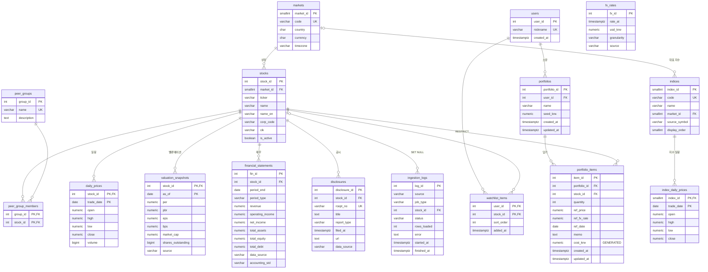

# 05. ERD 및 DB 설계서 (Stage 3 범위)

> **상태: Stage 3 확정 (v3.0).** Stage 1 테이블 10개 + Stage 2 사용자 테이블 4개 + Stage 3 재무·공시 테이블 2개, VIEW 2개, 보조 인덱스 10개, 트리거 2개를 실제 DDL 기준으로 담았다. 이후 단계에서 D가 테이블을 추가할 때 이 문서의 해당 절을 함께 확장한다.
> (Stage 4+: 매력도·비교군·섹터 — 의도적 비정규화 5-2, `v_stock_metrics`, EXPLAIN 비교도 그때 채운다. `watchlist_items`의 메모·목표가·`updated_at`은 Stage 5.)

- DDL 원문: `backend/db/schema.sql` → `backend/db/indexes.sql` → `backend/db/views.sql` 순서로 실행 (`python -m app.ingest init-db`가 같은 순서로 적용)
- DBMS: PostgreSQL 16 / 테이블 16개, VIEW 2개, 보조 인덱스 10개, 트리거 2개(updated_at 자동 갱신 — portfolios·portfolio_items)
- 금액·가격은 모두 `NUMERIC` (float 사용 안 함), 시각은 모두 `TIMESTAMPTZ`
- ORM(`backend/app/models/__init__.py`)은 `schema.sql`과 1:1이며 `tests/test_schema.py`가 일치를 검증한다.

## 1. ERD

`fx_rates`는 FK 관계가 없는 독립 테이블이다(조회 시점에 참조하며, 담은 시점 환율은 `portfolio_items`에 복사 — 5절).

## 2. 테이블 목록

| 영역 | 테이블 | 설명 | PK |
|---|---|---|---|
| 마스터 | markets | 시장(통화·국가·시간대) | market_id |
| 마스터 | stocks | 종목 | stock_id, UQ (market_id, ticker) |
| 마스터 | peer_groups | 경쟁 그룹 | group_id |
| 마스터 | peer_group_members | 종목↔그룹 N:M | (group_id, stock_id) |
| 시계열 | daily_prices | 종목 일봉(수정주가) | (stock_id, trade_date) |
| 시계열 | valuation_snapshots | PER·PBR·시총 스냅샷 | (stock_id, as_of) |
| 재무 | financial_statements | 재무제표(FY 5개년) | fin_id, UQ (stock_id, period_end, period_type) |
| 공시 | disclosures | 공시 목록(최근 1년) | disclosure_id, UQ (rcept_no) |
| 배경 | indices | 지수 정의 | index_id |
| 배경 | index_daily_prices | 지수 일봉 | (index_id, trade_date) |
| 배경 | fx_rates | USD/KRW | fx_id, UQ (granularity, rate_at) |
| 사용자 | users | 사용자(인증 없음, 기본 사용자 demo는 `master`가 시드) | user_id |
| 사용자 | watchlist_items | 관심종목 N:M + 정렬 순서 | (user_id, stock_id) |
| 사용자 | portfolios | 모의 포트폴리오 | portfolio_id, UQ (user_id, name) |
| 사용자 | portfolio_items | 담은 종목 (담은 시점 가격·환율 복사) | item_id, UQ (portfolio_id, stock_id) |
| 운영 | ingestion_logs | 적재·갱신 로그 | log_id |

## 3. 테이블 정의서

#### `markets`

| 컬럼 | 타입 | NULL | 기본값 | 키 | 설명 |
|---|---|---|---|---|---|
| market_id | smallint | N | 자동 증가 | PK | 시장 ID |
| code | varchar(10) | N |  | UQ | KOSPI / KOSDAQ / NASDAQ / NYSE |
| country | char(2) | N |  |  | 국가 (KR/US) |
| currency | char(3) | N |  |  | 통화 (KRW/USD) |
| timezone | varchar(40) | N |  |  | Asia/Seoul / America/New_York |

제약: `CHECK (country IN ('KR','US'))` / `CHECK (currency IN ('KRW','USD'))`

#### `stocks`

| 컬럼 | 타입 | NULL | 기본값 | 키 | 설명 |
|---|---|---|---|---|---|
| stock_id | integer | N | 자동 증가 | PK | 종목 ID |
| market_id | smallint | N |  | UQ(복합), FK→markets | 시장 ID |
| ticker | varchar(16) | N |  | UQ(복합) | 거래소 종목 코드 |
| name | varchar(128) | N |  |  | 이름 |
| name_en | varchar(128) | Y |  |  | 영문 이름 |
| corp_code | varchar(16) | Y |  |  | OpenDART 고유번호 (KR, `master`가 DART 매핑으로 채움 — `--offline`이면 NULL) |
| cik | varchar(10) | Y |  |  | SEC CIK 10자리 (US, `master`가 SEC 매핑으로 채움 — `--offline`이면 NULL) |
| is_active | boolean | N | true |  | 수집·점수 계산 대상 여부 (false면 데이터만 보존) |

제약: `UNIQUE (market_id, ticker)` — 같은 티커라도 시장이 다르면 다른 종목

#### `peer_groups`

| 컬럼 | 타입 | NULL | 기본값 | 키 | 설명 |
|---|---|---|---|---|---|
| group_id | integer | N | 자동 증가 | PK | 경쟁 그룹 ID |
| name | varchar(64) | N |  | UQ | 이름 |
| description | text | Y |  |  | 설명 |

#### `peer_group_members`

| 컬럼 | 타입 | NULL | 기본값 | 키 | 설명 |
|---|---|---|---|---|---|
| group_id | integer | N |  | PK, FK→peer_groups (CASCADE) | 경쟁 그룹 ID |
| stock_id | integer | N |  | PK, FK→stocks (CASCADE) | 종목 ID |

#### `daily_prices`

| 컬럼 | 타입 | NULL | 기본값 | 키 | 설명 |
|---|---|---|---|---|---|
| stock_id | integer | N |  | PK, FK→stocks (CASCADE) | 종목 ID |
| trade_date | date | N |  | PK | 시장 현지 날짜 |
| open / high / low | numeric(18,4) | N |  |  | 시가 / 고가 / 저가 |
| close | numeric(18,4) | N |  |  | 수정주가 |
| volume | bigint | N |  |  | 거래량(주) |

제약: `CHECK (volume >= 0)` / `CHECK (high >= low)` / `CHECK (low > 0)` — 0·음수 가격은 이상 행으로 격리

#### `valuation_snapshots`

| 컬럼 | 타입 | NULL | 기본값 | 키 | 설명 |
|---|---|---|---|---|---|
| stock_id | integer | N |  | PK, FK→stocks (CASCADE) | 종목 ID |
| as_of | date | N |  | PK | 기준일 |
| per / pbr | numeric(18,4) | Y |  |  | 적자·미제공은 NULL |
| eps / bps | numeric(18,4) | Y |  |  | 주당순이익 / 주당순자산 |
| market_cap | numeric(26,0) | Y |  |  | 종목 통화 기준 |
| shares_outstanding | bigint | Y |  |  | 발행(상장)주식수 |
| source | varchar(20) | N |  |  | PYKRX / YFINANCE / DERIVED |

제약: `CHECK (market_cap >= 0)` / `CHECK (shares_outstanding >= 0)` / `CHECK (source IN ('PYKRX','YFINANCE','DERIVED'))`

#### `financial_statements`

| 컬럼 | 타입 | NULL | 기본값 | 키 | 설명 |
|---|---|---|---|---|---|
| fin_id | integer | N | 자동 증가 | PK | 재무 행 ID |
| stock_id | integer | N |  | UQ(복합), FK→stocks (CASCADE) | 종목 ID |
| period_end | date | N |  | UQ(복합) | 결산일 |
| period_type | varchar(4) | N |  | UQ(복합) | FY / Q1~Q4 (현재 FY만 적재) |
| revenue | numeric(24,2) | Y |  |  | 매출액 |
| operating_income | numeric(24,2) | Y |  |  | 영업이익 |
| net_income | numeric(24,2) | Y |  |  | 순이익 (지배기업 소유주 귀속 우선) |
| total_assets | numeric(24,2) | Y |  |  | 자산총계 |
| total_equity | numeric(24,2) | Y |  |  | 자본총계 (지배기업 소유주 귀속 우선) |
| total_debt | numeric(24,2) | Y |  |  | 부채총계 (KR Liabilities / US Liabilities) |
| data_source | varchar(20) | N |  |  | DART / SEC / YFINANCE |
| accounting_std | varchar(20) | Y |  |  | K-IFRS / US-GAAP |

금액은 종목 통화 기준. 계정을 못 찾은 항목은 NULL로 두고, 대체 계정명을 쓴 경우 `ingestion_logs`에 남긴다.

제약: `CHECK (period_type IN ('FY','Q1','Q2','Q3','Q4'))` / `CHECK (data_source IN ('DART','SEC','YFINANCE'))` / `UNIQUE (stock_id, period_end, period_type)`

#### `disclosures`

| 컬럼 | 타입 | NULL | 기본값 | 키 | 설명 |
|---|---|---|---|---|---|
| disclosure_id | integer | N | 자동 증가 | PK | 공시 ID |
| stock_id | integer | N |  | FK→stocks (CASCADE) | 종목 ID |
| rcept_no | varchar(64) | N |  | UQ | DART 접수번호 / SEC accession number |
| title | text | N |  |  | 공시 제목 |
| report_type | varchar(100) | Y |  |  | 공시유형명(DART) / 서식(SEC: 10-K·10-Q·8-K …) |
| filed_at | timestamptz | N |  |  | 접수(제출) 시각 |
| url | text | Y |  |  | 원문 링크 |
| data_source | varchar(20) | N |  |  | DART / SEC |

제약: `CHECK (data_source IN ('DART','SEC'))` / `UNIQUE (rcept_no)` — 재적재 시 접수번호로 upsert

#### `indices`

| 컬럼 | 타입 | NULL | 기본값 | 키 | 설명 |
|---|---|---|---|---|---|
| index_id | smallint | N | 자동 증가 | PK | 지수 ID |
| code | varchar(16) | N |  | UQ | KOSPI / KOSDAQ / SPX / IXIC / DJI |
| name | varchar(64) | N |  |  | 이름 |
| market_id | smallint | Y |  | FK→markets | 시장 ID |
| source_symbol | varchar(32) | N |  |  | 라이브러리 조회용 심볼 (1001, ^GSPC …) |
| display_order | smallint | N | 0 |  | 화면 표시 순서 |

#### `index_daily_prices`

| 컬럼 | 타입 | NULL | 기본값 | 키 | 설명 |
|---|---|---|---|---|---|
| index_id | smallint | N |  | PK, FK→indices (CASCADE) | 지수 ID |
| trade_date | date | N |  | PK | 거래일(현지) |
| open / high / low | numeric(18,4) | Y |  |  | 시가 / 고가 / 저가 |
| close | numeric(18,4) | N |  |  | 종가 |

제약: `CHECK (close > 0)`

#### `fx_rates`

| 컬럼 | 타입 | NULL | 기본값 | 키 | 설명 |
|---|---|---|---|---|---|
| fx_id | integer | N | 자동 증가 | PK | 환율 행 ID |
| rate_at | timestamptz | N |  | UQ(복합) | 환율 기준 시각 |
| usd_krw | numeric(12,4) | N |  |  | 1달러당 원 |
| granularity | varchar(8) | N |  | UQ(복합) | SNAPSHOT(조회 시각) / DAILY(해당 일자 00:00 Asia/Seoul) |
| source | varchar(20) | N | 'YFINANCE' |  | 데이터 출처 |

제약: `CHECK (usd_krw > 0)` / `CHECK (granularity IN ('SNAPSHOT','DAILY'))` / `UNIQUE (granularity, rate_at)`

#### `ingestion_logs`

| 컬럼 | 타입 | NULL | 기본값 | 키 | 설명 |
|---|---|---|---|---|---|
| log_id | integer | N | 자동 증가 | PK | 로그 ID |
| source | varchar(20) | N |  |  | PYKRX / YFINANCE / DART / SEC / INTERNAL / REFRESH(갱신 서비스의 작업 단위 행) |
| job_type | varchar(30) | N |  |  | PRICES / INDICES / FX / VALUATION / FINANCIALS / DISCLOSURES / MASTER (이후 단계에서 확장) |
| stock_id | integer | Y |  | FK→stocks (SET NULL) | 종목 단위 작업일 때만 |
| status | varchar(10) | N |  |  | SUCCESS / FAILED / SKIPPED |
| rows_loaded | integer | N | 0 |  | 적재 행 수 |
| error | text | Y |  |  | 실패 사유 / 격리 행 사유 |
| started_at | timestamptz | N |  |  | 시작 시각 |
| finished_at | timestamptz | Y |  |  | 종료 시각 (`>= started_at`) |

쓰는 값: `MASTER`(INTERNAL `universe` + DART `corp_code`·SEC `cik` 매핑), `PRICES`(PYKRX·YFINANCE, 종목 1건당 1행 또는 국내 대량·미국 묶음 1행), `INDICES`(지수 1건당 1행), `FX`(YFINANCE), `VALUATION`(종목 1건당 1행), `FINANCIALS`·`DISCLOSURES`(DART·SEC, 종목 1건당 1행).
갱신 서비스(`services/refresh.py`)는 작업마다 `source='REFRESH'`·`stock_id` NULL인 작업 단위 행을 따로 남기고, **이 행의 마지막 성공 시각으로만 TTL을 판단**한다(CLI가 남긴 종목 단위 행으로 TTL을 채우지 않음). 일부 종목만 실패한 작업은 FAILED로 남겨 TTL을 시작하지 않는다.

제약: `CHECK (job_type IN ('PRICES','INDICES','FX','VALUATION','FINANCIALS','DISCLOSURES','MASTER'))` / `CHECK (status IN ('SUCCESS','FAILED','SKIPPED'))` / `CHECK (rows_loaded >= 0)` / `CHECK (finished_at IS NULL OR finished_at >= started_at)`

#### `users`

| 컬럼 | 타입 | NULL | 기본값/생성식 | 키 | 설명 |
|---|---|---|---|---|---|
| user_id | integer | N | 자동 증가 | PK | 사용자 ID |
| nickname | character varying(50) | N |  | UQ | 닉네임 |
| created_at | timestamp with time zone | N | now() |  | 생성 시각 |

요청 사용자는 `get_current_user_id`(설정 `DEFAULT_USER_ID`, 기본 1 = demo)가 정한다. 2차에서 로그인으로 대체한다.

#### `watchlist_items`

| 컬럼 | 타입 | NULL | 기본값/생성식 | 키 | 설명 |
|---|---|---|---|---|---|
| user_id | integer | N |  | PK, FK→users (CASCADE) | 사용자 ID |
| stock_id | integer | N |  | PK, FK→stocks (CASCADE) | 종목 ID |
| sort_order | integer | N | 0 |  | 표시 순서 |
| added_at | timestamp with time zone | N | now() |  | 추가 시각 |

메모·목표가·`updated_at`(트리거 `trg_watchlist_items_updated_at`)은 Stage 5에서 추가한다.

#### `portfolios`

| 컬럼 | 타입 | NULL | 기본값/생성식 | 키 | 설명 |
|---|---|---|---|---|---|
| portfolio_id | integer | N | 자동 증가 | PK | 포트폴리오 ID |
| user_id | integer | N |  | UQ(복합), FK→users (CASCADE) | 사용자 ID |
| name | character varying(100) | N |  | UQ(복합) | 이름 |
| seed_krw | numeric(20,0) | N |  |  | 투자 시드(원) |
| created_at | timestamp with time zone | N | now() |  | 생성 시각 |
| updated_at | timestamp with time zone | N | now() |  | 수정 시각(트리거 갱신) |

제약: `CHECK ((seed_krw > (0)::numeric))` / `UNIQUE (user_id, name)`

#### `portfolio_items`

| 컬럼 | 타입 | NULL | 기본값/생성식 | 키 | 설명 |
|---|---|---|---|---|---|
| item_id | integer | N | 자동 증가 | PK | 담은 항목 ID |
| portfolio_id | integer | N |  | UQ(복합), FK→portfolios (CASCADE) | 포트폴리오 ID |
| stock_id | integer | N |  | UQ(복합), FK→stocks (RESTRICT) | 담긴 종목은 삭제 불가 |
| quantity | integer | N |  |  | 수량(정수 주) |
| ref_price | numeric(18,4) | N |  |  | 담은 시점 종가(종목 통화) |
| ref_fx_rate | numeric(12,4) | N | 1 |  | 담은 시점 환율 (KRW 종목은 1) |
| ref_date | date | N |  |  | ref_price의 거래일 |
| memo | text | Y |  |  | 메모 |
| created_at | timestamp with time zone | N | now() |  | 생성 시각 |
| updated_at | timestamp with time zone | N | now() |  | 수정 시각(트리거 갱신) |
| cost_krw | numeric(24,2) | Y | GENERATED: (((quantity)::numeric * ref_price) * ref_fx_rate) |  | 원가(원) |

제약: `CHECK ((quantity > 0))` / `CHECK ((ref_price > (0)::numeric))` / `CHECK ((ref_fx_rate > (0)::numeric))` / `UNIQUE (portfolio_id, stock_id)`. "원가 합계 ≤ 시드"는 행 간 제약이라 CHECK로 걸 수 없어 서비스가 트랜잭션 + 포트폴리오 행 잠금(`SELECT … FOR UPDATE`)으로 보장한다.

## 4. 정규화 (Stage 3 범위)

- **1NF**: 모든 컬럼이 원자값. 배열·쉼표 구분 값 없음.
- **2NF**: 복합 PK 테이블(`daily_prices`, `valuation_snapshots`, `index_daily_prices`, `peer_group_members`, `watchlist_items`)의 비키 컬럼은 PK 전체에 종속. `financial_statements`는 대리키 `fin_id`를 두되 자연키 `(stock_id, period_end, period_type)`를 UNIQUE로 걸어 재무 값이 결산기 전체에 종속되게 한다.
- **3NF — `markets` 분리**: 통화·국가·시간대는 시장 단위 속성이므로 `stocks`에 반복하지 않는다(종목 → 시장 → 통화 이행적 종속 제거).
- **N:M 교차 테이블**: `peer_group_members` (국내·해외 종목 혼합 가능), `watchlist_items` (사용자 ↔ 종목, 속성 `sort_order`·`added_at`).
- **파생값은 저장하지 않음**: 같은 행 값만으로 계산되는 `portfolio_items.cost_krw`는 저장형 생성 컬럼(`GENERATED ALWAYS … STORED`)으로 두어 직접 쓰기를 막는다. 영업이익률·ROE도 저장하지 않고 `financials.sql`이 조회할 때 계산한다.

## 4-1. 의도적 비정규화 — `portfolio_items.ref_price`·`ref_fx_rate`·`ref_date`
- 형태: `daily_prices.close`와 `fx_rates.usd_krw`에서 가져올 수 있는 값을 항목 행에 복사해 둔다.
- 사유: "담은 시점의 가격과 환율"은 **그 시점에 확정된 변하지 않는 사실**이다. 시세 테이블은 수정주가 재계산(배당·분할)으로 과거 종가가 바뀌고, 환율도 SNAPSHOT이 새로 쌓이며 재적재·보정될 수 있다. 참조로만 연결하면 이런 갱신이 일어날 때 이미 담은 원가와 평가손익이 소급해서 바뀐다.
- 정합성: 항목 수정(PUT) 시 기준가·환율을 현재값으로 다시 저장하는 것만 허용한다(명세). `ref_date`로 어느 거래일 종가인지 추적할 수 있다.
- (원본 5-2 매력도 파생 테이블은 Stage 4에서 추가)

## 5. 인덱스 (Stage 3)

| 인덱스 | 대상 | 받치는 조회 | 비고 |
|---|---|---|---|
| (PK) | daily_prices (stock_id, trade_date) | 종목별 기간 일봉, 최신 2행 | 자동 |
| ix_stocks_name | stocks (name) | 이름 정렬·접두 검색 | 부분 일치는 순차 스캔 허용 |
| ix_daily_prices_trade_date | daily_prices (trade_date) | 특정 날짜 전 종목 | PK 선두가 stock_id라 별도 필요 |
| ix_index_prices_trade_date | index_daily_prices (trade_date) | 날짜 기준 전 지수 | |
| ix_fx_granularity_rate_at | fx_rates (granularity, rate_at DESC) | 최신 SNAPSHOT(TTL 판단) | |
| ix_ingestion_logs_job_finished | ingestion_logs (job_type, finished_at DESC) | 작업별 마지막 성공 시각 | |
| ix_peer_members_stock | peer_group_members (stock_id) | 종목 → 소속 그룹 | PK가 group_id 선두라 필요 |
| ix_watchlist_stock | watchlist_items (stock_id) | FK 역방향(CASCADE) | PK가 user_id 선두라 필요 |
| ix_portfolio_items_stock | portfolio_items (stock_id) | FK 역방향(RESTRICT 검사) | UQ가 portfolio_id 선두라 필요 |
| ix_fin_stock_type_end | financial_statements (stock_id, period_type, period_end DESC) | 종목별 최신 FY N건 (`financials.sql`) | UQ는 period_end가 period_type보다 앞이라 필터 후 정렬에 불리 |
| ix_disclosures_stock_filed | disclosures (stock_id, filed_at DESC) | 종목별 최근 공시 N건 (`disclosures.sql`) | |

(`valuation_snapshots (stock_id, as_of DESC)`는 PK 역방향 스캔과 중복이라 만들지 않는다.)

FK 컬럼 중 별도 인덱스가 없는 것은 PK·UNIQUE의 선두 컬럼으로 이미 인덱싱된다: `stocks.market_id`(UNIQUE 선두), `portfolios.user_id`(UNIQUE 선두), `portfolio_items.portfolio_id`(UNIQUE 선두), `financial_statements.stock_id`(UNIQUE 선두), `disclosures.stock_id`(`ix_disclosures_stock_filed` 선두), 복합 PK의 선두 컬럼들. `indices.market_id`(10행), `ingestion_logs.stock_id`는 행 수가 적어 생략했다.

## 6. VIEW (Stage 1~3)
| VIEW | 내용 | 주요 SQL 요소 | 사용처 |
|---|---|---|---|
| v_latest_price | 종목별 최신 종가·전일 종가·등락·등락률·거래량 | LATERAL, 서브쿼리 LIMIT 2, LAG, NULLIF | `stock_list.sql`, `stock_detail.sql` |
| v_fx_latest | 최신 USD/KRW 1행 (최신 rate_at, 동시각이면 SNAPSHOT 우선) | ORDER BY, LIMIT | `/stocks`의 `fx_rate_at`, 상세의 USD 원화 환산 |

환율 서비스(FxService)와 4시간 갱신이 넣은 SNAPSHOT이 있으면 그 행이, 없으면 `fx` 수집이 넣은 최신 DAILY 행이 나온다.

## 7. 검증 결과 (Stage 1~3)
| 검증 | 결과 |
|---|---|
| DDL 적용 (schema → indexes → views, 테스트 DB 카탈로그 조회) | 테이블 16, VIEW 2, 보조 인덱스 10, 트리거 2 |
| ORM ↔ DDL 컬럼 일치, Stage 1~3 외 테이블 없음 | `test_orm_matches_schema`, `test_tables_are_stage1_to_3_only` 통과 |
| 제약 위반 18건(고가<저가, 음수 거래량, 가격 0, PK·UNIQUE 중복, 없는 FK, 잘못된 국가·통화·granularity·job_type, 환율 0, 종료<시작 등) 거부, 종목 삭제 시 CASCADE | `test_constraints_reject_bad_rows`, `test_delete_cascades` 통과 |
| Stage 2 제약 위반 8건(관심종목 중복, 없는 사용자 FK, 시드 0, 포트폴리오 이름 중복, 수량 0, 담은 가격 0, 항목 종목 중복, 담긴 종목 삭제 RESTRICT) 거부, 사용자 삭제 시 CASCADE·`updated_at` 트리거 | `test_constraints_reject_bad_rows`(26건), `test_user_delete_cascades_and_updated_at_trigger` 통과 |
| Stage 3 제약 위반 5건(잘못된 결산 구분, 잘못된 재무 source, 재무 결산기 중복, 공시 접수번호 중복, 잘못된 공시 source) 거부 | `test_constraints_reject_bad_rows`(31건) 통과 |
| 같은 데이터 재적재 시 행 수 불변(upsert) | `test_ingest.py`의 샘플·전체 재적재, `test_load_financials_and_disclosures_upsert_and_are_idempotent` 통과 |
| 갱신 TTL·잠금·부분 실패 재시도 | `test_refresh.py` 9건 통과 (TTL 이내 외부 호출 0, 동시 요청 직렬화, 실패 종목만 30분 뒤 재시도) |
| 전체 테스트 (2026-10-15, v3.0) | `pytest -q` 194 passed |
| 실제 수집 적재 (2026-10-13, 개발 DB) | 25종목 `daily_prices` 12,276행, 지수 10개 4,960행, USD/KRW DAILY 516행, `ingestion_logs` 성공 41 / 실패 0 |
| 실제 수집 적재 (2026-10-15, 개발 DB — 4시간 자동 갱신 운영 후) | `valuation_snapshots` 25종목 3,913행(2025-10-15~2026-10-14), `financial_statements` 125행(25종목 × FY 5개년, DART 80 · SEC 45), `disclosures` 1,361행(DART 1,183 · SEC 178), USD/KRW DAILY 518 · SNAPSHOT 2 |

## 8. 이후 단계에서 채울 절

- 매력도·비교군·섹터 관련 테이블/컬럼, `v_stock_metrics`, 마이그레이션 파일 — Stage 4 이후
- 인덱스 전후 `EXPLAIN (ANALYZE)` 비교, 분석 쿼리와 SQL 요소 정리 — Stage 5
