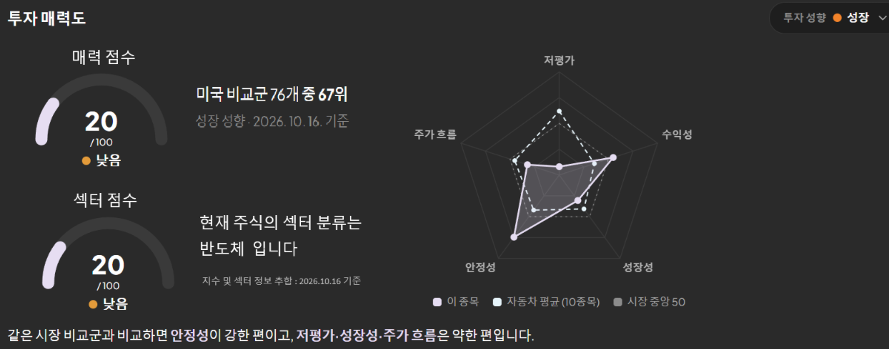

# 추가 기능 구현 계획

`기능구현_아이디어.md`를 **지금 ax_stockmind 코드**(stage6, 2026-10-19)와 맞춰 보고 정리한 실행 계획이에요. 이름·시그니처·SQL·응답 모양은 `추가기능_API_정의서.md`에 있어요.

- 팀 협업(A·B·C 분담, 단계별 계약·껍데기)은 끝났어요. D가 Claude와 함께 **ax_stockmind에서 바로** 구현해요.
- semi는 동작을 확인하는 참고용이에요. 원본과 같게 맞출 필요는 없어요.
- 기능마다 브랜치 1개(`feat/{기능}`) → PR → `main`. PR 하나에 "백엔드 + 테스트 + 문서"를 같이 넣어요.

결정 D1~D10은 2026-10-16에 정했어요(맨 아래 "결정 사항"). D4·D5·D8은 "측정 뒤 정한다"는 방식만 정했고, 값은 정해지는 시점에 이 문서에 채워요.

## 0. 지금 코드와 맞춰 보며 찾은 것

| # | 대상 | 찾은 것 | 계획에 반영한 내용 |
| --- | --- | --- | --- |
| 1 | 매력도 전체 | `queries/score_metrics.sql`에 **`stock_id` 필터와 listed 제외 조건이 없어요.** `reference_score.py`는 `{"stock_id": ...}`를 넘기지만 SQL이 무시해서 활성 종목 **전체**의 지표 행을 받아요(참고 점수가 엉뚱한 종목 값으로 계산됨). 유니버스 점수에도 listed 종목이 섞여 표본·순위가 달라져요 | **0단계(선행 수정)**로 먼저 고쳐요. 1·3단계가 이 SQL 위에서 바뀌어요 |
| 2 | 시장·섹터 점수 | 시장 심리 저장(`ensure_sentiment`)을 부르는 곳은 홈 API(`get_sentiment`)뿐이에요. 홈을 아무도 열지 않은 날은 저장값이 오래돼서, 상세의 시장·섹터 점수가 "데이터 부족"이 돼요 | 0단계에서 4시간 갱신(`RefreshService`의 `INDICES` 작업) 뒤에 시장 심리를 저장해요 |
| 3 | 시장·섹터 점수 | 홈에 시장 심리 지수가 이미 있어요(`services/sentiment.py`, `market_sentiment_daily`) | 새 시장 점수를 만들지 않고 이 저장값을 재료로 써요. 상세 경로에서는 읽기만 해요 |
| 4 | 시장·섹터 점수 | 상세 SQL(`stock_detail.sql`)이 `s.sector`를 꺼내지 않아요(업종 열은 Stage 1에서 뺀 채로 남아 있음). `stock_detail` 라우터에는 `fx_service` 인자도 없어요 | 3단계에서 `stock_detail.sql`에 `s.sector`를 추가하고, 라우터에는 `engine`만 추가해요 |
| 5 | 시장·섹터 점수 | 섹터 히트맵(`sector_performance_daily`)은 ETF·KRX 섹터 지수 기준이라 `stocks.sector`(점수 섹터 9개)와 분류가 달라요 | 섹터 흐름은 **같은 `stocks.sector` 비교군 종목의 일봉**으로 계산해요 |
| 6 | 안정성 | 안정성 설명 문구 `"빚이 적고 주가 출렁임이 작은가"`(`stock.js` `FACTORS`)와 `rawFmt`의 `debt_ratio` 배수 분기도 바꿔야 해요 | 1단계 바꾸는 곳에 넣었어요 |
| 7 | 안정성 | 상세의 '한눈에 보는 투자 지표' 위험 카드(`riskCard`)는 이미 변동성·최대낙폭을 보여줘요 | 고칠 것 없어요. 안정성 점수와 같은 숫자를 쓰게 돼요 |
| 8 | 안정성 | `reference_score.py`는 최신 `as_of`의 `stock_metric_values`를 읽어요. 배포 직후 점수를 다시 계산하기 전에는 낙폭 비교값이 없어요 | 배포 절차에 "배포 직후 점수 재계산"을 넣었어요 |
| 9 | 안정성 | 안정성이 가격만으로 계산되면 재무가 없는 종목도 안정성 팩터가 생겨 `factor_coverage`가 오를 수 있어요 | 재계산 때 "점수가 새로 생긴 종목 수"도 docs/09에 적어요 |
| 10 | 안정성 | `z_fixed`(자본 ≤ 0 → Z = −3)를 쓰는 지표는 `debt_ratio` 하나뿐이에요 | 규칙은 남기고 주석만 고쳐요 |
| 11 | 부하 분산 | `load_financials`·`load_disclosures`가 대상 전체 동안 `DART_LOCK_KEY` 하나를 잡아요. 상세 열기(`hydration.hydrate`)도 같은 함수를 불러서 07:00 비교군 재무가 끝날 때까지 기다려요. 회사 하나마다 트랜잭션이 3번(적재·`job_log`·`freshness.mark`)이에요 | 잠금은 회사 단위로, DB 쓰기는 여러 회사분을 모아 한 번에 (2단계) |
| 12 | 부하 분산 | SEC 재무도 `DART_LOCK_KEY` 안에서 돌아요 | `SEC_LOCK_KEY`를 새로 만들어요 |
| 13 | 한국 재무 증분 | `run_benchmark`에는 상장 목록 동기화가 없어요(목록은 `python -m app.ingest listing`로 따로 실행) | 공시 증분은 `run_benchmark`의 선정 단계 **바로 앞**에 넣어요 |
| 14 | 미국 재무 일괄 | SEC companyfacts.zip은 1GB가 넘는 것으로 알려져 있어 Cloud Run 메모리(1~2GiB)에서 통째로 풀기 어려워요 | 스트리밍 또는 frames API를 smoke로 비교해요 (D8) |
| 15 | 시장·섹터 점수 | `stocks.sector` 열은 있지만 **채우는 코드가 없어** 모든 종목이 NULL이에요(semi의 업종 분류 단계가 옮겨지지 않음) | 3단계에서 비교군 선정 때 섹터만 분류하는 `classify_sectors`를 추가했어요(선정 방식은 그대로) |

## 진행 순서 한눈에

| 단계 | 내용 | 크기 | 응답·DB 변경 | 먼저 할 이유 |
| --- | --- | --- | --- | --- |
| 0 | 선행 수정: 점수 SQL 대상 필터, 시장 심리 정기 저장 | 작음 (PR 1개) | 없음 (버그 수정) | 1·3단계가 이 위에서 바뀌어요 |
| 1 | 안정성 팩터 개편 | 작음 (PR 1개) | 매력도 지표 이름 `debt_ratio` → `max_drawdown` | 확정됐고 수집 변경이 없어요 |
| 2 | 실적 시즌 부하 분산 | 중간 (PR 1~2개) | `attractiveness.fin_basis` 추가 | 4단계와 배포의 전제예요 |
| 3 | 시장·섹터 점수 | 중간 (PR 1개) | 상세 응답에 `market_condition` 추가 | 시장 심리와 비교군 일봉을 그대로 써요 |
| 4 | 수집 확장 + 우선순위 적재 + 노출 확장 | 큼 (PR 3개 이상) | 테이블 1개, 설정, 노출 수 | 2단계 잠금 구조가 먼저 필요해요 |
| 별도 | KIS 장중 시세, Cloud Run 배포 | — | — | 배포 트랙 (5절) |

1·2·3단계는 고치는 파일이 거의 겹치지 않아서 순서를 바꿔도 돼요(`stock.js`만 1·3단계가 같이 고치는데, 1단계는 문구 몇 줄이에요).

---

## 0단계. 선행 수정

### 목표

매력도 계산 대상을 "활성 노출 종목 + 비교군(listed 제외)"으로, 참고 점수는 그 종목만으로 바로잡아요. 시장 심리를 홈 방문과 상관없이 4시간마다 저장해요.

### 바꾸는 곳

| 파일 | 바꾸는 내용 |
| --- | --- |
| `backend/app/queries/score_metrics.sql` | 머리 주석의 대상 설명, `base`의 `stocks` 조인 조건(`stock_id` NULL이면 활성·listed 제외, 아니면 그 종목만), `px`에 `stock_id` 필터 |
| `backend/app/services/scoring.py` | `compute_scores`의 `sql("score_metrics")` 호출에 `{"stock_id": None}` |
| `backend/app/services/refresh.py` | `_run("INDICES")`에서 지수 적재 뒤 KR·US 시장 심리 저장(실패해도 작업 상태는 그대로) |
| `backend/tests/test_scoring.py` | listed 종목이 유니버스 점수에서 빠지는지, 참고 점수가 그 종목 행만 쓰는지 |
| `backend/tests/test_refresh.py` | 갱신 뒤 `market_sentiment_daily`에 행이 생기는지 |

### 검증

1. `docker compose run --rm api pytest -q` 통과
2. 개발 DB에서 `python -m app.ingest scores` → listed 종목 행이 `stock_scores`에 없는지, listed 종목 상세의 참고 점수가 나오는지

---

## 1단계. 매력도 안정성 팩터 개편

### 목표

안정성 = 변동성(1년) + **1년 최대 낙폭**. 안정성만 섹터 중립화를 꺼요. 수익성·안정성 설명 문구를 바꿔요.

### 바꾸는 곳

| 파일 | 바꾸는 내용 |
| --- | --- |
| `backend/app/queries/score_metrics.sql` | `base`·`inp`에 `max_drawdown_1y` 추가, `debt_ratio` 행 → `max_drawdown` 행, 머리 주석의 z_fixed 설명 |
| `backend/app/queries/score_neutralize.sql` | `g`에 `mv.factor`, `SET` 조건에 `s.factor = 'safety'` |
| `backend/app/queries/score_zscore.sql` | 주석만 (z_fixed 규칙은 유지) |
| `backend/app/services/scoring.py` | `METRICS`의 `debt_ratio` → `max_drawdown`(방향 +1, 사유 "일봉 252개 미만") |
| `frontend/js/pages/stock.js` | `FACTORS`의 quality·safety `desc`, `rawFmt`의 `debt_ratio` 분기 삭제 |
| `backend/tests/test_scoring.py` | `reference_raw`·`reference_scores`·`test_boundary_cases`의 부채비율 → 낙폭, 새 테스트 2개 |
| `docs/09_매력도_점수_정의서.md` | 2절 지표 표, 4절 중립화 범위, 7절 재계산 결과, 9절 화면 이름 표 |

바꾸지 않는 것: DB 스키마, 프리셋 가중치, 응답 모양, 수집 코드, `analysis.metrics.debt_ratio`(수치 분석의 부채비율), '한눈에 보는 투자 지표' 카드.

### 검증

1. `pytest -q tests/test_scoring.py` 통과
2. 개발 DB 점수 재계산 뒤 아이디어 문서 "바꾸면 이렇게 돼요" 표(TSLA 75 → 41 등)와 비교. 0단계로 표본이 바뀌어 값이 조금 다를 수 있으니 다르면 표를 새 값으로 고쳐요
3. listed 종목 하나를 열어 참고 점수에 안정성이 나오는지
4. 화면은 저장소 밖 Playwright로 상세 매력도 카드만 확인

### 배포 절차

배포 직후 `python -m app.ingest scores`를 한 번 실행해요(0절 #8).

---

## 2단계. 실적 시즌 부하 분산 (회사 단위 잠금·묶음 저장·하루 재무 예산)

### 목표

상세 요청이 07:00 비교군 갱신 뒤에 줄 서지 않게 하고, 실적 시즌에도 하루 작업량을 일정하게 해요.

### 방식

- **잠금은 외부 호출에만, 회사 단위로**: DART/SEC를 부르는 동안만 잠그고 회사 하나가 끝나면 풀어요. 상세 요청은 지금 처리 중인 회사 하나만 기다려요
- **DB 쓰기는 모아서 한 번에**: 재무·공시 행, `freshness` 기록을 20개 회사(D3)마다 한 트랜잭션으로. 회사 300개면 트랜잭션 약 900번 → 약 15~30번
- **잠금 연결은 하나를 재사용**: 반복문 동안 연결 하나를 잡아 두고 `pg_advisory_lock`/`unlock`만 반복해요
- **하루 재무 예산**: 07:00 갱신에서 비교군 재무는 유효기간이 가장 오래 지난 순으로 100개(D4 임시값)까지. 노출·관심·포트폴리오 종목은 예산과 무관

### 바꾸는 곳

| 파일 | 바꾸는 내용 |
| --- | --- |
| `backend/app/ingest/store.py` | `SEC_LOCK_KEY`, `provider_lock_key`, `error_text`, `default_flush_every`, `LockSession`, `Unit`, `write_logs`, `BatchWriter` |
| `backend/app/ingest/jobs.py` | `load_financials`·`load_disclosures`의 묶음 잠금 제거, 회사 1개 수집 함수(`_fetch_financials`·`_fetch_disclosures`) + `BatchWriter`. `_load_valuation_base`는 `fundamental_bases` 행 + flush 뒤 파생으로 옮기고 삭제 |
| `backend/app/services/freshness.py` | `due(..., limit=)` |
| `backend/app/ingest/benchmark.py` | `load_benchmark`의 비교군 재무 대상에 예산 적용 |
| `backend/config/universe.yaml` | `benchmark.fin_daily_budget: 100`, `ingest.flush_every: 20` |
| `backend/app/providers/dart.py` | `_limiter = WindowLimiter(45, 60.0)` (D2) |
| `backend/app/queries/fin_basis.sql`, `services/data_quality.py`, `api/analysis.py`, `services/reference_score.py`, `stock.js` | "재무 기준 FY2025 n개 · FY2024 m개" 표기 (`attractiveness.fin_basis`) |
| `backend/tests/fakes.py` | `FakeFinancial`·`FakeDisclosure`에 `delay` |
| `backend/tests/test_store_batch.py`, `test_ingest_batch.py` (새), `test_data_quality.py`, `test_analysis.py` | 정의서 4-9 |
| `docs/architecture.md` | 잠금 설명을 "회사 단위·국가별 키"로 |

### 묶음 저장에서 지킬 규칙

- 재무 행과 `freshness.mark`는 **같은 트랜잭션**(따로 넣으면 "적재 안 됐는데 신선함"이 될 수 있어요)
- 실패 로그(`ingestion_logs`)는 **별도 트랜잭션**. flush가 실패해도 로그는 남고, 그 묶음 회사들은 FAILED로 기록해요
- 상세 hydrate(회사 1개)는 바로 flush돼요(묶음 크기와 상관없이 회사 1개면 반복이 끝나며 flush)
- 미국 기초값 × 종가 밸류에이션(`derive_us_valuations`)은 flush 뒤 그 묶음 성공 종목에 실행해요

### 주의할 점

- `WindowLimiter`는 프로세스 안에서만 공유돼요. 잠금이 회사 단위가 되면 API 서비스와 Job이 번갈아 DART를 부를 수 있어서 프로세스별 한도를 45로 낮춰요(D2). 프로세스가 3개 이상이 되면 다시 검토해요
- 잠금을 1초 이상 기다리면 로그 비고에 남겨 실제 대기 시간을 확인해요

### 검증

- 단위: 잠금 키가 국가별로 나뉘는지, 예산이 `limit`으로 적용되고 노출 종목은 빠지지 않는지, flush 실패 시 freshness는 FAILED이고 로그는 남는지, 묶음 20에서 25개 회사면 flush 2번인지
- 통합: 비교군 재무를 스레드로 돌리는 중에 상세 hydrate가 회사 하나 처리 시간 안에 시작되는지(가짜 provider에 지연)
- 개발 DB: `python -m app.ingest benchmark` 중 다른 창에서 비교군 종목 상세 → 수십 초 안에 `ready`

---

## 3단계. 시장·섹터 점수 (종목 상세 투자 매력도 카드)

### 목표

'투자 매력도' 카드에서 매력 점수 아래에 **"시장·섹터 점수" 게이지 하나**를 보여줘요(코드·API 이름 `market_condition`). 매력도가 높아도 시장·섹터가 약한 날이면 숫자로 드러나게 하는 위험 표시예요.

- 해설·권유 문구("구매 비권장" 등)는 넣지 않아요. 점수와 재료값만
- 홈의 시장 심리 카드는 그대로예요
- 새 외부 호출·새 테이블·새 API가 없어요. 상세 경로에서 DB 쓰기도 없어요

### 계산 정의 (D1 확정)

| 재료 | 값 | 0~100 | 비중 |
| --- | --- | --- | --- |
| 시장 | 그 종목 국가의 시장 심리 지수 최신 저장값 | 그대로 | 0.7 |
| 섹터 흐름 | 같은 `stocks.sector` 비교군 종목들의 최근 5거래일 수익률 중앙값 | `clamp(50 + r × 100 × 5)` → −10% 이하 0, 0% 50, +10% 이상 100 | 0.3 |

- 점수 = 0.7 × 시장 + 0.3 × 섹터 흐름 (HALF_UP 정수)
- 섹터가 없거나(금융 등 `sector` NULL) 표본이 5개 미만이면 시장만 써요 (D9)
- 시장 심리 저장값이 기준일보다 5거래일 넘게 오래됐으면 점수 없이 "데이터 부족" (0단계의 정기 저장으로 평소엔 생기지 않아요)
- 라벨은 매력 점수와 같은 구간·단어(매우 낮음~매우 높음)

### 화면 (투자 매력도 카드)

시안 속 숫자·섹터 이름·범례는 자리 채움 값이에요.

| 위치 | 내용 | 지금 코드(`renderScore`)와 차이 |
| --- | --- | --- |
| 왼쪽 위 | "매력 점수" 제목 + 반원 게이지 + 라벨, 옆에 순위·프리셋·기준일 문장 | 제목 추가, 문장을 게이지 아래 → 옆으로 |
| 왼쪽 아래 | "시장·섹터 점수" 제목 + 같은 모양 게이지 + 라벨, 옆에 섹터 문장·추합 날짜 | 새로 추가 |
| 오른쪽 | 5요소 레이더 + 범례 | 그대로 |
| 아래 | 요약 문장 + 요소별 강약 목록 + '계산 근거 보기' | 그대로 |

- 섹터 없는 종목은 섹터 문장을 "섹터 분류가 없어 시장 심리만 반영했습니다"로 (D9)
- 재료값과 5일 수익률 비교(이 종목·섹터 중앙값·지수)는 시장·섹터 게이지 **툴팁**에 넣어요 (D7). 홈 `senti__gauge`와 같은 방식(마우스·키보드 포커스)
- 두 게이지가 같은 색일 필요는 없어요
- 좁은 화면(767px 이하)에서는 매력 점수 → 시장·섹터 점수 → 레이더 순서로 세로로

### 바꾸는 곳

| 파일 | 내용 |
| --- | --- |
| `backend/app/queries/stock_detail.sql` | SELECT에 `s.sector` |
| `backend/app/queries/sector_flow.sql` (새) | 섹터 표본 5거래일 수익률 중앙값·표본 수·기준일 |
| `backend/app/services/market_condition.py` (새) | 순수 계산 + 조회(저장값 읽기, SQL), 1시간 캐시 |
| `backend/app/services/sentiment.py` | `_latest_stored` → `latest_stored` (이름만) |
| `backend/app/services/market_calendar.py` | `sessions_between` |
| `backend/app/schemas/api.py`, `backend/app/api/stocks.py` | `MarketConditionOut`, `StockDetailOut.market_condition`, 라우터에 `engine` 의존성 |
| `frontend/js/pages/stock.js`, `frontend/css/pages.css` | `gauge(score, { name })`, 게이지 2행, 툴팁 |
| `backend/tests/test_market_condition.py` (새), `test_stocks_api.py` | 정의서 5-10 |
| `docs/06_기능_API_정의서.md`, `docs/09_매력도_점수_정의서.md` | 응답 필드, 계산 정의(매력도와 별개) |

### 검증

1. `pytest -q` 통과
2. 개발 DB에서 같은 섹터 종목 여러 개의 섹터 흐름 값이 같은지, 시장 심리 값이 홈 카드와 같은지
3. 금융 종목(섹터 NULL)에서 문장이 "시장 심리만 반영"으로 바뀌는지
4. 화면이 시안 배치와 같은지, 390px에서 세로로 쌓이고 가로 스크롤이 없는지 (Playwright, 저장소 밖)

---

## 4단계. 데이터 수집 확장 + 우선순위 백그라운드 적재

2단계가 끝나면 시작해요. 4-1~4-3은 바로, 4-4(노출 확장)는 4-1 뒤 다시 잰 적재 시간으로 D5를 정한 뒤에 해요.

### 4-1. 한국 재무: 일괄 첫 적재 + 공시 기준점 증분

DART에는 "최근 재무"를 바로 주는 API가 없어서, **처음엔 파일로 한 번에 넣고 이후엔 새 사업보고서를 낸 회사만 다시 받아요.**

**① 첫 적재 (개발 PC, API 호출 없음)**

- OpenDART "재무정보 일괄다운로드"에서 사업보고서 txt를 받아요. listed 한국 종목 전체, 최근 3~4개 회계연도 (D10)
- `app/ingest/dart_bulk.py`(새)가 지금 `fnlttSinglAcntAll` 파싱과 같은 계정 규칙(연결 우선 → 별도)으로 `financial_statements`에 넣고 `data_freshness`도 기록해요
- 먼저 확인: txt 헤더·인코딩·계정 코드가 API와 같은지 표본 3종목으로 대조. 적재 뒤 DB 크기를 재서 무료 500MB에 여유가 적으면 연도 수를 줄여요

**② 매일 증분 (`list.json` 기준점)**

- 회사 지정 없이 날짜로 사업보고서(A001) 목록을 받는 `DartClient.list_annual_reports` 추가
- 기준점 테이블 `ingest_cursor` (`008_ingest_cursor.sql`)
- 07:00 `run_benchmark`의 선정 단계 앞에서: 기준점 날짜 − 2일부터 최신순으로 받다가 기준점 이하 번호가 나오면 멈춤 → DB에 있는 회사만 재무 유효기간 종료 + 공시 행 저장 → **모두 성공한 뒤에만** 기준점 갱신
- 정정 사업보고서도 새 접수번호라 같이 잡혀요. 공시 직후 재무 API가 비어 있으면 FAILED로 두고 다음 날 다시 받아요
- 90일 상한 만료는 안전장치로 남겨요

### 4-2. 미국 재무 일괄 수집

- companyfacts.zip(스트리밍)과 frames API를 smoke로 둘 다 받아 보고 정해요 (D8). 기준: 크기·메모리, 지금 태그 대체 규칙을 옮길 수 있는지, 호출 수
- `merge_supplement`(yfinance 보완) 규칙은 그대로

### 4-3. 우선순위 큐와 하루 예산

- 우선순위: 노출 → 비교군 → listed(국내는 거래대금, 같으면 시가총액. 미국은 D11)
- 큐는 테이블 없이 매일 쿼리로(재무 기록이 없는 listed부터)
- 예산: `universe.yaml background`, 실제 사용량은 오늘 `ingestion_logs`의 DART·SEC 행 수
- 상세 요청은 큐와 상관없이 바로 받아요(2단계 회사 단위 잠금)

### 4-4. 노출 종목 확장

- D5 수치로 `universe.yaml stocks` 확장 또는 "노출 = 시가총액 상위 N"
- 화면(D6): 리스트 페이지 나누기 + 국가·섹터 필터 (`GET /stocks`에 `sector`)
- 적재 시간·DB 크기는 개발 PC에서 먼저 재고 문서에 남겨요

---

## 5. 별도 트랙: 실시간 시세·Cloud Run 배포

기능 계획이 아니라 배포 계획이라 따로 진행해요. 순서가 걸리는 것만 적어요.

- 배포 전 smoke(`python -m app.ingest smoke`)를 Cloud Run Job으로 돌려 yfinance·pykrx 차단 여부부터 확인해요. 막히면 4단계보다 대체 소스 전환이 먼저예요
- 2단계(짧은 회사 단위 잠금)는 Supabase 세션 풀러에서 연결이 끊겨 잠금이 풀리는 위험도 줄여요. 배포 전에 2단계를 끝내는 것을 권해요
- KIS 관심종목 장중 시세는 4단계와 독립이에요. 장 시간·거래일 판단은 `market_calendar`를 재사용해요

---

## 결정 사항 (2026-10-16 확정)

| # | 질문 | 결정 | 이유 |
| --- | --- | --- | --- |
| D1 | 시장·섹터 점수 비중과 섹터 기간 | 시장 0.7 / 섹터 0.3, 5거래일. 배포 한 달 뒤 값 분포로 조정 | 섹터는 "살짝 반영", 기간은 "안 좋은 날"을 잡으려고 짧게 |
| D2 | DART 분당 제한을 프로세스 간에 지키는 법 | 프로세스별 `WindowLimiter(45, 60.0)` | DB 카운터는 구현이 커요. 배포 후 프로세스는 2개 |
| D3 | 묶음 저장 크기 | 20개 회사 | 실패 시 다시 받는 양과 트랜잭션 수의 균형 |
| D4 | 하루 재무 예산 | 임시 100, 첫 배포 뒤 BENCHMARK 실행 시간으로 확정 | — |
| D5 | 노출 종목 수 | 2단계·4-1 뒤 다시 잰 적재 시간으로. 그 전까지 25개 | 지금 측정값이 25개(257초) 하나뿐 |
| D6 | 노출 확장 시 화면 | 리스트 페이지 나누기 + 국가·섹터 필터 | 25개 기준 화면 |
| D7 | 재료값·5일 수익률 비교 위치 | 시장·섹터 게이지 툴팁 | 카드에 줄을 늘리지 않고 근거는 남김 |
| D8 | 미국 일괄 재무 방식 | smoke로 둘 다 받아 보고 결정 | 크기·태그 규칙 확인이 먼저 |
| D9 | 섹터 없는 종목 | 시장만 반영, "섹터 분류가 없어 시장 심리만 반영했습니다" | 비교군 구조를 바꾸면 매력도 표본도 바뀌어요 |
| D10 | 한국 재무 첫 적재 범위 | listed 한국 종목 전체, 최근 3~4개 회계연도 | 파일 적재라 호출 한도와 무관. DB 용량 보고 줄임 |

아직 정할 것 (권하는 답은 정의서 11절)

| # | 질문 | 정하는 시점 |
| --- | --- | --- |
| D1 조정 | 시장·섹터 비중 | 3단계 배포 한 달 뒤 |
| D4 확정 | 하루 재무 예산 | 2단계 첫 배포 뒤 |
| D5 | 노출 종목 수 | 4-1 적재 뒤 |
| D8 | 미국 일괄 방식 | 4-2 시작 때 |
| D11 | 미국 listed 우선순위 소스 | 4-3 시작 전 |
| D12 | 백그라운드 하루 예산 값 | 4-3 시작 전 |

## 구현 전에 다시 확인할 것 (외부 문서)

- DART 일일 한도·분당 제한
- `list.json`: 회사 지정 없을 때 조회 기간 최대 3개월, `page_count` 최대 100, `rcept_no` 형식(`YYYYMMDD` + 일련번호)
- 재무정보 일괄다운로드: 공개 시점, 파일 형식·인코딩, 계정 코드가 API와 같은지
- SEC companyfacts.zip 크기·갱신 시각, frames API 사용 조건
- KIS 초당 요청 한도, 접근 토큰 발급 제한
