# 05. ERD 및 DB 설계서

- DDL 원문: `backend/db/schema.sql` → `backend/db/indexes.sql` → `backend/db/views.sql` 순서로 실행 (`python -m app.ingest init-db`가 같은 순서로 적용). 이미 적재된 DB는 `backend/db/migrations/001~012`로 바꾼다(8절).
- DBMS: PostgreSQL 16 / **테이블 26개, VIEW 4개, 보조 인덱스 10개, 부분 UNIQUE 인덱스 1개(주 그룹 제약), 트리거 3개**(updated_at 자동 갱신 — portfolios·portfolio_items·watchlist_items), 생성 컬럼 1개(`portfolio_items.cost_krw`)
- 금액·가격은 모두 `NUMERIC`(float 사용 안 함), 시각은 모두 `TIMESTAMPTZ`
- ORM(`backend/app/models/__init__.py`)은 `schema.sql`과 1:1이며 `tests/test_schema.py::test_orm_matches_schema`가 일치를 검증한다.
- 3절 테이블 정의와 2절 행 수는 2026-10-22 개발 DB에 DDL을 적용한 상태에서 시스템 카탈로그(`pg_attribute`, `pg_constraint`)와 `count(*)`로 뽑았다. 2026-10-26 로그인(migration 011)·테마 분류(012)로 바뀐 테이블은 그날 값으로 고쳤다(행 수 칸에 날짜 표시).
- 매력도 계산 정의는 `09_매력도_점수_정의서.md`, 데이터 출처는 `03_데이터_조사_정의서.md`를 따른다.

## 1. ERD

```mermaid
erDiagram
    markets ||--o{ stocks : "상장"
    markets |o--o{ indices : "대표 지수"
    stocks ||--o{ peer_group_members : ""
    peer_groups ||--o{ peer_group_members : ""
    stocks ||--o{ daily_prices : "일봉"
    stocks ||--o{ valuation_snapshots : "밸류에이션"
    stocks ||--o{ financial_statements : "재무"
    stocks ||--o{ disclosures : "공시"
    stocks ||--o{ stock_metric_values : "지표 원값·Z"
    stocks ||--o{ stock_scores : "매력도"
    stocks ||--o{ data_freshness : "유효기간"
    stocks ||--o| fundamental_bases : "미국 기초값"
    scoring_presets ||--o{ scoring_weights : "가중치"
    scoring_presets ||--o{ stock_scores : "프리셋"
    indices ||--o{ index_daily_prices : "지수 일봉"
    users ||--o| user_preferences : "설정"
    users ||--o{ watchlist_items : ""
    stocks ||--o{ watchlist_items : ""
    users ||--o{ portfolios : "소유"
    portfolios ||--o{ portfolio_items : "담기"
    stocks ||--o{ portfolio_items : "RESTRICT"
    stocks |o--o{ ingestion_logs : "SET NULL"

    markets {
        smallint market_id PK
        varchar code UK
        char country
        char currency
        varchar timezone
    }
    stocks {
        int stock_id PK
        smallint market_id FK
        varchar ticker
        varchar name
        varchar name_en
        varchar corp_code
        varchar cik
        boolean is_active
        varchar coverage
        timestamptz detail_synced_at
        varchar industry
        smallint sic
        varchar ksic
        varchar sector
        timestamptz industry_checked_at
        int cap_rank
        timestamptz cap_ranked_at
    }
    peer_groups {
        int group_id PK
        varchar name UK
        text description
        varchar kind
        varchar sector
        varchar scoring
        boolean commodity_linked
    }
    peer_group_members {
        int group_id PK,FK
        int stock_id PK,FK
        boolean is_primary
    }
    daily_prices {
        int stock_id PK,FK
        date trade_date PK
        numeric open
        numeric high
        numeric low
        numeric close
        bigint volume
    }
    valuation_snapshots {
        int stock_id PK,FK
        date as_of PK
        numeric per
        numeric pbr
        numeric eps
        numeric bps
        numeric market_cap
        bigint shares_outstanding
        varchar source
        numeric dps
    }
    financial_statements {
        int fin_id PK
        int stock_id FK
        date period_end
        varchar period_type
        numeric revenue
        numeric operating_income
        numeric net_income
        numeric total_assets
        numeric total_equity
        numeric total_debt
        varchar data_source
        varchar accounting_std
        varchar currency
        numeric fx_rate
        date filed_at
        boolean consolidated
        text notes
        numeric operating_cf
        numeric comprehensive_income
        numeric borrowings
        numeric cash
    }
    disclosures {
        int disclosure_id PK
        int stock_id FK
        varchar rcept_no UK
        text title
        varchar report_type
        timestamptz filed_at
        text url
        varchar data_source
    }
    indices {
        smallint index_id PK
        varchar code UK
        varchar name
        smallint market_id FK
        varchar source_symbol
        smallint display_order
        varchar category
        varchar unit
    }
    index_daily_prices {
        smallint index_id PK,FK
        date trade_date PK
        numeric open
        numeric high
        numeric low
        numeric close
    }
    fx_rates {
        int fx_id PK
        timestamptz rate_at
        numeric usd_krw
        varchar granularity
        varchar source
    }
    sector_performance_daily {
        bigint id PK
        char market UK
        varchar sector_code UK
        varchar sector_name
        date trade_date UK
        numeric change_pct
        timestamptz fetched_at
    }
    market_sentiment_daily {
        bigint id PK
        char market UK
        date trade_date UK
        numeric score
        varchar label
        numeric price_position
        numeric ma_gap_score
        numeric rsi_score
        numeric vix_score
        smallint formula_version
        timestamptz computed_at
    }
    users {
        int user_id PK
        varchar nickname UK
        timestamptz created_at
        varchar email UK
        varchar password_hash
        varchar google_sub UK
        timestamptz last_login_at
        timestamptz last_seen_at
    }
    user_preferences {
        int user_id PK,FK
        jsonb prefs
        timestamptz updated_at
    }
    watchlist_items {
        int user_id PK,FK
        int stock_id PK,FK
        int sort_order
        timestamptz added_at
        varchar memo
        numeric target_price
        timestamptz updated_at
    }
    portfolios {
        int portfolio_id PK
        int user_id FK
        varchar name
        numeric seed_krw
        timestamptz created_at
        timestamptz updated_at
    }
    portfolio_items {
        int item_id PK
        int portfolio_id FK
        int stock_id FK
        int quantity
        numeric ref_price
        numeric ref_fx_rate
        date ref_date
        text memo
        numeric cost_krw "GENERATED"
        timestamptz created_at
        timestamptz updated_at
    }
    scoring_presets {
        smallint preset_id PK
        varchar code UK
        varchar name
        text description
        smallint sort_order
    }
    scoring_weights {
        smallint preset_id PK,FK
        varchar factor PK
        numeric weight
    }
    stock_metric_values {
        int stock_id PK,FK
        date as_of PK
        varchar metric PK
        varchar factor
        numeric raw_value
        numeric z_raw
        numeric z_adj
    }
    stock_scores {
        int stock_id PK,FK
        date as_of PK
        smallint preset_id PK,FK
        numeric value_score
        numeric quality_score
        numeric growth_score
        numeric safety_score
        numeric momentum_score
        numeric composite
        numeric score
        smallint factor_coverage
        jsonb data_quality
    }
    data_freshness {
        int stock_id PK,FK
        varchar kind PK
        timestamptz fetched_at
        timestamptz valid_until
        varchar status
        text error
    }
    fundamental_bases {
        int stock_id PK,FK
        bigint shares_outstanding
        date shares_as_of
        numeric dps
        date dps_period_end
        varchar source
        timestamptz updated_at
    }
    ingest_cursor {
        varchar source PK
        char last_rcept_no
        date last_rcept_dt
        timestamptz updated_at
    }
    ingestion_logs {
        int log_id PK
        varchar source
        varchar job_type
        int stock_id FK
        varchar status
        int rows_loaded
        text error
        timestamptz started_at
        timestamptz finished_at
    }
```

FK가 없는 독립 테이블은 4개다.
- `fx_rates`: 조회 시점에 참조한다. 담은 시점 환율은 `portfolio_items`에 복사한다(5-1).
- `sector_performance_daily`(섹터 히트맵)·`market_sentiment_daily`(시장 심리 지수): 대시보드 홈 위젯용이다(migration 007).
- `ingest_cursor`: 소스 단위 수집 기준점이다(migration 008).

## 2. 테이블 목록
행 수는 2026-10-22 개발 DB에서 `count(*)`로 셌다. 운영(Cloud Run) DB는 `python -m app.ingest status`로 확인한다.

| 영역 | 테이블 | 설명 | PK | 행 수 |
|---|---|---|---|---|
| 마스터 | markets | 시장(통화·국가·시간대) | market_id | 4 |
| 마스터 | stocks | 종목 — 노출(featured)·매력도 비교군(benchmark)·상장 목록(listed) | stock_id, UQ (market_id, ticker) | 8,301 (노출 25 · 비교군 636 · 상장 목록 7,640 — 2026-10-26 테마 재선정 후) |
| 마스터 | peer_groups | 테마 — 섹터 중립화 주 그룹·비교군 선정 단위·화면 경쟁 비교 | group_id | 38 |
| 마스터 | peer_group_members | 종목↔테마 N:M, 주 테마 표시(상장 목록 종목 포함) | (group_id, stock_id) | 3,714 (주 테마 3,702 · 보조 12) |
| 시계열 | daily_prices | 종목 일봉(수정주가) | (stock_id, trade_date) | 190,562 (2026-10-26 — 노출 25 · 비교군 636종목) |
| 시계열 | valuation_snapshots | PER·PBR·시총·주당배당 | (stock_id, as_of) | 4,580 (PYKRX 4,200 · DERIVED 292 · YFINANCE 88) |
| 재무 | financial_statements | 재무제표(FY) | fin_id, UQ (stock_id, period_end, period_type) | 20,896 (DART 7,396 · SEC 13,500) |
| 공시 | disclosures | 공시 목록(최근 1년) | disclosure_id, UQ (rcept_no) | 1,361 (DART 1,183 · SEC 178) |
| 배경 | indices | 지수·원자재 선물 정의 | index_id | 15 (지수 10 · 원자재 5) |
| 배경 | index_daily_prices | 지수 일봉 | (index_id, trade_date) | 7,067 (2026-10-26 — 지수 10 · 원자재 5, 2024-10 ~) |
| 배경 | fx_rates | USD/KRW | fx_id, UQ (granularity, rate_at) | 533 (DAILY 523 · SNAPSHOT 10) |
| 홈 위젯 | sector_performance_daily | 섹터 전일 대비 등락률(캐시, 30일 보관) | id, UQ (market, sector_code, trade_date) | 176 |
| 홈 위젯 | market_sentiment_daily | 시장 심리 지수(StockMind 간이 계산) | id, UQ (market, trade_date) | 14 |
| 사용자 | users | 사용자 — demo, 배포의 게스트 `guest-…`, 계정(이메일·비밀번호 / Google, 2차) | user_id, UQ (nickname), UQ (email), UQ (google_sub) | demo 1 (+ 게스트는 방문 브라우저마다 생김, 3일 미접속 시 정리) |
| 사용자 | user_preferences | 계정별 화면 설정(테마·투자 성향·지표 선택 등, JSON) — 2차 | user_id | 0 (로그인한 사용자가 설정을 바꿀 때 생김) |
| 사용자 | watchlist_items | 관심종목 N:M + 정렬·메모·목표가 | (user_id, stock_id) | demo 8 (`seed-demo`) |
| 사용자 | portfolios | 모의 포트폴리오 | portfolio_id, UQ (user_id, name) | demo 2 |
| 사용자 | portfolio_items | 담은 종목(담은 시점 가격·환율 복사) | item_id, UQ (portfolio_id, stock_id) | demo 10 (KRW·USD 혼합) |
| 설정 | scoring_presets | 투자 성향 프리셋 | preset_id, UQ (code) | 4 |
| 설정 | scoring_weights | 프리셋별 팩터 가중치 | (preset_id, factor) | 20 (4 × 5) |
| 파생 | stock_metric_values | 매력도 지표 원값·Z | (stock_id, as_of, metric) | 12,501 (2026-10-26 — 기준일 여러 개 누적, 10-26 하루 661종목) |
| 파생 | stock_scores | 프리셋별 매력도 점수 | (stock_id, as_of, preset_id) | 5,556 (2026-10-26 — 기준일 누적, 10-26 하루 2,636) |
| 운영 | data_freshness | 종목·데이터 종류별 유효기간 | (stock_id, kind) | 7,203 |
| 운영 | fundamental_bases | 미국 PER·PBR 계산용 기초값(발행주식수·주당배당) | stock_id | 137 |
| 운영 | ingest_cursor | 공시 목록 증분 수집 기준점 | source | 1 |
| 운영 | ingestion_logs | 적재·갱신 로그 | log_id | 1,909 (적재·갱신마다 증가) |

## 3. 테이블 정의서

#### `markets`

| 컬럼 | 타입 | NULL | 기본값/생성식 | 키 | 설명 |
|---|---|---|---|---|---|
| market_id | smallint | N | 자동 증가 | PK | 시장 ID |
| code | character varying(10) | N |  | UQ | KOSPI / KOSDAQ / NASDAQ / NYSE |
| country | character(2) | N |  |  | 국가 (KR/US) |
| currency | character(3) | N |  |  | 통화 (KRW/USD) |
| timezone | character varying(40) | N |  |  | Asia/Seoul / America/New_York |

제약: `CHECK ((country = ANY (ARRAY['KR'::bpchar, 'US'::bpchar])))` / `CHECK ((currency = ANY (ARRAY['KRW'::bpchar, 'USD'::bpchar])))`

#### `stocks`

`coverage`·`detail_synced_at`은 migration 003, 업종 4칸은 006, `listed` 허용은 005, `cap_rank`·`cap_ranked_at`은 009에서 추가했다.

| 컬럼 | 타입 | NULL | 기본값/생성식 | 키 | 설명 |
|---|---|---|---|---|---|
| stock_id | integer | N | 자동 증가 | PK | 종목 ID |
| market_id | smallint | N |  | UQ(복합), FK→markets | 시장 ID |
| ticker | character varying(16) | N |  | UQ(복합) | 거래소 종목 코드 |
| name | character varying(128) | N |  |  | 이름 |
| name_en | character varying(128) | Y |  |  | 영문 이름 |
| corp_code | character varying(16) | Y |  |  | OpenDART 고유번호 (KR, `master`가 DART 매핑으로 채움 — `--offline`이면 NULL) |
| cik | character varying(10) | Y |  |  | SEC CIK 10자리 (US, `master`가 SEC 매핑으로 채움 — `--offline`이면 NULL) |
| is_active | boolean | N | true |  | 수집·점수 계산 대상 여부 (false면 데이터만 보존) |
| coverage | character varying(10) | N | 'featured' |  | featured(화면 노출 — 주가 1시간·그 밖 4시간 갱신) / benchmark(매력도 비교군, 1일 갱신) / listed(상장 보통주 목록 — 이름·티커만, 상세를 열 때 수집, 점수 유니버스 제외) |
| detail_synced_at | timestamp with time zone | Y |  |  | 비교군 종목 상세(공시·2년 일봉·5개년 재무)를 마지막으로 받은 시각 |
| industry | character varying(64) | Y |  |  | 미국 SEC SIC 설명(국내는 012 이전의 KRX 업종명이 남아 있을 수 있음 — 화면·계산에 쓰지 않음) |
| sic | smallint | Y |  |  | 미국 SEC SIC 코드 |
| ksic | character varying(10) | Y |  |  | 국내 DART 기업개황 업종 코드(KSIC 2~5자리) — 테마 분류 (migration 012) |
| sector | character varying(32) | Y |  |  | 주 테마의 부모 섹터(`config/universe.yaml` themes). NULL = 주 테마 없음(분류되지 않은 업종) |
| industry_checked_at | timestamp with time zone | Y |  |  | 업종 코드(KSIC·SIC)를 마지막으로 확인한 시각(1년마다 다시 확인) |
| cap_rank | integer | Y |  |  | 국가 안 시가총액 순위(1 = 가장 큼). 미국 상위 1,500개만 값이 있다 — 백그라운드 재무 적재 우선순위용, 화면에는 쓰지 않음 (migration 009) |
| cap_ranked_at | timestamp with time zone | Y |  |  | 순위를 매긴 시각(30일마다 다시 매김) |

제약: `CHECK ((cap_rank > 0))` / `CHECK (((coverage)::text = ANY ((ARRAY['featured'::character varying, 'benchmark'::character varying, 'listed'::character varying])::text[])))` / `UNIQUE (market_id, ticker)`

#### `peer_groups`

테마(`config/universe.yaml themes`, master 적재가 맞추고 설정에서 빠진 그룹은 구성원과 함께 지운다). 종목마다 주 테마 1개(`peer_group_members.is_primary`)가 매력도 섹터 중립화·비교군 선정 기준이고, 보조 테마는 경쟁 비교·테마 필터에만 쓴다(09 4절). 모든 행이 `kind = 'theme'`이다(`sector` 값은 남겨 두었지만 쓰지 않는다). 주 테마는 뷰 `v_stock_theme`(종목별 1행, `family` = `scoring`)로 읽는다.

| 컬럼 | 타입 | NULL | 기본값/생성식 | 키 | 설명 |
|---|---|---|---|---|---|
| group_id | integer | N | 자동 증가 | PK | 경쟁 그룹 ID |
| name | character varying(64) | N |  | UQ | 이름 |
| description | text | Y |  |  | 설명 |
| kind | character varying(10) | N | 'theme' |  | 모두 theme |
| sector | character varying(32) | Y |  |  | 부모 섹터(`config/universe.yaml` sectors) — migration 012 |
| scoring | character varying(10) | N | 'general' |  | general / financial(금융끼리 표준화, 매출 기준 지표 제외) / none(점수 없음 — 리츠) |
| commodity_linked | boolean | N | false |  | 원자재 연동 테마(E/P 3년 평균 순이익, EPS 변화 제외, 상세 원자재 표시) |

제약: `CHECK (((kind)::text = ANY ((ARRAY['theme'::character varying, 'sector'::character varying])::text[])))` / `CHECK (scoring IN ('general','financial','none'))`

#### `peer_group_members`

부분 UNIQUE 인덱스 `CREATE UNIQUE INDEX ux_pgm_primary ON peer_group_members (stock_id) WHERE is_primary` — 종목당 주 그룹 최대 1개.

| 컬럼 | 타입 | NULL | 기본값/생성식 | 키 | 설명 |
|---|---|---|---|---|---|
| group_id | integer | N |  | PK, FK→peer_groups (CASCADE) | 경쟁 그룹 ID |
| stock_id | integer | N |  | PK, FK→stocks (CASCADE) | 종목 ID |
| is_primary | boolean | N | false |  | 주 테마 여부(매력도 섹터 중립화·비교군 선정 기준) |

#### `daily_prices`

| 컬럼 | 타입 | NULL | 기본값/생성식 | 키 | 설명 |
|---|---|---|---|---|---|
| stock_id | integer | N |  | PK, FK→stocks (CASCADE) | 종목 ID |
| trade_date | date | N |  | PK | 시장 현지 날짜 |
| open | numeric(18,4) | N |  |  | 시가 |
| high | numeric(18,4) | N |  |  | 고가 |
| low | numeric(18,4) | N |  |  | 저가 |
| close | numeric(18,4) | N |  |  | 수정주가 |
| volume | bigint | N |  |  | 거래량(주) |

제약: `CHECK ((high >= low))` / `CHECK ((low > (0)::numeric))` / `CHECK ((volume >= 0))`

#### `valuation_snapshots`

`v_stock_metrics`는 `dps`와 `dividend_yield`(= dps ÷ 최신 종가)를 끝 열로 붙였다(`CREATE OR REPLACE VIEW`는 끝에 붙인 열만 허용). `KIS`는 migration 010에서 허용했다.

| 컬럼 | 타입 | NULL | 기본값/생성식 | 키 | 설명 |
|---|---|---|---|---|---|
| stock_id | integer | N |  | PK, FK→stocks (CASCADE) | 종목 ID |
| as_of | date | N |  | PK | 기준일 |
| per | numeric(18,4) | Y |  |  | 적자·미제공은 NULL |
| pbr | numeric(18,4) | Y |  |  | 주가순자산비율 |
| eps | numeric(18,4) | Y |  |  | 주당순이익 |
| bps | numeric(18,4) | Y |  |  | 주당순자산 |
| market_cap | numeric(26,0) | Y |  |  | 종목 통화 기준 |
| shares_outstanding | bigint | Y |  |  | 발행(상장)주식수 |
| source | character varying(20) | N |  |  | 데이터 출처 — PYKRX / KIS / YFINANCE / DERIVED |
| dps | numeric(18,4) | Y |  |  | 연간 주당배당금(종목 통화). 0 = 무배당, NULL = 미제공 (migration 005) |

제약: `CHECK ((dps >= (0)::numeric))` / `CHECK ((market_cap >= (0)::numeric))` / `CHECK ((shares_outstanding >= 0))` / `CHECK (((source)::text = ANY ((ARRAY['PYKRX'::character varying, 'YFINANCE'::character varying, 'DERIVED'::character varying])::text[])))`

#### `financial_statements`

| 컬럼 | 타입 | NULL | 기본값/생성식 | 키 | 설명 |
|---|---|---|---|---|---|
| fin_id | integer | N | 자동 증가 | PK | 재무 행 ID |
| stock_id | integer | N |  | UQ(복합), FK→stocks (CASCADE) | 종목 ID |
| period_end | date | N |  | UQ(복합) | 결산일 |
| period_type | character varying(4) | N |  | UQ(복합) | FY / Q1~Q4 |
| revenue | numeric(24,2) | Y |  |  | 매출액 |
| operating_income | numeric(24,2) | Y |  |  | 영업이익 |
| net_income | numeric(24,2) | Y |  |  | 지배기업 소유주 귀속 우선 |
| total_assets | numeric(24,2) | Y |  |  | 자산총계 |
| total_equity | numeric(24,2) | Y |  |  | 지배기업 소유주 귀속 우선 |
| total_debt | numeric(24,2) | Y |  |  | 부채총계 (KR Liabilities / US Liabilities) |
| data_source | character varying(20) | N |  |  | 데이터 출처 |
| accounting_std | character varying(20) | Y |  |  | K-IFRS / US-GAAP |
| currency | character varying(3) | Y |  |  | 공시 표시통화(KRW·USD). 금액은 시장 통화로 환산해 저장(D-026, migration 014). NULL = 기록 전 행 |
| fx_rate | numeric(12,4) | Y |  |  | 환산에 쓴 결산일 USD/KRW(원화 공시면 NULL). `CHECK (fx_rate > 0)` |
| filed_at | date | Y |  |  | 그 결산기 값이 처음 공시된 보고서 제출일(DART 접수일·SEC filed — 신호 유효 시점, migration 016, D-033) |
| consolidated | boolean | Y |  |  | 연결 true / 별도 false |
| notes | text | Y |  |  | 수집 경로(`path=DART_API`·`SEC_API`·`YFINANCE`·`DART_BULK`·`SEC_FRAMES`)·대체 계정·전기값(D-039). NULL = 수정 4 전 행 |
| operating_cf | numeric(24,2) | Y |  |  | 영업활동 현금흐름 |
| comprehensive_income | numeric(24,2) | Y |  |  | 총포괄이익(지배 우선) |
| equity_method_income | numeric(24,2) | Y |  |  | 지분법손익 |
| borrowings | numeric(24,2) | Y |  |  | 차입금·사채 합계(리스부채 제외) |
| cash | numeric(24,2) | Y |  |  | 현금및현금성자산 |
| goodwill | numeric(24,2) | Y |  |  | 영업권(따로 표시할 때만) |
| intangibles | numeric(24,2) | Y |  |  | 무형자산(영업권 포함 합계) |
| interest_expense | numeric(24,2) | Y |  |  | 이자비용(국내는 손익계산서에 없으면 현금흐름표 이자 지급액) |
| nci_net_income | numeric(24,2) | Y |  |  | 비지배지분 순이익 |

분기 행(`Q1`~`Q4`)은 3개월치(4분기 = 연간 − 3분기 누적), 재무상태표 칸은 분기 말 값이다. 비교 표본(노출·비교군)만 최근 20개 분기를 받는다. 추가 계정 9개는 점수에 아직 쓰지 않는다(측정 라운드 M1 입력 — 09 2절).

제약: `CHECK (((data_source)::text = ANY ((ARRAY['DART'::character varying, 'SEC'::character varying, 'YFINANCE'::character varying])::text[])))` / `CHECK (((period_type)::text = ANY ((ARRAY['FY'::character varying, 'Q1'::character varying, 'Q2'::character varying, 'Q3'::character varying, 'Q4'::character varying])::text[])))` / `UNIQUE (stock_id, period_end, period_type)`

#### `sanity_runs` (migration 015, D-030)
| 컬럼 | 타입 | NULL | 기본값 | 키 | 설명 |
|---|---|---|---|---|---|
| run_id | integer | N | nextval | PK | |
| ran_at | timestamp with time zone | N | now() |  | 실행 시각 |
| as_of | date | N |  |  | 판정한 점수 계산일 |
| model_version | character varying(40) | Y |  |  | 점수 모델 버전 |
| environment | character varying(20) | N |  |  | dev / deploy — `CHECK (environment IN ('dev', 'deploy'))` |
| passed · known_fail · target_fail · unverified · required_fail | integer | N |  |  | 네 칸(통과·감수한 실패·target 실패·미검증)과 required 실패 수 |
| ok | boolean | N |  |  | required 실패 0 |
| results | jsonb | N |  |  | `[{id, status, kind, result, value}]` |
| report | text | N |  |  | 마크다운 보고 |

인덱스: `ix_sanity_runs_as_of (as_of, environment)`

#### `disclosures`

| 컬럼 | 타입 | NULL | 기본값/생성식 | 키 | 설명 |
|---|---|---|---|---|---|
| disclosure_id | integer | N | 자동 증가 | PK | 공시 ID |
| stock_id | integer | N |  | FK→stocks (CASCADE) | 종목 ID |
| rcept_no | character varying(64) | N |  | UQ | DART 접수번호 / SEC accession number |
| title | text | N |  |  | 공시 제목 |
| report_type | character varying(100) | Y |  |  | 보고서 유형/서식 |
| filed_at | timestamp with time zone | N |  |  | 접수(제출) 시각 |
| url | text | Y |  |  | 원문 링크 |
| data_source | character varying(20) | N |  |  | 데이터 출처 |

제약: `CHECK (((data_source)::text = ANY ((ARRAY['DART'::character varying, 'SEC'::character varying])::text[])))`

#### `indices`

| 컬럼 | 타입 | NULL | 기본값/생성식 | 키 | 설명 |
|---|---|---|---|---|---|
| index_id | smallint | N | 자동 증가 | PK | 지수 ID |
| code | character varying(16) | N |  | UQ | KOSPI / KOSDAQ / SPX / IXIC / DJI |
| name | character varying(64) | N |  |  | 이름 |
| market_id | smallint | Y |  | FK→markets | 시장 ID |
| source_symbol | character varying(32) | N |  |  | 라이브러리 조회용 심볼 (1001, ^GSPC …) |
| display_order | smallint | N | 0 |  | 화면 표시 순서 |
| category | character varying(10) | N | 'index' |  | index = 지수 / commodity = 원자재 선물(대시보드 '원자재' 묶음, 원자재 연동 종목의 가격 위치) — migration 012 |
| unit | character varying(16) | Y |  |  | 원자재 가격 단위($/톤 등). 지수는 NULL |

#### `index_daily_prices`

| 컬럼 | 타입 | NULL | 기본값/생성식 | 키 | 설명 |
|---|---|---|---|---|---|
| index_id | smallint | N |  | PK, FK→indices (CASCADE) | 지수 ID |
| trade_date | date | N |  | PK | 거래일(현지) |
| open | numeric(18,4) | Y |  |  | 시가 |
| high | numeric(18,4) | Y |  |  | 고가 |
| low | numeric(18,4) | Y |  |  | 저가 |
| close | numeric(18,4) | N |  |  | 종가 |

제약: `CHECK ((close > (0)::numeric))`

#### `fx_rates`

| 컬럼 | 타입 | NULL | 기본값/생성식 | 키 | 설명 |
|---|---|---|---|---|---|
| fx_id | integer | N | 자동 증가 | PK | 환율 행 ID |
| rate_at | timestamp with time zone | N |  | UQ(복합) | 환율 기준 시각 |
| usd_krw | numeric(12,4) | N |  |  | 1달러당 원 |
| granularity | character varying(8) | N |  | UQ(복합) | SNAPSHOT / DAILY |
| source | character varying(20) | N | 'YFINANCE' |  | 데이터 출처 |

제약: `CHECK (((granularity)::text = ANY ((ARRAY['SNAPSHOT'::character varying, 'DAILY'::character varying])::text[])))` / `CHECK ((usd_krw > (0)::numeric))` / `UNIQUE (granularity, rate_at)`

#### `sector_performance_daily`

대시보드 섹터 히트맵. 갱신 작업 `SECTORS_US`(섹터 ETF 11개 묶음 다운로드)·`SECTORS_KR`(KRX 코스피 200 섹터 지수)만 쓰고 홈 화면은 읽기만 한다. 섹터 가중치(타일 크기)는 저장하지 않고 `app/services/sectors.py` 상수로 둔다. 캐시 성격이라 30일 지난 행은 갱신 작업이 지운다.

| 컬럼 | 타입 | NULL | 기본값/생성식 | 키 | 설명 |
|---|---|---|---|---|---|
| id | bigint | N | 자동 증가 | PK | 행 ID |
| market | character(2) | N |  | UQ(복합) | KR / US |
| sector_code | character varying(16) | N |  | UQ(복합) | 미국 섹터 ETF 티커(XLK…) / KRX 섹터 지수 코드 |
| sector_name | character varying(40) | N |  |  | 화면 표시용 한글명 |
| trade_date | date | N |  | UQ(복합) | 거래일(현지) |
| change_pct | numeric(8,4) | Y |  |  | 전일 대비 %(1.23 = 1.23%) |
| fetched_at | timestamp with time zone | N | now() |  | 받은 시각 |

제약: `CHECK ((market = ANY (ARRAY['KR'::bpchar, 'US'::bpchar])))` / `UNIQUE (market, sector_code, trade_date)`

#### `market_sentiment_daily`

시장 심리 지수(0~100, 높을수록 탐욕). 기준 지수(국내 KOSPI, 미국 S&P 500)와 VIX 일봉(`index_daily_prices`)으로 계산해 저장한다 — 새 외부 호출 없음. CNN Fear & Greed 지수가 아니다. 계산식은 `app/services/sentiment.py`, 저장된 행의 `formula_version`이 현재 상수와 다르면 다시 계산해 덮어쓴다. 구성요소가 2개 미만('데이터 부족')인 날은 저장하지 않는다.

| 컬럼 | 타입 | NULL | 기본값/생성식 | 키 | 설명 |
|---|---|---|---|---|---|
| id | bigint | N | 자동 증가 | PK | 행 ID |
| market | character(2) | N |  | UQ(복합) | KR / US |
| trade_date | date | N |  | UQ(복합) | 기준 지수 거래일 |
| score | numeric(5,2) | N |  |  | 구성요소 점수 단순 평균(0~100) |
| label | character varying(10) | N |  |  | 극단적 공포·공포·중립·탐욕·극단적 탐욕 |
| price_position | numeric(5,2) | Y |  |  | 52주(252거래일) 범위 안 위치 × 100 |
| ma_gap_score | numeric(5,2) | Y |  |  | clamp(50 + 125일 이동평균 괴리율(%) × 5) |
| rsi_score | numeric(5,2) | Y |  |  | RSI(14, Wilder) |
| vix_score | numeric(5,2) | Y |  |  | clamp((35 − VIX) / 23 × 100), 미국만 |
| formula_version | smallint | N |  |  | 계산식 버전 |
| computed_at | timestamp with time zone | N | now() |  | 계산 시각 |

제약: `CHECK (((ma_gap_score >= (0)::numeric) AND (ma_gap_score <= (100)::numeric)))` / `CHECK ((market = ANY (ARRAY['KR'::bpchar, 'US'::bpchar])))` / `CHECK (((price_position >= (0)::numeric) AND (price_position <= (100)::numeric)))` / `CHECK (((rsi_score >= (0)::numeric) AND (rsi_score <= (100)::numeric)))` / `CHECK (((score >= (0)::numeric) AND (score <= (100)::numeric)))` / `CHECK (((vix_score >= (0)::numeric) AND (vix_score <= (100)::numeric)))` / `UNIQUE (market, trade_date)`

#### `users`

| 컬럼 | 타입 | NULL | 기본값/생성식 | 키 | 설명 |
|---|---|---|---|---|---|
| user_id | integer | N | 자동 증가 | PK | 사용자 ID |
| nickname | character varying(50) | N |  | UQ | 닉네임 |
| created_at | timestamp with time zone | N | now() |  | 생성 시각 |
| email | character varying(254) | Y |  | UQ | 계정 이메일(소문자). NULL = demo·게스트 — migration 011 |
| password_hash | character varying(200) | Y |  |  | argon2id 해시. Google로만 가입한 계정은 NULL |
| google_sub | character varying(255) | Y |  | UQ | Google 계정 고유 ID(ID token `sub`) |
| last_login_at | timestamp with time zone | Y |  |  | 마지막 로그인 시각 |
| last_seen_at | timestamp with time zone | N | now() |  | 게스트 마지막 접속(1시간에 한 번 갱신). 3일(`GUEST_RETENTION_DAYS`) 지난 게스트는 `cleanup-guests`가 지운다 |

제약: `CHECK (email = lower(email))` / `users_account_check` — 계정은 이메일과 (비밀번호 해시 또는 Google sub)를 함께 가진다: `CHECK (email IS NULL AND password_hash IS NULL AND google_sub IS NULL OR email IS NOT NULL AND (password_hash IS NOT NULL OR google_sub IS NOT NULL))`. 토큰은 DB에 두지 않는다 — access token(JWT)은 서명으로만 검증하고 refresh token·로그인 시도 제한은 Redis에 둔다.

#### `user_preferences`

계정(로그인한 사용자)만 행을 가진다. 키는 화면 localStorage 키와 1:1(`app/services/auth.py PREF_KEYS`: theme·preset·metrics·watch_view·home_portfolio), 모르는 키는 저장하지 않는다 — migration 011.

| 컬럼 | 타입 | NULL | 기본값/생성식 | 키 | 설명 |
|---|---|---|---|---|---|
| user_id | integer | N |  | PK, FK→users (CASCADE) | 사용자 ID |
| prefs | jsonb | N | '{}' |  | 설정 값 |
| updated_at | timestamp with time zone | N | now() |  | 마지막 저장 시각 |

제약: `CHECK (jsonb_typeof(prefs) = 'object')`

#### `watchlist_items`

`memo`·`target_price`·`updated_at`은 migration 004(멱등, 컬럼 추가만 — 기존 행 값 유지).

| 컬럼 | 타입 | NULL | 기본값/생성식 | 키 | 설명 |
|---|---|---|---|---|---|
| user_id | integer | N |  | PK, FK→users (CASCADE) | 사용자 ID |
| stock_id | integer | N |  | PK, FK→stocks (CASCADE) | 종목 ID |
| sort_order | integer | N | 0 |  | 표시 순서 |
| added_at | timestamp with time zone | N | now() |  | 추가 시각 |
| memo | character varying(200) | Y |  |  | 사용자 메모 (migration 004) |
| target_price | numeric(20,4) | Y |  |  | 목표가(종목 통화 — KRW 종목은 원, USD 종목은 달러) |
| updated_at | timestamp with time zone | N | now() |  | 수정 시각(트리거 `trg_watchlist_items_updated_at` 갱신) |

제약: `CHECK ((target_price > (0)::numeric))`

#### `portfolios`

| 컬럼 | 타입 | NULL | 기본값/생성식 | 키 | 설명 |
|---|---|---|---|---|---|
| portfolio_id | integer | N | 자동 증가 | PK | 포트폴리오 ID |
| user_id | integer | N |  | UQ(복합), FK→users (CASCADE) | 사용자 ID |
| name | character varying(100) | N |  | UQ(복합) | 이름 |
| seed_krw | numeric(20,0) | N |  |  | 투자 시드(원) |
| created_at | timestamp with time zone | N | now() |  | 생성 시각 |
| updated_at | timestamp with time zone | N | now() |  | 수정 시각(트리거 갱신) |

제약: `CHECK ((seed_krw > (0)::numeric))` / `UNIQUE (user_id, name)`

#### `portfolio_items`

"원가 합계 ≤ 시드"는 행 간 제약이라 CHECK로 걸 수 없어 서비스가 트랜잭션 + 포트폴리오 행 잠금(`SELECT … FOR UPDATE`)으로 보장한다.

| 컬럼 | 타입 | NULL | 기본값/생성식 | 키 | 설명 |
|---|---|---|---|---|---|
| item_id | integer | N | 자동 증가 | PK | 담은 항목 ID |
| portfolio_id | integer | N |  | UQ(복합), FK→portfolios (CASCADE) | 포트폴리오 ID |
| stock_id | integer | N |  | UQ(복합), FK→stocks (RESTRICT) | 담긴 종목은 삭제 불가 |
| quantity | integer | N |  |  | 수량(정수 주) |
| ref_price | numeric(18,4) | N |  |  | 담은 시점 종가(종목 통화) |
| ref_fx_rate | numeric(12,4) | N | 1 |  | 담은 시점 환율 (KRW 종목은 1) |
| ref_date | date | N |  |  | ref_price의 거래일 |
| memo | text | Y |  |  | 메모 |
| created_at | timestamp with time zone | N | now() |  | 생성 시각 |
| updated_at | timestamp with time zone | N | now() |  | 수정 시각(트리거 갱신) |
| cost_krw | numeric(24,2) | Y | GENERATED: (((quantity)::numeric * ref_price) * ref_fx_rate) |  | 원가(원) |

제약: `CHECK ((quantity > 0))` / `CHECK ((ref_fx_rate > (0)::numeric))` / `CHECK ((ref_price > (0)::numeric))` / `UNIQUE (portfolio_id, stock_id)`

#### `scoring_presets`

`backend/config/scoring.yaml`에서 적재(init-db·migrate·scores 실행 시). 프리셋별 가중치 합 = 1은 행 간 제약이라 적재 시 검증한다(`validate_presets`).

| 컬럼 | 타입 | NULL | 기본값/생성식 | 키 | 설명 |
|---|---|---|---|---|---|
| preset_id | smallint | N | 자동 증가 | PK | 프리셋 ID |
| code | character varying(20) | N |  | UQ | aggressive / growth / balanced / value |
| name | character varying(50) | N |  |  | 화면 이름 (위험·성장·균형·가치) |
| description | text | Y |  |  | 설명 |
| sort_order | smallint | N | 0 |  | 화면 표시 순서 (위험 1 → 가치 4) |

#### `scoring_weights`

| 컬럼 | 타입 | NULL | 기본값/생성식 | 키 | 설명 |
|---|---|---|---|---|---|
| preset_id | smallint | N |  | PK, FK→scoring_presets (CASCADE) | 프리셋 ID |
| factor | character varying(12) | N |  | PK | value / quality / growth / safety / momentum |
| weight | numeric(4,3) | N |  |  | 가중치 0~1 |

제약: `CHECK (((factor)::text = ANY ((ARRAY['value'::character varying, 'quality'::character varying, 'growth'::character varying, 'safety'::character varying, 'momentum'::character varying])::text[])))` / `CHECK (((weight >= (0)::numeric) AND (weight <= (1)::numeric)))`

#### `stock_metric_values`

| 컬럼 | 타입 | NULL | 기본값/생성식 | 키 | 설명 |
|---|---|---|---|---|---|
| stock_id | integer | N |  | PK, FK→stocks (CASCADE) | 종목 ID |
| as_of | date | N |  | PK | 기준일 |
| metric | character varying(24) | N |  | PK | 지표 (earnings_yield, book_yield, roe … 9종, 09 2절) |
| factor | character varying(12) | N |  |  | 소속 팩터 |
| raw_value | numeric | Y |  |  | 지표 원값, 계산 불가면 NULL |
| z_raw | numeric(8,4) | Y |  |  | 국가 내 로버스트 Z(방향 반영, ±3 클리핑) |
| z_adj | numeric(8,4) | Y |  |  | 주 그룹 축소 추정으로 섹터 중립화한 Z |

제약: `CHECK (((factor)::text = ANY ((ARRAY['value'::character varying, 'quality'::character varying, 'growth'::character varying, 'safety'::character varying, 'momentum'::character varying])::text[])))`

#### `stock_scores`

| 컬럼 | 타입 | NULL | 기본값/생성식 | 키 | 설명 |
|---|---|---|---|---|---|
| stock_id | integer | N |  | PK, FK→stocks (CASCADE) | 종목 ID |
| as_of | date | N |  | PK | 기준일 |
| preset_id | smallint | N |  | PK, FK→scoring_presets | 프리셋 ID |
| value_score | numeric(8,4) | Y |  |  | 가치 팩터 점수(유효 지표 z_adj 평균, Z 단위) |
| quality_score | numeric(8,4) | Y |  |  | 퀄리티 팩터 점수 |
| growth_score | numeric(8,4) | Y |  |  | 성장 팩터 점수 |
| safety_score | numeric(8,4) | Y |  |  | 안정성 팩터 점수 |
| momentum_score | numeric(8,4) | Y |  |  | 모멘텀 팩터 점수 |
| composite | numeric(8,4) | Y |  |  | 유효 팩터 가중 평균(재정규화), 유효 팩터 < 3이면 NULL |
| score | numeric(5,2) | Y |  |  | 0~100 = 100·Φ(국가 내 표준화한 composite) |
| factor_coverage | smallint | N |  |  | 유효 팩터 수 0~5 |
| data_quality | jsonb | N | '{}'::jsonb |  | 계산 불가 지표·팩터와 사유, 대체 계산 메모 |

제약: `CHECK (((factor_coverage >= 0) AND (factor_coverage <= 5)))` / `CHECK (((score >= (0)::numeric) AND (score <= (100)::numeric)))`

#### `data_freshness`

종목·데이터 종류별 유효기간(migration 006). 일봉은 이 표와 관계없이 항상 빠진 날짜만 증분으로 받는다(`price_history`는 2년 백필 여부만 정한다).

| 컬럼 | 타입 | NULL | 기본값/생성식 | 키 | 설명 |
|---|---|---|---|---|---|
| stock_id | integer | N |  | PK, FK→stocks (CASCADE) | 종목 ID |
| kind | character varying(16) | N |  | PK | 데이터 종류 |
| fetched_at | timestamp with time zone | N |  |  | 마지막 시도 시각 |
| valid_until | timestamp with time zone | N |  |  | 이 시각 전에는 다시 받지 않는다 |
| status | character varying(10) | N |  |  | 마지막 시도 결과 |
| error | text | Y |  |  | 실패 사유 |

제약: `CHECK (((kind)::text = ANY ((ARRAY['financials'::character varying, 'disclosures'::character varying, 'price_history'::character varying])::text[])))` / `CHECK (((status)::text = ANY ((ARRAY['SUCCESS'::character varying, 'FAILED'::character varying])::text[])))` / `CHECK ((valid_until >= fetched_at))`

#### `fundamental_bases`

미국 종목 PER·PBR·시가총액을 '기초값 × 종가'로 계산할 때 쓴다(migration 006). SEC companyfacts에서 재무와 같은 호출로 받고, 유효기간은 `data_freshness.financials`를 따른다.

| 컬럼 | 타입 | NULL | 기본값/생성식 | 키 | 설명 |
|---|---|---|---|---|---|
| stock_id | integer | N |  | PK, FK→stocks (CASCADE) | 종목 ID |
| shares_outstanding | bigint | Y |  |  | 발행주식수 |
| shares_as_of | date | Y |  |  | 발행주식수 기준일 |
| dps | numeric(18,4) | Y |  |  | 최근 FY 주당 배당(선언 기준), NULL = 공시값 없음 |
| dps_period_end | date | Y |  |  | 배당 기준 결산일 |
| source | character varying(20) | N |  |  | 데이터 출처 |
| updated_at | timestamp with time zone | N | now() |  | 수정 시각 |

제약: `CHECK ((dps >= (0)::numeric))` / `CHECK ((shares_outstanding > 0))`

#### `ingest_cursor`

공시 목록 증분 수집 기준점(migration 008). 모두 성공한 뒤에만 기준점을 옮긴다 — 중간에 실패하면 다음 실행이 같은 지점부터 다시 읽는다.

| 컬럼 | 타입 | NULL | 기본값/생성식 | 키 | 설명 |
|---|---|---|---|---|---|
| source | character varying(20) | N |  | PK | 소스 이름 — 'DART_A001'(DART 사업보고서 목록) |
| last_rcept_no | character(14) | N |  |  | 마지막으로 처리한 접수번호(14자리 숫자) |
| last_rcept_dt | date | N |  |  | 그 접수번호의 접수일 |
| updated_at | timestamp with time zone | N | now() |  | 기준점을 옮긴 시각 |

제약: `CHECK ((last_rcept_no ~ '^[0-9]{14}$'::text))`

#### `ingestion_logs`

갱신 TTL 판단(작업별 마지막 성공 시각)에도 쓴다. `job_type`은 단계마다 늘었다: SCORES(001) · BENCHMARK·HYDRATE(003) · SECTORS_US·SECTORS_KR(007).

| 컬럼 | 타입 | NULL | 기본값/생성식 | 키 | 설명 |
|---|---|---|---|---|---|
| log_id | integer | N | 자동 증가 | PK | 로그 ID |
| source | character varying(20) | N |  |  | PYKRX / KIS / YFINANCE / DART / SEC / INTERNAL |
| job_type | character varying(30) | N |  |  | 작업 종류 |
| stock_id | integer | Y |  | FK→stocks (SET NULL) | 종목 단위 작업일 때만 |
| status | character varying(10) | N |  |  | SUCCESS / FAILED / SKIPPED |
| rows_loaded | integer | N | 0 |  | 적재 행 수 |
| error | text | Y |  |  | 실패 사유 / 격리 행 사유 |
| started_at | timestamp with time zone | N |  |  | 시작 시각 |
| finished_at | timestamp with time zone | Y |  |  | 종료 시각 |

제약: `CHECK (((finished_at IS NULL) OR (finished_at >= started_at)))` / `CHECK (((job_type)::text = ANY ((ARRAY['PRICES'::character varying, 'INDICES'::character varying, 'FX'::character varying, 'VALUATION'::character varying, 'FINANCIALS'::character varying, 'DISCLOSURES'::character varying, 'SCORES'::character varying, 'MASTER'::character varying, 'BENCHMARK'::character varying, 'HYDRATE'::character varying, 'SECTORS_US'::character varying, 'SECTORS_KR'::character varying])::text[])))` / `CHECK ((rows_loaded >= 0))` / `CHECK (((status)::text = ANY ((ARRAY['SUCCESS'::character varying, 'FAILED'::character varying, 'SKIPPED'::character varying])::text[])))`
## 4. 정규화

### 4-1. 1NF
모든 컬럼에는 값이 하나씩만 들어간다. 반복되는 값은 컬럼 목록(`group1, group2…`)이나 배열로 두지 않고 교차 테이블의 행으로 나눴다. 종목 하나가 여러 그룹에 속하는 경쟁 그룹 소속과 관심종목이 그 예다.

JSONB 컬럼은 `stock_scores.data_quality` 하나뿐이다. 조회·조인에 쓰지 않는 진단 정보(계산하지 못한 팩터와 그 사유)라서 문서 하나로 저장한다.

### 4-2. 2NF
복합 PK를 가진 테이블의 일반 속성은 PK 전체에 종속된다. 해당 테이블: `daily_prices`, `valuation_snapshots`, `index_daily_prices`, `stock_metric_values`, `stock_scores`, `scoring_weights`, `peer_group_members`, `watchlist_items`, `data_freshness`.
- 예: `daily_prices.close`는 (종목, 날짜) 조합에 종속된다. 종목 이름처럼 `stock_id`에만 종속되는 속성은 이 테이블에 두지 않는다.
- 대리키 테이블은 자연키를 UNIQUE로 건다. 예: `financial_statements`는 `fin_id` + UNIQUE `(stock_id, period_end, period_type)`. 그래서 재무 값은 결산기 전체에 종속된다.
- 예외: `stock_metric_values.factor`는 `metric`만으로 정해지는 값이다. 파생 테이블(5-2)에서 팩터별 집계를 JOIN 없이 하려고 함께 저장했다.

### 4-3. 3NF — `markets` 분리 (이행적 종속 제거)
`stocks`에 통화·국가·시간대를 두면 `stock_id → market → currency/country/timezone`이라는 이행적 종속이 생긴다. 그러면 같은 시장 종목 수만큼 같은 값이 반복된다(지금은 8,301행).

그래서 시장 단위 속성을 `markets`(4행)로 분리했고, `stocks`는 `market_id`만 참조한다. 시장의 시간대를 바꿔도 한 행만 고치면 된다.

### 4-4. 왜 이렇게 나눴나 — 테이블 분리 근거
| 질문 | 답 |
|---|---|
| 일봉을 `stocks`에 넣지 않은 이유 | 종목 1 : 일봉 N(종목당 약 500행). 같은 행에 두면 종목 속성이 날짜마다 반복된다 |
| `valuation_snapshots`와 `financial_statements`를 나눈 이유 | 밸류에이션은 **거래일**마다, 재무는 **결산기**마다 생긴다. 키가 다르므로 다른 테이블이다 |
| `indices`와 `stocks`를 합치지 않은 이유 | 지수는 거래량·재무·공시가 없고, 관심종목·포트폴리오에 담을 수 없다. 합치면 NULL 컬럼과 예외 규칙이 늘어난다 |
| `data_freshness`를 `stocks` 컬럼으로 두지 않은 이유 | 유효기간은 종목 × 데이터 종류(financials·disclosures·price_history)마다 따로 있다. 컬럼으로 두면 종류가 늘 때마다 테이블을 바꿔야 한다 |
| `fundamental_bases`를 분리한 이유 | 미국 종목에만 있는 1:1 속성(발행주식수·FY 주당 배당)이다. 국내 8천여 행에 NULL 컬럼을 두지 않으려고 나눴다 |
| `ingest_cursor`를 `ingestion_logs`와 나눈 이유 | 로그는 계속 쌓이는 이력이다. 기준점은 소스당 1행을 덮어쓰는 현재 상태다 |

### 4-5. N:M 교차 테이블
| 관계 | 교차 테이블 | 속성 |
|---|---|---|
| 종목 ↔ 경쟁 그룹 | `peer_group_members` | `is_primary`(매력도 섹터 중립화의 주 그룹, 종목당 최대 1개) |
| 사용자 ↔ 종목(관심종목) | `watchlist_items` | `sort_order`, `added_at`, `memo`, `target_price`, `updated_at` |

### 4-6. 파생값은 저장하지 않음 (VIEW)
아래 값은 원천 데이터에서 언제든 계산할 수 있어서 테이블에 저장하지 않는다. `v_stock_metrics` VIEW로 계산한다.
- 수익률·변동성·MDD·이동평균·52주 위치·거래량 비율
- 영업이익률·ROE·YoY·시총 원화 환산·배당수익률

원천이 갱신·보정되면 지표도 자동으로 따라 바뀐다.

`portfolio_items.cost_krw`는 같은 행 값만으로 계산된다. 그래서 저장형 생성 컬럼(`GENERATED ALWAYS … STORED`)으로 두어 직접 쓰지 못하게 막았다.

## 5. 의도적 비정규화 3건

### 5-1. `portfolio_items.ref_price`·`ref_fx_rate`·`ref_date`
- 형태: `daily_prices.close`와 `fx_rates.usd_krw`에서 가져올 수 있는 값을 항목 행에 복사해 둔다.
- 사유: "담은 시점의 가격과 환율"은 **그 시점에 확정된, 변하지 않는 사실**이다.
  - 시세 테이블은 수정주가 재계산(배당·분할) 때문에 과거 종가가 바뀐다.
  - 환율도 SNAPSHOT이 새로 쌓이고 재적재·보정될 수 있다.
  - 참조로만 연결하면 이런 갱신이 일어날 때 이미 담은 원가와 평가손익이 거슬러 올라가 바뀐다.
- 정합성: 항목을 수정(PUT)할 때만 기준가·환율을 현재값으로 다시 저장한다. `ref_date`로 어느 거래일 종가인지 추적할 수 있다.

### 5-2. `stock_metric_values`·`stock_scores` (매력도 파생 테이블)
- 형태: `v_stock_metrics`·`valuation_snapshots`·`financial_statements`·`daily_prices`에서 계산할 수 있는 값을 기준일(`as_of`)별로 저장한다.
  - `stock_metric_values`: 지표 원값과 Z
  - `stock_scores`: 프리셋별 점수
- 사유:
  - 매력도는 같은 시장(금융은 금융끼리) 전체의 중앙값·MAD, 주 테마 평균, 같은 범위 안 재표준화를 거치는 상대 점수다. 종목 하나만 보여 줘도 비교 표본 전체(2026-10-26 661종목)를 계산해야 한다.
  - 리스트·관심종목·포트폴리오 요약·홈 순위에서 반복해서 조회한다.
  - 상세 화면은 점수의 근거(지표 원값·z_raw·z_adj)를 보여 줘야 한다.
  - 지표 Z는 프리셋과 무관해서 한 번만 저장한다. 프리셋별로는 가중합·변환 결과만 저장한다.
- 정합성: **다시 만들 수 있는 파생 테이블**이다.
  - `python -m app.ingest scores`와 `POST /market/refresh`가 해당 `as_of`의 두 테이블을 한 트랜잭션에서 DELETE한 뒤 INSERT로 다시 만든다.
  - 점수가 어느 프리셋으로 계산됐는지는 `preset_id`로 추적한다.

### 5-3. `market_sentiment_daily` (시장 심리 지수)
- 형태: `index_daily_prices`(KOSPI·S&P 500·VIX)로 계산할 수 있는 값을 거래일별로 저장한다. 구성요소 점수 4개와 종합 점수다.
- 사유:
  - 52주(252거래일) 위치, 125일 이동평균, RSI(14)를 매번 계산하면 홈 화면을 열 때마다 지수 2년치를 훑어야 한다.
  - 직전 거래일·5거래일 전 값과 비교해 보여 주므로 과거 값도 필요하다.
- 정합성: `formula_version`이 현재 계산식 상수와 다르면 다시 계산해 덮어쓴다. 빠진 날은 그 시점까지 자른 시계열로 계산해 채운다.
- 참고: `sector_performance_daily`는 DB 안 다른 테이블로 계산할 수 없는 외부 원천(섹터 ETF·KRX 섹터 지수)의 캐시라서 비정규화가 아니다.

## 6. 인덱스
| 인덱스 | 대상 | 받치는 조회 | 비고 |
|---|---|---|---|
| (PK) | daily_prices (stock_id, trade_date) | 종목별 기간 일봉, 최신 2행(LAG) | 자동 |
| ix_stocks_name | stocks (name) | 이름 정렬·접두 검색 | 부분 일치 검색(`stock_search.sql`)은 8천여 행 순차 스캔(수 ms). pg_trgm은 확장 설치가 필요해 두지 않음 |
| ix_daily_prices_trade_date | daily_prices (trade_date) | 특정 날짜의 전 종목 | PK 선두가 stock_id라 따로 필요 |
| ~~ix_valuation_stock_asof~~ | valuation_snapshots (stock_id, as_of DESC) | 종목별 최신 1행 | **만들지 않음** — PK 역방향 스캔과 중복(6-1) |
| ix_fin_stock_type_end | financial_statements (stock_id, period_type, period_end DESC) | 종목별 최신 FY N건 | 6-1 해석 참고 |
| ix_disclosures_stock_filed | disclosures (stock_id, filed_at DESC) | 종목별 최근 공시 N건 | |
| ix_index_prices_trade_date | index_daily_prices (trade_date) | 날짜 기준 전 지수 | |
| ix_fx_granularity_rate_at | fx_rates (granularity, rate_at DESC) | 최신 SNAPSHOT(TTL 판단) | |
| ix_watchlist_stock | watchlist_items (stock_id) | FK 역방향(CASCADE) | PK가 user_id 선두라 필요 |
| ix_portfolio_items_stock | portfolio_items (stock_id) | FK 역방향(RESTRICT 검사) | UQ가 portfolio_id 선두라 필요 |
| ix_ingestion_logs_job_finished | ingestion_logs (job_type, finished_at DESC) | 작업별 마지막 성공 시각(갱신 TTL) | |
| ix_peer_members_stock | peer_group_members (stock_id) | 종목 → 소속 그룹 | PK가 group_id 선두라 필요 |
| ux_pgm_primary (부분 UNIQUE) | peer_group_members (stock_id) WHERE is_primary | 종목당 주 그룹 1개 제약 | 제약용 |

FK 컬럼 중 별도 인덱스가 없는 것은 PK·UNIQUE의 선두 컬럼으로 이미 인덱싱돼 있다.
- `stocks.market_id`(UNIQUE 선두), `portfolios.user_id`(UNIQUE 선두), `portfolio_items.portfolio_id`(UNIQUE 선두)
- `financial_statements.stock_id`(UNIQUE 선두), `disclosures.stock_id`(`ix_disclosures_stock_filed` 선두)
- `data_freshness`·`fundamental_bases`·`stock_metric_values`·`stock_scores`의 `stock_id`(PK 선두)

`indices.market_id`(10행)와 `ingestion_logs.stock_id`는 행 수가 적거나 그 방향으로 조회하지 않아서 생략했다.

### 6-1. 인덱스 전후 EXPLAIN (ANALYZE) 비교
`python -m app.ingest explain`으로 2026-10-22 개발 DB에서 실행했다.
- '인덱스 전'은 트랜잭션 안에서 해당 인덱스를 DROP한 뒤 측정하고 ROLLBACK했다. 실제 DB는 바뀌지 않는다.
- 각 쿼리를 7번 실행한 중앙값이다.
- 실행 계획 원문은 `explain_result.md`에 있다.

| 쿼리 | 인덱스 | 행 수 | 인덱스 전 계획 | 전(ms) | 인덱스 후 계획 | 후(ms) |
|---|---|---|---|---|---|---|
| 종목별 최근 공시 5건 (종목 상세 '최근 공시') | `ix_disclosures_stock_filed` | 1,361 | Seq Scan | 0.082 | Index Scan (ix_disclosures_stock_filed) | 0.013 |
| 특정 거래일의 전 종목 시세 (거래량 순위·날짜 단위 조회) | `ix_daily_prices_trade_date` | 45,126 | Seq Scan | 1.332 | Bitmap Heap Scan, Bitmap Index Scan | 0.032 |
| 종목별 최신 FY 재무 5건 (재무 추이) | `ix_fin_stock_type_end` | 20,896 | Index Scan Backward (UNIQUE 인덱스) | 0.012 | Index Scan (ix_fin_stock_type_end) | 0.013 |
| 종목별 최신 밸류에이션 1행 — PK와 기능이 겹치는지 확인 | `ix_valuation_stock_asof` | 4,580 | Index Scan Backward (valuation_snapshots_pkey) | 0.006 | Index Scan (ix_valuation_stock_asof) | 0.014 |

해석:
- **`ix_daily_prices_trade_date`**: 45,126행 순차 스캔에서 비트맵 인덱스 스캔으로 바뀌어 해당 날짜 행만 읽는다. 약 **42배** 빨라졌다. 2026-10-15 측정(10,849행, 약 15배)보다 데이터가 늘수록 효과가 커진다.
- **`ix_disclosures_stock_filed`**: 순차 스캔 + 정렬에서 인덱스 스캔으로 바뀌어, 정렬 없이 앞 5건만 읽는다. 약 6배 빨라졌다.
- **`ix_fin_stock_type_end`**: 재무가 125행일 때는 플래너가 순차 스캔을 골랐다. 비교군 재무가 쌓여 20,896행이 된 지금은 순차 스캔 대신 **UNIQUE `(stock_id, period_end, period_type)` 역방향 스캔**을 쓴다. 그래서 이 인덱스와 차이가 거의 없다. 지금은 FY만 적재해서 `period_type` 조건이 거르는 행이 없기 때문이다. 분기 재무(REQ-DATA-12)를 적재하면 `period_type`을 선두 다음에 둔 이 인덱스가 정렬 없이 FY만 읽게 해 준다. 그래서 인덱스를 유지한다.
- **`ix_valuation_stock_asof`(만들지 않음)**: 인덱스가 없으면 PK `(stock_id, as_of)`의 역방향 스캔으로 같은 쿼리를 처리한다. 인덱스를 만들면 오히려 0.006ms에서 0.014ms로 느려졌다. B-tree는 양방향으로 스캔할 수 있어서, `ORDER BY as_of DESC LIMIT 1`을 PK가 그대로 받친다. **기능이 겹치는 인덱스**라 크기와 쓰기 비용만 늘어서 만들지 않는다. 측정은 이 인덱스를 트랜잭션 안에서 임시로 만들어 비교한다.
- 데이터 규모가 작아 절대 시간은 ms 미만이다. 핵심은 실행 계획이 '전체 읽기'에서 '필요한 행만 읽기'로 바뀌는 것이다.

## 7. VIEW
| VIEW | 내용 | 주요 SQL 요소 | 사용처 |
|---|---|---|---|
| v_latest_price | 종목별 최신 종가·전일 종가·등락·등락률·거래량 | LATERAL, 서브쿼리 LIMIT 2, LAG, NULLIF | `stock_list.sql`, `stock_detail.sql`, `watchlist.sql` |
| v_fx_latest | 최신 USD/KRW 1행(최신 rate_at, 같은 시각이면 SNAPSHOT 우선) | ORDER BY, LIMIT | 리스트 `fx_rate_at`, 상세·포트폴리오 원화 환산 |
| v_stock_theme | 종목별 주 테마 1행(`peer_group_members.is_primary` + `peer_groups`) — theme·sector·family(= scoring)·commodity_linked. 주 테마가 없는 종목은 행이 없어 `COALESCE(family, 'general')`로 읽는다 (migration 012와 함께) | JOIN, WHERE | `score_metrics`·`score_zscore`·`score_aggregate`·`analysis`·`stock_detail.sql`, `reference_score.py`, 비교군 선정 |
| v_stock_metrics | 수익률 5종, 연환산 변동성, MDD, 이동평균 3종, 120일선 괴리율, 52주 고저·위치, 거래량 비율, 최신 밸류에이션, 시총 원화 환산, 영업이익률, ROE, 부채비율, 매출·영업이익 YoY, 주당배당·배당수익률 (42열) | CTE, ROW_NUMBER, LAG, MAX OVER(누적), STDDEV_SAMP, AVG FILTER, LATERAL, GROUP BY, NULLIF | 상세 분석, 매력도 지표, 랭킹·통계 |

`v_stock_metrics` 컬럼 순서(다른 SQL이 이름으로 읽음, `CREATE OR REPLACE VIEW`라 끝에만 붙일 수 있음): `stock_id, market, country, currency, as_of, close, change_rate, return_1w, return_1m, return_3m, return_6m, return_1y, volatility_1y, max_drawdown_1y, ma20, ma60, ma120, ma120_gap, high_52w, low_52w, position_52w, volume, avg_volume_20d, volume_ratio_20d, valuation_as_of, per, pbr, eps, bps, market_cap, market_cap_krw, fx_usd_krw, fx_rate_at, fin_period_end, accounting_std, operating_margin, roe, debt_ratio, revenue_yoy, operating_income_yoy, dps, dividend_yield`

계산 규칙(데이터가 부족하면 NULL):
| 지표 | 정의 | NULL 조건 |
|---|---|---|
| return_1w~1y | 최신 종가 / (기준일 − 기간 이전 가장 가까운 거래일 종가) − 1 | 해당 날짜 이전 데이터 없음 |
| volatility_1y | 최근 252개 일수익률 `STDDEV_SAMP × √252` | 일수익률 252개 미만 |
| max_drawdown_1y | 최근 252거래일 `MIN(close / 누적 MAX(close) − 1)` | 252거래일 미만 |
| ma20/60/120 | 최근 N거래일 종가 평균 | N거래일 미만 |
| ma120_gap | 종가 / ma120 − 1 | ma120 NULL |
| high/low_52w, position_52w | 최근 1년 일중 고가 최대·저가 최소, (종가 − 저가)/(고가 − 저가) | 1년 전 데이터 없음, 고가=저가 |
| volume_ratio_20d | 최신 거래량 / 직전 20거래일(최신일 제외) 평균 | 21거래일 미만, 평균 0 |
| market_cap_krw | 시총 × (USD면 최신 환율, KRW면 1) | 밸류에이션 없음 |
| operating_margin | 영업이익 / 매출 | 매출 0·NULL |
| roe | 순이익 / 자본 | 자본 ≤ 0·NULL |
| debt_ratio | 부채총계 / 자본 | 자본 0·NULL |
| revenue_yoy, operating_income_yoy | (당기 − 전기) / \|전기\| | 전기 0·NULL, 직전 FY 결산일이 330~400일 전이 아님 |
| dividend_yield | dps / 최신 종가 | dps NULL(미제공). 무배당은 0 |

## 8. 마이그레이션
새로 만드는 DB는 `schema.sql`에 모두 반영돼 있다. 이미 적재된 DB만 아래 파일로 바꾼다. 모두 멱등이어서 여러 번 실행해도 결과가 같다. 실행은 `python -m app.ingest migrate <이름>`이다.

| 파일 | 내용 | 뒤에 할 일 |
|---|---|---|
| `001_scoring_v2.sql` | `peer_group_members.is_primary` + `ux_pgm_primary`, 매력도 테이블 4개 생성 | `002` 후 `scores` |
| `002_presets.sql` | 프리셋 4종(aggressive·growth·balanced·value)과 가중치 20행 | `scores` |
| `003_benchmark.sql` | `stocks.coverage`·`detail_synced_at`, `job_type`에 BENCHMARK·HYDRATE | `benchmark` |
| `004_watchlist_memo.sql` | `watchlist_items.memo`·`target_price`·`updated_at` + 트리거 | — |
| `005_listed_dividend.sql` | `coverage`에 `listed` 허용, `valuation_snapshots.dps`, `v_stock_metrics` 끝 열 `dps`·`dividend_yield` | `listing` |
| `006_sector_freshness.sql` | `stocks` 업종 4칸, `peer_groups.kind`, `data_freshness`, `fundamental_bases` | `benchmark --reselect` |
| `007_home_widgets.sql` | `sector_performance_daily`, `market_sentiment_daily`, `job_type`에 SECTORS_US·SECTORS_KR | — |
| `008_ingest_cursor.sql` | `ingest_cursor`(DART 사업보고서 목록 증분 기준점) | — |
| `009_cap_rank.sql` | `stocks.cap_rank`·`cap_ranked_at`(미국 시가총액 순위 — 백그라운드 재무 적재 우선순위) | — |
| `010_kis_source.sql` | `valuation_snapshots.source`에 `KIS`(한국투자증권 Open API) 허용 | — |
| `011_auth.sql` | `users` 계정 칸(email·password_hash·google_sub·last_login_at·last_seen_at), `user_preferences` | — |
| `012_themes.sql` | `stocks.ksic`, `peer_groups.sector`·`scoring`·`commodity_linked`, `indices.category`·`unit`, 국내 업종 확인 시각 초기화(뷰 `v_stock_theme`은 views.sql) | `master` → `benchmark --reselect` |
| `014_fin_currency.sql` | `financial_statements.currency`·`fx_rate`(재무 표시통화와 원화 환산 환율 — 09 2절, D-026) | 외화 공시 종목 `financials --tickers 241560` → `scores` |
| `015_sanity_runs.sql` | `sanity_runs`(매력도 sanity 실행 기록 — 통과·감수한 실패·target 실패·미검증·required 실패, 결과 JSON·보고, D-030) | `sanity --save --env deploy`(배포 Job) |
| `016_fin_collection.sql` | `financial_statements.filed_at`·`consolidated`·`notes`와 추가 계정 9개(영업현금흐름·총포괄이익·지분법손익·차입금·현금·영업권·무형자산·이자비용·비지배 순이익 — 09 2절, D-033·D-039) | `financials --scope sample`(비교 표본 한 경로 재수집 — FY 5·분기 20) → `scores` |

**적용 순서 주의 (011·012)**: `migrate`는 마이그레이션 파일 뒤에 `views.sql` 전체를 다시 적용한다. `views.sql`의 `v_stock_theme`이 012에서 생기는 `peer_groups.sector`·`scoring`·`commodity_linked`를 읽기 때문에, **010 이하인 DB에서 011을 먼저 돌리면 뷰 단계에서 실패하고 011 전체가 롤백된다**(파일과 뷰가 한 트랜잭션). 그런 DB는 **012 → 011 순서**로 적용한다(둘 다 멱등이라 다시 돌려도 결과가 같다). 2026-10-26 배포 DB 적용 때 실제로 겪었다(troubleshooting 3).
- 012 직후 `master`가 테마 38개를 맞춘다. `benchmark --reselect`가 업종 코드(국내 DART KSIC 약 2,500개 — 분당 45회라 약 1시간, 미국 SIC 약 6분)를 받은 뒤 비교군을 고른다. 이미 업종 코드를 받은 DB가 있으면 `stocks.ksic·sic·industry·industry_checked_at`을 시장+티커로 복사해 이 시간을 건너뛸 수 있다(2026-10-26 배포에서 로컬 값 4,089행 복사).

## 9. 검증 결과
2026-10-26 `pytest` 전체 **550 passed**(테스트 DB `stockdb_test`) 중 DB 설계 관련 결과다. 테스트 전체 목록은 `07_테스트_결과서.md`에 있다.

| 검증 | 결과 | 테스트 |
|---|---|---|
| ORM ↔ DDL 컬럼·타입·NULL 일치 (26개 테이블) | 차이 0 | `test_schema::test_orm_matches_schema` |
| 정의된 테이블 외 다른 테이블 없음 | 26개 일치 | `test_schema::test_tables_are_stage1_to_6_only` |
| 제약 위반 행 거부 — 고가<저가, 음수 거래량, 가격 0, PK·UNIQUE 중복, 없는 FK, 잘못된 국가·통화·granularity·job_type·결산 구분·source, 환율 0, 종료<시작, 시드 0, 수량 0, 담은 가격 0, 점수 101, 유효 팩터 6개, 가중치 1 초과, 주 그룹 2개, 그룹 kind, 유효기간 < 시도 시각, 발행주식수 0 등 | 47/47 거부 | `test_schema::test_constraints_reject_bad_rows` (47케이스) |
| 종목 삭제 시 일봉·밸류에이션·그룹 소속·재무·공시·지표값·점수 CASCADE, 로그의 stock_id는 SET NULL, 그룹·프리셋 삭제 시 소속·가중치 CASCADE (담긴 종목 삭제 RESTRICT는 위 47케이스에 포함) | 확인 | `test_schema::test_delete_cascades` |
| 사용자 삭제 시 관심종목·포트폴리오·항목 CASCADE, UPDATE 시 `updated_at` 트리거 갱신(portfolios·watchlist_items), `cost_krw` 생성 컬럼(2주 × 195달러 × 1,300원 = 507,000원) | 확인 | `test_schema::test_user_delete_cascades_and_updated_at_trigger` |
| `v_stock_metrics` 지표를 파이썬 손계산과 비교(허용 오차 1e-4), 데이터 부족 시 NULL, 직전 FY가 2년 전이면 YoY NULL | 일치 | `test_analysis::test_stock_metrics_match_hand_calculation` 외 2건 |
| 같은 데이터 재적재 시 행 수 불변(upsert) | 확인 | `test_ingest::test_sample_reload_is_idempotent`, `test_load_financials_and_disclosures_upsert_and_are_idempotent`, `test_dart_bulk::test_load_bulk_is_idempotent_and_seeds_cursor` |

## 10. 분석 쿼리와 SQL 요소
조회·분석 쿼리는 모두 `backend/app/queries/*.sql`에 원문으로 두고 SQLAlchemy `text()`로 실행한다. 아래 표는 각 파일에서 주석을 뺀 본문을 스캔해 만들었다(2026-10-22, 31개 파일). 가이드의 필수 요소(SELECT·WHERE·JOIN·GROUP BY·HAVING·ORDER BY·AVG·SUM·COUNT·MAX·MIN)는 모두 쓰였다.

| SQL 파일 | SELECT | WHERE | JOIN | GROUP BY | HAVING | ORDER BY | AVG | SUM | COUNT | MAX | MIN | 윈도우 함수 | CTE | LATERAL | 사용한 윈도우 함수 |
|---|---|---|---|---|---|---|---|---|---|---|---|---|---|---|---|
| `backend/app/queries/analysis.sql` | ✓ | ✓ | ✓ |  |  | ✓ |  |  | ✓ |  |  | ✓ | ✓ |  | COUNT, PERCENT_RANK, RANK |
| `backend/app/queries/candles.sql` | ✓ | ✓ |  |  |  | ✓ |  |  |  | ✓ |  |  |  |  |  |
| `backend/app/queries/disclosures.sql` | ✓ | ✓ |  |  |  | ✓ |  |  |  |  |  |  |  |  |  |
| `backend/app/queries/fin_basis.sql` | ✓ | ✓ | ✓ | ✓ |  | ✓ |  |  | ✓ | ✓ |  |  | ✓ |  |  |
| `backend/app/queries/financials.sql` | ✓ | ✓ |  |  |  | ✓ |  |  |  |  |  |  |  |  |  |
| `backend/app/queries/fx_daily_recent.sql` | ✓ | ✓ |  |  |  | ✓ |  |  |  | ✓ |  |  | ✓ |  |  |
| `backend/app/queries/home_attractiveness.sql` | ✓ | ✓ | ✓ |  |  | ✓ |  |  |  |  |  | ✓ | ✓ | ✓ | RANK |
| `backend/app/queries/home_volume_surge.sql` | ✓ | ✓ | ✓ | ✓ |  | ✓ | ✓ |  | ✓ | ✓ |  | ✓ | ✓ | ✓ | RANK, ROW_NUMBER |
| `backend/app/queries/market_indices.sql` | ✓ | ✓ | ✓ |  |  | ✓ |  |  |  | ✓ | ✓ | ✓ | ✓ | ✓ | ROW_NUMBER |
| `backend/app/queries/peers.sql` | ✓ | ✓ | ✓ |  |  | ✓ | ✓ |  | ✓ |  |  | ✓ | ✓ | ✓ | AVG, COUNT, RANK |
| `backend/app/queries/peers_chart.sql` | ✓ | ✓ | ✓ |  |  | ✓ |  |  |  | ✓ |  | ✓ | ✓ |  | FIRST_VALUE |
| `backend/app/queries/portfolio_items_valued.sql` | ✓ | ✓ | ✓ |  |  | ✓ |  |  |  |  |  |  |  | ✓ |  |
| `backend/app/queries/score_aggregate.sql` | ✓ | ✓ | ✓ | ✓ |  | ✓ | ✓ | ✓ | ✓ | ✓ |  | ✓ | ✓ |  | AVG, STDDEV_SAMP |
| `backend/app/queries/score_metrics.sql` | ✓ | ✓ | ✓ | ✓ |  | ✓ |  |  |  | ✓ |  | ✓ | ✓ | ✓ | LAG, ROW_NUMBER |
| `backend/app/queries/score_neutralize.sql` | ✓ | ✓ | ✓ |  |  |  | ✓ |  | ✓ |  |  | ✓ | ✓ |  | AVG, COUNT |
| `backend/app/queries/score_zscore.sql` | ✓ | ✓ | ✓ | ✓ |  | ✓ | ✓ |  | ✓ |  |  |  | ✓ |  |  |
| `backend/app/queries/sector_flow.sql` | ✓ | ✓ | ✓ | ✓ | ✓ | ✓ |  |  | ✓ | ✓ |  | ✓ | ✓ |  | ROW_NUMBER |
| `backend/app/queries/stats_data_quality.sql` | ✓ | ✓ | ✓ | ✓ |  | ✓ |  | ✓ | ✓ | ✓ |  |  | ✓ |  |  |
| `backend/app/queries/stats_disclosure_frequency.sql` | ✓ | ✓ |  | ✓ |  | ✓ |  | ✓ | ✓ |  |  | ✓ | ✓ |  | SUM |
| `backend/app/queries/stats_market_excluded.sql` | ✓ | ✓ | ✓ | ✓ | ✓ | ✓ |  |  | ✓ |  |  |  |  |  |  |
| `backend/app/queries/stats_market_valuation.sql` | ✓ | ✓ | ✓ | ✓ | ✓ | ✓ | ✓ | ✓ | ✓ | ✓ | ✓ |  |  |  |  |
| `backend/app/queries/stats_monthly.sql` | ✓ | ✓ |  | ✓ |  | ✓ | ✓ | ✓ | ✓ | ✓ | ✓ | ✓ | ✓ |  | FIRST_VALUE, LAST_VALUE |
| `backend/app/queries/stats_overview.sql` | ✓ | ✓ |  |  |  |  |  |  | ✓ | ✓ | ✓ |  |  |  |  |
| `backend/app/queries/stats_peer_group_valuation.sql` | ✓ | ✓ | ✓ | ✓ |  | ✓ | ✓ | ✓ | ✓ | ✓ | ✓ |  | ✓ |  |  |
| `backend/app/queries/stats_ranking.sql` | ✓ | ✓ | ✓ |  |  | ✓ |  |  | ✓ |  |  | ✓ | ✓ |  | COUNT, RANK |
| `backend/app/queries/stock_detail.sql` | ✓ | ✓ | ✓ |  |  | ✓ |  |  |  |  |  |  |  | ✓ |  |
| `backend/app/queries/stock_groups.sql` | ✓ | ✓ | ✓ |  |  | ✓ |  |  | ✓ |  |  |  |  |  |  |
| `backend/app/queries/stock_list.sql` | ✓ | ✓ | ✓ |  |  | ✓ |  |  | ✓ |  |  | ✓ | ✓ | ✓ | COUNT, RANK |
| `backend/app/queries/stock_search.sql` | ✓ | ✓ | ✓ |  |  | ✓ |  |  |  |  |  |  |  |  |  |
| `backend/app/queries/watchlist.sql` | ✓ | ✓ | ✓ |  |  | ✓ |  |  |  |  |  |  |  | ✓ |  |
| `backend/db/views.sql` | ✓ | ✓ | ✓ | ✓ |  | ✓ | ✓ |  | ✓ | ✓ | ✓ | ✓ | ✓ | ✓ | LAG, MAX, ROW_NUMBER |
| **사용 파일 수** | 31 | 31 | 24 | 13 | 3 | 29 | 9 | 6 | 19 | 15 | 6 | 15 | 20 | 10 | |

주요 쿼리:
| 쿼리 | 용도 | 핵심 기법 |
|---|---|---|
| `backend/db/views.sql` `v_stock_metrics` | 종목별 수익률·변동성·MDD·이동평균·52주·재무 지표 | CTE 여러 단계, ROW_NUMBER로 최근 N거래일, LAG 일수익률, 누적 MAX OVER(MDD), STDDEV_SAMP, AVG FILTER, LATERAL 기준일 종가 |
| `score_metrics.sql` | 매력도 지표 원값 9종 | CTE, LAG(직전 FY), ROW_NUMBER(t−21·126·252거래일), MAX FILTER 피벗, CROSS JOIN LATERAL (VALUES …)로 지표 행 펼치기 |
| `score_zscore.sql` | 국가 내 로버스트 Z | `PERCENTILE_CONT(0.5) WITHIN GROUP`으로 중앙값·MAD, LEAST/GREATEST 클리핑, UPDATE … FROM |
| `score_neutralize.sql` | 섹터 중립화 | 주 그룹(부분 UNIQUE) LEFT JOIN, COUNT·AVG OVER (PARTITION BY 그룹, 지표)로 n/(n+k) 축소 |
| `score_aggregate.sql` | 프리셋별 점수 | AVG GROUP BY(팩터), CROSS JOIN 프리셋, FILTER 피벗, SUM(w·F)/SUM(w) 재정규화, AVG·STDDEV_SAMP OVER 재표준화, `erf`로 100·Φ |
| `analysis.sql` | 국가 내 순위·백분위 | RANK·PERCENT_RANK OVER (같은 as_of·프리셋·country) |
| `peers.sql` | 경쟁 그룹 비교 | 그룹별 RANK() OVER, AVG() OVER, COUNT OVER(그룹 크기) |
| `peers_chart.sql` | 기준일=100 추이 | FIRST_VALUE OVER로 구간 첫 종가 |
| `stats_market_valuation.sql` | 시장별 평균 밸류에이션 | GROUP BY + HAVING(표본 수), AVG/MIN/MAX FILTER, SUM |
| `stats_peer_group_valuation.sql` | 그룹별 평균·최고·최저 | CTE + GROUP BY, COUNT FILTER |
| `stats_disclosure_frequency.sql` | 기간별 공시 빈도 | date_trunc, COUNT FILTER, SUM(CASE), 구성비 SUM() OVER (), 누적 SUM() OVER (ORDER BY) |
| `stats_monthly.sql` | 종목 월별 집계(거래일 수·평균 종가·최고/최저·월 수익률·거래량) | date_trunc + GROUP BY, 월 파티션 FIRST_VALUE·LAST_VALUE(이름 붙인 WINDOW) |
| `stats_ranking.sql` | 지표별 TOP N | v_stock_metrics 재사용, CASE로 지표 선택(컬럼명 문자열 조립 없음), RANK()(동점 같은 순위, NULL 제외) |
| `stats_data_quality.sql` | 작업별 데이터 품질 | GROUP BY + COUNT FILTER + MAX, 격리 행 수 SUM |
| `home_volume_surge.sql` | 홈 '거래량 급증' TOP 5 | ROW_NUMBER로 직전 20거래일, AVG, RANK, LATERAL |
| `home_attractiveness.sql` | 홈 '매력도 순위' TOP 5 | 저장된 `stock_scores` 최신 점수만 읽기, RANK |
| `sector_flow.sql` | 시장·섹터 점수의 섹터 흐름 | 같은 국가·섹터 5거래일 수익률 중앙값, GROUP BY + HAVING(최소 표본), ROW_NUMBER |
| `stock_search.sql` | 상단 검색 자동완성 | LIKE 부분 일치(서버가 `%`·`_` 이스케이프), CASE로 일치 순위 정렬 |
