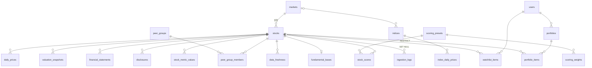

# 08. 최종 결과보고서

> StockMind — 국내·미국 주식 데이터 백엔드와 분석 대시보드 (1차 세미프로젝트)
> - 수치는 실제 실행 결과다. DB 행 수·EXPLAIN·테스트·API 개수·코드 규모는 2026-10-22 기준이다.
> - 상세 근거는 각 절에 적은 문서·파일을 따른다.
> - 구성도·요청 흐름은 [architecture.md](architecture.md), 실행·점검 방법은 [operations_guide.md](operations_guide.md), 대표 장애 사례는 [troubleshooting.md](troubleshooting.md)에 있다.
> - 서비스: https://stockmind-538269380647.asia-northeast3.run.app (Cloud Run)

## 1. 프로젝트 개요
국내(KOSPI·KOSDAQ)·미국(NASDAQ·NYSE) 주식의 일봉·지수·환율·밸류에이션·재무·공시를 수집·전처리해 PostgreSQL에 정규화된 구조로 적재한다.
- SQL VIEW·윈도우 함수로 분석 지표를 계산한다.
- 매력도 점수(다중 팩터: 로버스트 Z·섹터 중립화·투자 성향 프리셋·100·Φ)를 계산한다.
- FastAPI로 제공한다.

바닐라 HTML/CSS/JS 대시보드에서 다음을 쓸 수 있다.
- 지수·섹터 히트맵·시장 심리 지수·관심종목·시장 주목 종목
- 주식 리스트와 종목 분석·경쟁 비교
- 시드 안에서 종목을 담아 보는 원화 통합 모의 포트폴리오

| 항목 | 내용 |
|---|---|
| 데이터 | 노출 25종목 + 매력도 비교군 121종목(일봉 45,126행), 검색용 상장 종목 목록 8,155개, 지수 10종(4,538행), USD/KRW 일별 2년, 재무 FY 20,896행, 공시 1,361건 |
| DB | PostgreSQL 16 — 테이블 25 · VIEW 3 · 보조 인덱스 10 · 부분 UNIQUE 인덱스 1 · 트리거 3 · 생성 컬럼 1 · 마이그레이션 10 |
| API | FastAPI — `/api/v1` 아래 34개 경로 · 41개 오퍼레이션 + 헬스체크 `/health`·`/health/db` (총 36개 경로 · 43개 오퍼레이션, `/openapi.json` 집계, Swagger `/docs`) |
| 화면 | 대시보드 홈 · 주식 리스트 · 종목 상세 · 모의 포트폴리오 · 설정 (빌드 없는 ES Modules, Chart.js CDN, 라이트 기본/다크) |
| 테스트 | pytest 316개 함수 / 507개 케이스 전부 통과(57초, 외부 호출 없음) |
| 코드 규모 | Python 8,622줄 · SQL 1,729줄 · 프론트(HTML/CSS/JS) 4,270줄 · 테스트 5,410줄 (저장소 추적 파일 `wc -l` — Python `backend/app/`, SQL `backend/app/queries`·`backend/db/`, 프론트 `frontend/`, 테스트 `backend/tests/`) |
| 배포 | Google Cloud Run(컨테이너) + Supabase PostgreSQL, 브라우저별 게스트 세션 |

## 2. 문제 정의
| # | 문제 | 해결 |
|---|---|---|
| P1 | 시세·재무·공시가 출처마다 형식·통화·시간대·회계기준이 다름 | Provider 인터페이스 뒤에서 수집하고, 전처리 후 정규화 스키마로 통합(시장 단위 속성 분리) |
| P2 | 수익률·변동성·MDD 같은 파생 지표를 매번 손으로 계산 | `v_stock_metrics` VIEW 하나로 일관되게 계산, 데이터가 부족하면 NULL |
| P3 | 국내·해외 경쟁 종목을 같은 기준으로 비교하기 어려움 | 경쟁 그룹(N:M) + RANK/AVG OVER 비교표 + 기준일=100 환산 차트 + 원화 환산 시총 |
| P4 | 시드 배분·환율 영향을 엑셀로 계산 | 담은 시점 가격·환율을 고정 저장하는 장바구니형 모의 포트폴리오, 가격 효과/환율 효과 분리 |
| P5 | 비공식 라이브러리·외부 API의 호출 비용과 차단 위험 | 작업 종류별 TTL(주가·지수·환율 1시간, 그 밖 4시간)에 1회, advisory lock으로 동시 중복 호출 방지, 실패 시 마지막 값, 데이터 종류별 유효기간 |

## 3. 요구사항 (`02_요구사항_정의서.md`)
- 요구사항은 96개다(필수 86·선택 10). **필수는 전부 구현·검증했다.**
- 선택 중 아직 구현하지 않은 것은 3개다: 분기 재무(DATA-12), 투자 스타일 체크리스트(STK-11), 시나리오 API(PF-13).
- 관심종목 정렬 변경(WL-03)은 API만 구현했다.
- 로그인(USR-03)은 2차 범위다.
- CRUD는 Swagger와 화면 양쪽에서 동작한다.
  - 관심종목: `POST·GET·PATCH·PUT·DELETE /watchlist`
  - 모의 포트폴리오: `/portfolios`, `/portfolios/{id}/items`, `/summary`, `/preview/equal-weight`

## 4. 활용 데이터 (`03_데이터_조사_정의서.md`)
| 데이터 | 국내 | 미국 | 적재 범위 |
|---|---|---|---|
| 일봉(수정주가) | pykrx (대체: KIS·yfinance) | yfinance(묶음 다운로드) | 노출 2년 · 비교군 약 400일 |
| 지수 | pykrx KOSPI·KOSDAQ·KOSPI 200 (대체: KIS·yfinance) | yfinance ^GSPC·^IXIC·^DJI·^NDX·^RUT·^SOX·^VIX | 10종, 2년 |
| USD/KRW | yfinance `KRW=X` | (동일) | DAILY 2년 + SNAPSHOT(조회·갱신 시) |
| 시총·PER·PBR·EPS·BPS·DPS | pykrx 일별 (대체: KIS·DART 파생) | SEC 기초값(발행주식수·배당) × 최신 종가 | 노출·비교군 |
| 재무 FY | OpenDART 연결(CFS) + 대량 파일 | SEC companyfacts + 대량 파일 (+ yfinance 보완) | 노출 5개년 · 비교군·상장 목록은 백그라운드 |
| 공시 1년 | OpenDART(지분공시 제외) | SEC submissions(Form 4 제외) | 노출 최근 1년 · 그 밖은 상세 요청 시 |
| 섹터 등락률 | KRX 코스피 200 섹터 지수 11개 | 섹터 SPDR ETF 11개 | 30일 보관 |
| 상장 종목 목록 | KRX 코스피·코스닥 보통주 | NASDAQ·NYSE 보통주 | 이름·티커만, 하루 1회 |

- 1단계 smoke test에서 pykrx 1.2.x가 KRX 로그인 없이는 시총·펀더멘털·지수를 돌려주지 않는다는 것을 확인했다(`smoke_test_result.md`).
  - KRX 계정 로그인으로 해결했다.
  - 국내 소스는 환경변수 `PRICE_SOURCE_KR`로 `pykrx`·`kis`·`yfinance` 중에서 바꿀 수 있다.
- 배포 후 Cloud Run에서 KRX 로그인이 거부되는 일이 생겼다. 그래서 한국투자증권 Open API(KIS)를 대체 소스로 추가했다(troubleshooting 2).
- 데이터 이용 조건: pykrx·yfinance는 비공식 라이브러리이며, 원 사이트(KRX·Yahoo) 약관을 따른다. 저장소에는 소량 샘플(`backend/sample_data/`)만 커밋한다.

## 5. 데이터 전처리
| 규칙 | 구현 | 결과 |
|---|---|---|
| 수정주가 통일 | pykrx `adjusted=True`, yfinance `auto_adjust=True`, 대량 수집 시 수정주가 변경 감지 → 다시 받기 | 전 종목 수정주가 (ING-18) |
| 시장 현지 날짜 | tz-aware 인덱스를 시장 시간대로 변환 후 date. 장 마감 전에는 일봉·지수를 전날까지만 요청 | KR 15:30·US 16:00 기준 |
| 결측·이상 행 격리 | 종가 결측·OHLCV 결측·가격 0 이하·고가<저가·음수 거래량·환율 튐(주변 중앙값 대비 5%)은 버리지 않고 `backend/data/quarantine/*.csv` + `ingestion_logs`에 사유를 남김 | ING-01·ING-03 |
| 중복 제거·재실행 안전 | 키 기준 중복 제거 + `INSERT … ON CONFLICT DO UPDATE` | 재실행해도 행 수 불변 (ING-06·07) |
| 실패 격리 | 종목·지수 단위로 `ingestion_logs` 기록, 지수 백오프 3회 재시도. 한 종목 실패가 전체를 멈추지 않음 | ING-08 |
| DART 계정 차이 | account_id 후보 → 계정명 후보 → 다음 해 보고서의 전기값 | 카카오 "영업수익", POSCO홀딩스 "매출액" 등 대체 추출 기록 |
| SEC 보완 | 10-K FY(기간 350~380일), 결산일별 최신 제출값, 빈 값은 같은 결산기 yfinance로 | 남은 NULL은 추정하지 않음 |
| 데이터 유효기간 | 재무는 공시 일정 기반 + 90일 상한(사업보고서·10-K 공시 시 즉시 만료), 공시 1일. 종목마다 만료 시각을 어긋나게 | FR 테스트 |

## 6. 도메인 모델 (`04_도메인_모델_정의서.md`)
요구사항 서술에서 명사를 뽑아 Entity 24개를 정했다.
- 시장·종목·경쟁 그룹·일봉·밸류에이션·재무·공시·지수·지수 일봉·환율
- 사용자·관심종목·포트폴리오·담은 종목
- 프리셋·가중치·지표 값·매력도 점수
- 적재 로그·유효기간·미국 기초값·수집 기준점·섹터 등락률·시장 심리 지수

N:M 관계 2개(종목↔경쟁 그룹, 사용자↔종목)는 교차 테이블로 만들었다. 그래서 테이블은 25개다.

파생값의 처리 위치는 이렇게 나눴다.
- 수익률·변동성 등: VIEW
- 원가: 생성 컬럼
- 평가손익: 서비스 계산
- 매력도·시장 심리: 다시 만들 수 있는 파생 테이블

## 7. ERD (`05_ERD_및_DB설계서.md` 1절)

FK가 없는 독립 테이블은 4개다.
- `fx_rates`: 담은 시점 환율은 `portfolio_items`에 복사한다.
- `sector_performance_daily`·`market_sentiment_daily`: 홈 위젯용이다.
- `ingest_cursor`: 수집 기준점이다.

## 8. DB 구현 (`backend/db/*.sql`, `05_ERD_및_DB설계서.md`)
- **정규화**
  - 통화·국가·시간대를 `markets`로 분리했다(이행적 종속 제거, 3NF).
  - 종목↔경쟁 그룹, 사용자↔종목은 교차 테이블(N:M)이다.
  - 유효기간·미국 기초값은 종류·국가별로 다른 테이블로 나눴다(05 4-4).
  - 파생 지표는 VIEW로 계산한다.
- **의도적 비정규화 3건**
  1. `portfolio_items.ref_price·ref_fx_rate·ref_date` — 담은 시점의 변하지 않는 사실이다. 시세 보정이나 환율 갱신이 원가를 거슬러 바꾸면 안 된다.
  2. `stock_metric_values`·`stock_scores` — 국가별 중앙값·MAD·그룹 평균·재표준화를 조회할 때마다 계산하지 않으려고 저장한다. 점수의 근거(지표 원값·Z)를 설명하는 데도 쓴다. 다시 만들 수 있는 파생 테이블이다.
  3. `market_sentiment_daily` — 지수 2년치로 계산하는 값을 거래일별로 저장한다. `formula_version`이 바뀌면 다시 계산한다.
- **제약조건**
  - PK·FK(CASCADE/RESTRICT/SET NULL)·UNIQUE·CHECK를 걸었다. CHECK 예: 가격>0, 고가≥저가, 수량>0, 시드>0, 점수 0~100, 값 목록.
  - 생성 컬럼 `cost_krw = quantity × ref_price × ref_fx_rate`, `updated_at` 트리거 3개를 둔다.
  - 위반 47종이 모두 거부된다(DB-03).
  - 종목당 주 경쟁 그룹 1개는 부분 UNIQUE 인덱스로 막는다.
  - 프리셋 가중치 합 = 1은 행 간 제약이라 적재할 때 검증한다.
- **행 간 제약** "원가 합계 ≤ 시드"는 CHECK로 걸 수 없다. 그래서 서비스에서 한 트랜잭션 + `SELECT … FOR UPDATE`로 막는다. 동시 담기 테스트(PF-12)가 이 잠금을 검증한다.
- **인덱스와 EXPLAIN** (2026-10-22, 7회 중앙값, `explain_result.md`):

| 쿼리 | 인덱스 | 행 수 | 인덱스 전 계획 | 전(ms) | 인덱스 후 계획 | 후(ms) |
|---|---|---|---|---|---|---|
| 종목별 최근 공시 5건 | `ix_disclosures_stock_filed` | 1,361 | Seq Scan | 0.082 | Index Scan | 0.013 |
| 특정 거래일의 전 종목 시세 | `ix_daily_prices_trade_date` | 45,126 | Seq Scan | 1.332 | Bitmap Index Scan | 0.032 |
| 종목별 최신 FY 재무 5건 | `ix_fin_stock_type_end` | 20,896 | Index Scan Backward (UNIQUE) | 0.012 | Index Scan | 0.013 |
| 종목별 최신 밸류에이션 1행(만들지 않은 인덱스 확인) | `ix_valuation_stock_asof` | 4,580 | Index Scan Backward (PK) | 0.006 | Index Scan | 0.014 |

  - 날짜 인덱스는 일봉이 10,849행일 때 약 15배였고, 45,126행이 된 지금은 약 42배 빠르다. 데이터가 늘수록 효과가 커진다.
  - 재무 인덱스는 지금 FY만 있어서 UNIQUE 인덱스와 차이가 없다. 분기 재무를 대비해 유지한다.
  - `valuation_snapshots(stock_id, as_of DESC)`는 PK 역방향 스캔과 겹친다. 오히려 느려져서 만들지 않았다.

## 9. FastAPI 구현 (`backend/app/`)
| 계층 | 위치 | 역할 |
|---|---|---|
| 라우터 | `backend/app/api/` market · home · stocks · watchlist · portfolios · analysis · health | 요청 검증(Pydantic v2), 응답 스키마(Swagger 문서), 요청 사용자 의존성 |
| 서비스 | `backend/app/services/` fx · refresh · scheduler · portfolio · scoring · reference_score · hydration · freshness · data_quality · home_ranking · sectors · sentiment · market_condition · market_calendar · guest | TTL·advisory lock, 포트폴리오 계산(Decimal), 점수 재생성, 상세 수집 예약, 대시보드 위젯, 시장·섹터 점수, 게스트 세션 |
| SQL | `backend/app/queries/*.sql` 30개 (+ `backend/db/views.sql`) | 조회·분석 쿼리 원문을 `text()`로 실행 |
| 모델 | `backend/app/models/` | schema.sql과 1:1 ORM (테이블 25개, 차이 0건 — DB-01) |
| 수집 | `backend/app/providers/`, `backend/app/ingest/` | Provider 인터페이스 + pykrx·KIS·yfinance·DART·SEC 구현, 대량 수집·백그라운드 적재, 적재 CLI(`python -m app.ingest`) |
| 공통 | `backend/app/core/` | 설정, DB 세션(연결 제한 10초, 커넥션 풀 5+3), 오류 형식 `{"error": {code, message, detail}}`·에러 코드 26종(06 5절), 요청 ID 로깅(500 포함) |

- **갱신 정책**
  - 작업 종류별로 마지막 작업 단위 성공 시각이 TTL 안이면 `SKIPPED`로 기록한다.
  - TTL은 주가·지수·환율 1시간, 밸류에이션·섹터·점수 4시간이다.
  - TTL 안에서 연속 호출하면 외부 호출은 0회다. TTL이 지나면 작업마다 정확히 1회만 부른다. 동시 요청도 한 번만 실행한다(RF).
  - 일부 종목만 실패하면 30분 뒤 실패한 종목만 다시 받는다.
  - 서버가 떠 있는 동안 앱 안 스케줄러가 5분마다 할 일을 확인한다. 시세 갱신은 위 TTL로, 비교군은 매일 07:00 KST, 백그라운드 재무는 매일 08:00 KST 이후 1회 돌린다.
- **입력·오류**
  - 경로·쿼리·본문의 형식·범위를 DB 컬럼에 맞춰 422로 먼저 거부한다.
  - 처리하지 못한 예외는 내부 정보 없는 500 + 요청 ID로 응답한다(ERR).
  - 헬스체크는 `/health`·`/health/db` 두 개다(HL).
- **환율**: 최신 SNAPSHOT이 TTL 안이면 DB 값을 쓴다. 지났으면 advisory lock 안에서 한 번 조회한다. 실패하면 마지막 값 + `fx_stale`을 돌려준다.
- **포트폴리오**
  - 수량/금액/비중 모드를 서버가 정수 수량으로 바꾼다.
  - 시드를 넘으면 409(잔여·최대 수량 안내), 수량이 0이면 422(최소 금액), 같은 종목이면 409(수정 안내)다.
  - 요약에는 시장·그룹 비중, 가중 매력도, 평가손익과 **가격 효과 + 환율 효과 분리**가 들어간다.
- **사용자**
  - 요청 사용자는 `get_current_user_id()`가 정한다. 로컬은 demo, 배포는 서명된 쿠키로 나눈 브라우저별 게스트다.
  - 남의 리소스는 404로 숨긴다(USR).

## 10. 프론트엔드 구현 (`frontend/`)
- **디자인 시스템**(`frontend/css/tokens.css`)
  - 라이트 모드(흰 바탕 + 코발트 블루)가 기본이고, 설정 화면에서 다크로 바꿀 수 있다.
  - 색·간격·라운드는 CSS 변수 한 곳에서 관리한다.
  - 등락은 색 + ▲▼로 표시한다. 시장과 관계없이 상승은 빨강, 하락은 파랑이며 `--up`·`--down`에서 관리한다.
- **화면 구성**
  - 홈: 상단 검색·투자 성향, 지수·환율 카드(52주 위치·장 상태), 관심종목(컴팩트/카드), 섹터 히트맵, 시장 심리 지수, 시장 주목 종목 카드 4장, 포트폴리오 도넛
  - 리스트: 146종목, 25개씩 페이지, 업종 섹터 필터
  - 상세: 투자 매력도 게이지·레이더·시장·섹터 점수, 접는 상세 영역
  - 포트폴리오: 담기 패널·균등 배분 미리보기
- **상태**: 모든 영역에 로딩 스켈레톤·빈 상태·오류 상태(다시 시도)가 있다. 숫자 포맷은 `format.js` 한 곳에서 한다(억·조, 달러, 부호, 퍼센트).
- **접근성**: 탭은 `role=tab`·`aria-selected`·화살표 키, 버튼은 `aria-label`, 모달은 포커스 순환·ESC, 차트는 `role=img` + `aria-label`을 쓴다. 768px 미만에서는 사이드바가 하단 탭 바로 바뀐다.

## 11. 주요 SQL
### 11-1. `v_stock_metrics` — 기간 지표 (CTE + 윈도우 함수)
> 주요 CTE 발췌(앞부분). 재무 CTE는 11-2, 최종 SELECT를 포함한 전체 정의는 [`backend/db/views.sql`](../backend/db/views.sql)의 `v_stock_metrics`.

최근 N거래일은 `ROW_NUMBER`, 일수익률은 `LAG`, MDD는 누적 `MAX() OVER (ROWS UNBOUNDED PRECEDING)`, 변동성은 `STDDEV_SAMP × √252`. 기간이 다 차지 않으면 `CASE`로 NULL을 돌려준다.
```sql
WITH latest AS (                      -- 기준: 종목별 최신 거래일
    SELECT lp.stock_id, lp.market, lp.country, lp.currency,
           lp.trade_date AS as_of, lp.close, lp.change_rate, lp.volume
    FROM v_latest_price lp
),
recent AS (                           -- 최신일부터 거꾸로 거래일 번호(rn=1이 최신)
    SELECT d.stock_id, d.trade_date, d.close, d.volume,
           ROW_NUMBER() OVER (PARTITION BY d.stock_id ORDER BY d.trade_date DESC) AS rn
    FROM daily_prices d
),
daily_ret AS (                        -- 최근 253개 종가 → 252개 일수익률
    SELECT r.stock_id, r.rn, r.trade_date, r.close,
           r.close / NULLIF(LAG(r.close) OVER (PARTITION BY r.stock_id ORDER BY r.trade_date), 0) - 1 AS ret
    FROM recent r
    WHERE r.rn <= 253
),
risk AS (                             -- 연환산 변동성: 252개 일수익률이 모두 있을 때만
    SELECT dr.stock_id,
           CASE WHEN COUNT(dr.ret) = 252
                THEN STDDEV_SAMP(dr.ret) * SQRT(252::numeric) END AS volatility_1y
    FROM daily_ret dr
    GROUP BY dr.stock_id
),
drawdown AS (                         -- 최근 252거래일 누적 고점 대비 낙폭
    SELECT r.stock_id, r.rn,
           r.close / MAX(r.close) OVER (PARTITION BY r.stock_id ORDER BY r.trade_date
                                        ROWS UNBOUNDED PRECEDING) - 1 AS dd
    FROM recent r
    WHERE r.rn <= 252
),
mdd AS (
    SELECT dd.stock_id,
           CASE WHEN COUNT(*) = 252 THEN MIN(dd.dd) END AS max_drawdown_1y
    FROM drawdown dd
    GROUP BY dd.stock_id
),
ma AS (                               -- 이동평균: 해당 기간 거래일 수가 다 찼을 때만
    SELECT r.stock_id,
           CASE WHEN COUNT(*) FILTER (WHERE r.rn <= 20)  = 20  THEN AVG(r.close) FILTER (WHERE r.rn <= 20)  END AS ma20,
           CASE WHEN COUNT(*) FILTER (WHERE r.rn <= 60)  = 60  THEN AVG(r.close) FILTER (WHERE r.rn <= 60)  END AS ma60,
           CASE WHEN COUNT(*) FILTER (WHERE r.rn <= 120) = 120 THEN AVG(r.close) FILTER (WHERE r.rn <= 120) END AS ma120,
           -- 거래량 기준: 최신일을 제외한 직전 20거래일 평균
           CASE WHEN COUNT(*) FILTER (WHERE r.rn BETWEEN 2 AND 21) = 20
                THEN AVG(r.volume) FILTER (WHERE r.rn BETWEEN 2 AND 21) END AS avg_volume_20d
    FROM recent r
    WHERE r.rn <= 120
    GROUP BY r.stock_id
),
range_52w AS (                        -- 52주(기준일로부터 1년) 고가·저가 (일중 고가·저가 기준)
    SELECT l.stock_id,
           MAX(d.high) AS high_52w,
           MIN(d.low)  AS low_52w
    FROM latest l
    JOIN daily_prices d
      ON d.stock_id = l.stock_id
     AND d.trade_date >  (l.as_of - INTERVAL '1 year')::date
     AND d.trade_date <= l.as_of
    GROUP BY l.stock_id
),
-- … fy·fin CTE(11-2) 다음 최종 SELECT: 기간 수익률(1주~1년 전 가장 가까운 거래일 종가, LEFT JOIN LATERAL),
--     변동성·MDD·이동평균·52주 범위(1년치가 있을 때만)·거래량 비율, 최신 밸류에이션·환율(원화 시총)·최신 FY 재무를 결합
```
### 11-2. `v_stock_metrics` — 재무 지표 (직전 FY는 결산일 간격으로 확인)
> 같은 VIEW의 재무 CTE 발췌. 전체 정의는 [`backend/db/views.sql`](../backend/db/views.sql).

```sql
fy AS (                               -- FY 재무 + 직전 FY (결산일 간격이 약 1년일 때만 직전 FY로 인정)
    SELECT f.stock_id, f.period_end, f.revenue, f.operating_income, f.net_income,
           f.total_equity, f.total_debt, f.accounting_std,
           LAG(f.period_end)       OVER w AS prev_end,
           LAG(f.revenue)          OVER w AS prev_revenue,
           LAG(f.operating_income) OVER w AS prev_operating_income,
           ROW_NUMBER() OVER (PARTITION BY f.stock_id ORDER BY f.period_end DESC) AS rn
    FROM financial_statements f
    WHERE f.period_type = 'FY'
    WINDOW w AS (PARTITION BY f.stock_id ORDER BY f.period_end)
),
fin AS (
    SELECT fy.stock_id, fy.period_end AS fin_period_end, fy.accounting_std,
           fy.operating_income / NULLIF(fy.revenue, 0)       AS operating_margin,
           CASE WHEN fy.total_equity > 0 THEN fy.net_income / fy.total_equity END AS roe,
           fy.total_debt / NULLIF(fy.total_equity, 0)        AS debt_ratio,
           CASE WHEN fy.prev_end BETWEEN fy.period_end - 400 AND fy.period_end - 330
                THEN (fy.revenue - fy.prev_revenue) / NULLIF(ABS(fy.prev_revenue), 0) END AS revenue_yoy,
           CASE WHEN fy.prev_end BETWEEN fy.period_end - 400 AND fy.period_end - 330
                THEN (fy.operating_income - fy.prev_operating_income)
                     / NULLIF(ABS(fy.prev_operating_income), 0) END AS operating_income_yoy
    FROM fy
    WHERE fy.rn = 1
)
```
### 11-3. 매력도 점수 — 국가 내 로버스트 Z → 섹터 중립화 → 프리셋 가중 평균 → 100·Φ (`backend/app/queries/score_*.sql`, 09_매력도_점수_정의서.md)
지표 9종을 같은 시장 안에서 중앙값·MAD로 표준화하고(표본 < 5나 MAD = 0이면 평균·표준편차), 방향 반영 후 ±3으로 자른다.
```sql
WITH v AS (
    SELECT mv.stock_id, mv.metric, mv.raw_value, mk.country
    FROM stock_metric_values mv
    JOIN stocks s   ON s.stock_id = mv.stock_id
    JOIN markets mk ON mk.market_id = s.market_id
    WHERE mv.as_of = :as_of AND mv.raw_value IS NOT NULL AND mv.z_raw IS NULL
),
med AS (                              -- 국가·지표별 중앙값과 평균·표준편차
    SELECT v.country, v.metric, COUNT(*) AS n,
           PERCENTILE_CONT(0.5) WITHIN GROUP (ORDER BY v.raw_value) AS m,
           AVG(v.raw_value)         AS mean,
           STDDEV_SAMP(v.raw_value) AS sd
    FROM v
    GROUP BY v.country, v.metric
),
mad AS (                              -- MAD = 중앙값으로부터의 절대 편차의 중앙값
    SELECT v.country, v.metric,
           PERCENTILE_CONT(0.5) WITHIN GROUP (ORDER BY ABS(v.raw_value - med.m)) AS mad
    FROM v
    JOIN med ON med.country = v.country AND med.metric = v.metric
    GROUP BY v.country, v.metric
),
z AS (
    SELECT v.stock_id, v.metric,
           CASE WHEN med.n >= 5 AND mad.mad > 0 THEN (v.raw_value - med.m) / (1.4826 * mad.mad)
                WHEN med.sd > 0                 THEN CAST((v.raw_value - med.mean) / med.sd AS double precision)
                ELSE 0 END AS z
    FROM v
    JOIN med ON med.country = v.country AND med.metric = v.metric
    JOIN mad ON mad.country = v.country AND mad.metric = v.metric
)
UPDATE stock_metric_values t
SET z_raw = LEAST(3, GREATEST(-3, CASE WHEN t.metric = ANY(CAST(:negatives AS text[])) THEN -z.z ELSE z.z END))
FROM z
WHERE t.as_of = :as_of AND t.stock_id = z.stock_id AND t.metric = z.metric
```
주 그룹 평균을 n/(n+k)로 축소해 뺀 z_adj의 팩터 평균을 프리셋 가중치로 합산하고(유효 팩터 3개 이상, 재정규화), 같은 시장 안에서 다시 표준화해 erf로 0~100으로 바꾼다. Min-Max를 쓰지 않아 종목이 추가돼도 기존 점수가 0·100으로 재배치되지 않는다. 안정성 팩터(1년 최대 낙폭·변동성)는 업종과 관계없는 위험이라 섹터 중립화하지 않는다(2026-10-19, `score_neutralize.sql`의 `factor = 'safety'` 조건).
```sql
comp AS (
    SELECT wide.*, CASE WHEN wide.coverage >= 3 THEN wide.weighted END AS composite
    FROM wide
),
zc AS (                               -- 국가·프리셋 안에서 종합 점수를 다시 표준화 (NULL은 통계에서 제외)
    SELECT comp.*,
           AVG(comp.composite)         OVER (PARTITION BY comp.preset_id, comp.country) AS c_mean,
           STDDEV_SAMP(comp.composite) OVER (PARTITION BY comp.preset_id, comp.country) AS c_sd
    FROM comp
)
SELECT zc.stock_id, zc.preset_id, zc.country, zc.coverage AS factor_coverage,
       ROUND(zc.value_score, 4)    AS value_score,
       ROUND(zc.quality_score, 4)  AS quality_score,
       ROUND(zc.growth_score, 4)   AS growth_score,
       ROUND(zc.safety_score, 4)   AS safety_score,
       ROUND(zc.momentum_score, 4) AS momentum_score,
       ROUND(zc.composite, 4)      AS composite,
       CASE WHEN zc.composite IS NOT NULL THEN
         ROUND(CAST(100 * 0.5 * (1 + erf(CAST(CASE WHEN zc.c_sd > 0 THEN (zc.composite - zc.c_mean) / zc.c_sd ELSE 0 END
                                             AS double precision) / sqrt(2::double precision))) AS numeric), 2)
       END AS score
FROM zc
```
### 11-4. 경쟁 비교 — 그룹 내 RANK와 그룹 평균 (`backend/app/queries/peers.sql`)
```sql
SELECT b.*,
       CASE WHEN b.return_1m IS NOT NULL THEN RANK() OVER (PARTITION BY b.group_id, b.return_1m IS NULL ORDER BY b.return_1m DESC) END AS return_1m_rank,
       CASE WHEN b.return_3m IS NOT NULL THEN RANK() OVER (PARTITION BY b.group_id, b.return_3m IS NULL ORDER BY b.return_3m DESC) END AS return_3m_rank,
       CASE WHEN b.return_1y IS NOT NULL THEN RANK() OVER (PARTITION BY b.group_id, b.return_1y IS NULL ORDER BY b.return_1y DESC) END AS return_1y_rank,
       CASE WHEN b.per IS NOT NULL THEN RANK() OVER (PARTITION BY b.group_id, b.per IS NULL ORDER BY b.per ASC) END AS per_rank,
       CASE WHEN b.pbr IS NOT NULL THEN RANK() OVER (PARTITION BY b.group_id, b.pbr IS NULL ORDER BY b.pbr ASC) END AS pbr_rank,
       CASE WHEN b.roe IS NOT NULL THEN RANK() OVER (PARTITION BY b.group_id, b.roe IS NULL ORDER BY b.roe DESC) END AS roe_rank,
       CASE WHEN b.operating_margin IS NOT NULL THEN RANK() OVER (PARTITION BY b.group_id, b.operating_margin IS NULL ORDER BY b.operating_margin DESC) END AS operating_margin_rank,
       CASE WHEN b.revenue_yoy IS NOT NULL THEN RANK() OVER (PARTITION BY b.group_id, b.revenue_yoy IS NULL ORDER BY b.revenue_yoy DESC) END AS revenue_yoy_rank,
       CASE WHEN b.market_cap_krw IS NOT NULL THEN RANK() OVER (PARTITION BY b.group_id, b.market_cap_krw IS NULL ORDER BY b.market_cap_krw DESC) END AS market_cap_krw_rank,
       CASE WHEN b.score IS NOT NULL THEN RANK() OVER (PARTITION BY b.group_id, b.score IS NULL ORDER BY b.score DESC) END AS score_rank,
       -- 그룹 평균 (AVG는 NULL을 제외하고 계산)
       ROUND(AVG(b.return_1m) OVER g, 6)        AS return_1m_avg,
       ROUND(AVG(b.return_3m) OVER g, 6)        AS return_3m_avg,
       ROUND(AVG(b.return_1y) OVER g, 6)        AS return_1y_avg,
       ROUND(AVG(b.per) OVER g, 4)              AS per_avg,
       ROUND(AVG(b.pbr) OVER g, 4)              AS pbr_avg,
       ROUND(AVG(b.roe) OVER g, 6)              AS roe_avg,
       ROUND(AVG(b.operating_margin) OVER g, 6) AS operating_margin_avg,
       ROUND(AVG(b.revenue_yoy) OVER g, 6)      AS revenue_yoy_avg,
       ROUND(AVG(b.market_cap_krw) OVER g, 0)   AS market_cap_krw_avg,
       ROUND(AVG(b.score) OVER g, 2)            AS score_avg
FROM base b
WINDOW g AS (PARTITION BY b.group_id)
```
### 11-5. 시장별 밸류에이션 — GROUP BY + HAVING (`backend/app/queries/stats_market_valuation.sql`)
```sql
SELECT mk.code AS market, mk.country, mk.currency,
       COUNT(*)                                                AS stocks,
       COUNT(vm.per) FILTER (WHERE vm.per > 0)                 AS per_samples,
       ROUND(AVG(vm.per) FILTER (WHERE vm.per > 0), 2)         AS avg_per,
       ROUND(MIN(vm.per) FILTER (WHERE vm.per > 0), 2)         AS min_per,
       ROUND(MAX(vm.per) FILTER (WHERE vm.per > 0), 2)         AS max_per,
       ROUND(AVG(vm.pbr) FILTER (WHERE vm.pbr > 0), 2)         AS avg_pbr,
       ROUND(AVG(vm.roe), 4)                                   AS avg_roe,
       ROUND(SUM(vm.market_cap_krw), 0)                        AS total_market_cap_krw
FROM v_stock_metrics vm
JOIN stocks s   ON s.stock_id = vm.stock_id
JOIN markets mk ON mk.market_id = s.market_id
WHERE s.is_active
GROUP BY mk.code, mk.country, mk.currency
HAVING COUNT(*) >= :min_samples
ORDER BY total_market_cap_krw DESC NULLS LAST
```
SQL 요소(SELECT·WHERE·JOIN·GROUP BY·HAVING·ORDER BY·AVG·SUM·COUNT·MAX·MIN·윈도우 함수·CTE) 사용 현황은 `05_ERD_및_DB설계서.md` 9절 표 참고(누락 없음).

## 12. 실행 결과
- **배포 서비스**: https://stockmind-538269380647.asia-northeast3.run.app (README 맨 위 QR로 접속). Swagger는 같은 주소의 `/docs`다.
- **스크린샷**(`개발산출물/assets/screenshots/`):

| 파일 | 화면 |
|---|---|
| `home.png` | 대시보드 홈 — 상단 검색·투자 성향, 지수·USD/KRW 카드(52주 위치·장 상태), 관심종목, 섹터 히트맵, 시장 심리 지수, 시장 주목 종목, 포트폴리오 도넛 |
| `stocks.png` | 주식 리스트 — 시장 탭·정렬·업종 섹터 필터, ★·담기, 25개씩 페이지 |
| `stock_detail.png` | 종목 상세 — 가격 차트, 투자 매력도(게이지·레이더·요소별 카드), 핵심 정보, 접는 상세 영역 |
| `portfolio.png` | 모의 포트폴리오 — 요약, 담기 패널, 비중 차트, 담은 종목 |

- API 실제 응답 예시는 `06_기능_API_정의서.md` 3절에 있다. 적재 결과는 `05_ERD_및_DB설계서.md` 2절(테이블별 행 수)에 있다.

## 13. 테스트 결과 (`07_테스트_결과서.md`)
**507 passed / 0 failed** — 316개 함수, 57초. 별도 테스트 DB를 쓰고, 외부 호출 없이 호출 횟수를 기록하는 가짜 provider를 쓴다.

| 분류 | 핵심 검증 |
|---|---|
| DB | ORM↔DDL 차이 0(25개 테이블), 제약 위반 47종 거부, 생성 컬럼·트리거·삭제 규칙 |
| 수집 | upsert 재실행 시 행 수 불변, 한 종목 실패 격리, 이상 행 격리 사유, DART 계정 대체, SEC 보완, 수정주가 변경 감지, 장중에는 외부 호출 없음 |
| 대량 수집 | DART·SEC 대량 파일, 공시 기준점(`ingest_cursor`)은 모두 성공해야 이동, KIS 토큰 재사용·코드 매핑, 하루 호출 예산 |
| 갱신·환율 | TTL 안 외부 호출 0회, TTL이 지나면 작업별 1회, 1시간/4시간 TTL 구분, 실패 시 마지막 값 + stale, 동시 요청 1회 |
| 분석 SQL·통계 | v_stock_metrics 손계산 일치, 그룹 RANK·평균, HAVING 표본 조건, 월별 집계(date_trunc·FIRST/LAST_VALUE), TOP N 랭킹(동점·NULL 제외) |
| 매력도 | 로버스트 Z·±3 자르기·MAD 0 대체, 축소 추정, 재정규화·유효 팩터 3개 미만 NULL, Φ(0) = 50·Φ(1) = 84.13, 파이썬 기준 구현과 전 과정 일치, Min-Max 재배치 없음, 상장 목록 제외 |
| 시장·섹터 점수 | 0.7 × 시장 + 0.3 × 섹터, 표본 5개 미만이면 시장만, 오래된 심리 지수 제외, 오류가 나도 상세 응답 유지 |
| 포트폴리오 | 명세 시나리오 손계산, 시드 초과·축소 409, 수량 0 422, 동시 담기, 균등 배분 미리보기(저장 안 함) |
| 사용자·소유권 | 교차 접근 404 + 데이터 불변, 요청의 `user_id` 무시, 게스트 세션(첫 쓰기 때 demo 복사·브라우저 분리·옛 쿠키 무시) |
| 오류·입력 검증 | 에러 코드 재현, 경계값(최댓값 통과·+1 거부·0·음수), 500 정보 비노출·요청 ID |
| 헬스체크·데이터 품질 | DB 실패 503, 품질 집계·stale 경계(TTL×2) |
| 대시보드 홈 | 거래량 급증 배수·대상 집합, 저장 매력도 순위, 52주 범위, 휴장 달력, 심리 지수 경계·백필·버전 재계산, 섹터 묶음 호출 1회·마감 후 재호출 없음 |
| 통합 | 화면·정적 파일 제공, 프론트 import 경로, 화면 흐름 시나리오 |

## 14. 문제점 및 해결방법
| # | 문제 | 원인 | 해결 |
|---|---|---|---|
| 1 | pykrx 시총·펀더멘털·지수가 빈 결과 | pykrx 1.2.x가 KRX 로그인 요구, import 시점에 환경변수를 읽음 | KRX 계정 + `.env` 값을 import 전에 환경변수로 내보냄. yfinance 전환·DART 파생 폴백 유지 |
| 2 | SEC 403 | 연락처 없는 User-Agent는 일부 경로 차단 | API 키는 없고 이메일 포함 UA 필수임을 실측으로 확인해 설정 |
| 3 | DART 계정 ID가 회사·연도마다 다름 | 표준계정코드 미사용, 다른 계정 ID | account_id → 계정명 → 다음 해 전기값 순서의 매핑, 대체 내역 로그 |
| 4 | "최근 공시 5건"이 임원 지분 보고로 채워짐 | 삼성전자 1년 2,851건 중 2,730건이 지분공시 | DART 지분공시(D)·SEC Form 4 제외 |
| 5 | 증분 적재가 이전 봉을 다시 받음 / 당일 환율이 고정됨 | yfinance가 시작일 이전 마지막 봉 반환, 외환은 24시간 거래 | 요청 구간 밖 행 제거, 환율은 마지막 일자부터 다시 받아 upsert |
| 6 | SQL 실행 오류 | 주석 속 `%`·`:limit개`를 placeholder로 해석, `PERCENT_RANK`가 double이라 `ROUND(x, 2)` 불가 | SQL 파일은 파라미터 없이 실행, 주석 수정, `CAST(… AS numeric)` |
| 7 | 로컬 5432 포트 충돌 | 다른 프로젝트의 PostgreSQL 컨테이너 | 이 프로젝트 DB를 5433으로 |
| 8 | "다음 갱신 가능 시각"이 항상 지금 | 아직 실행할 수 없는 SCORES 작업이 최소값을 결정 | 실행 가능한 작업만 계산 |
| 9 | 503 응답 시 환율 실패 로그가 사라짐 | 같은 트랜잭션이 롤백 | 실패 로그를 별도 트랜잭션으로 기록 |
| 10 | 중복 인덱스 | PK 역방향 스캔과 기능 중복 | EXPLAIN 비교 후 삭제(측정은 임시 생성으로 재현 가능) |
| 11 | 화면: 열 어긋남·숨김 안내 노출·입력값 초기화 등 7건 | 행별 grid의 auto 열, `display`가 `hidden`보다 우선, 포커스 이동 시 change 재발생 | 고정 열 폭, `[hidden]` 우선 규칙, 같은 종목 재선택 무시 |
| 12 | 샘플 데이터로 재현 시 `seed-demo` 실패 | 데모 포트폴리오에 샘플에 없는 종목(AVGO 등) 포함 | 시세 없는 종목·빈 포트폴리오는 건너뛰고 보고(A-79), 깨끗한 DB에서 재현 절차 재검증 |
| 13 | `portfolio_id`만 알면 다른 사용자의 포트폴리오를 조회·수정·삭제 가능 | API가 클라이언트의 `user_id`를 그대로 신뢰하고, 포트폴리오 단건 조회에 소유자 조건이 없었음 | `user_id` 파라미터 제거 → `get_current_user_id()` 의존성(1차는 `DEFAULT_USER_ID`), 서비스가 요청 사용자 소유만 조회하고 남의 리소스는 404(A-57·A-82). 교차 접근 테스트로 재현 후 수정 |
| 14 | 국내 적자 기업의 E/P가 비어 매력도에서 빠짐 | KRX가 적자 기업 EPS를 제공하지 않음(LG에너지솔루션·삼성SDI·현대제철) | EPS가 없으면 FY 순이익 / 주식수로 대체해 적자가 E/P 하위로 가게 하고 `data_quality.notes`에 기록(A-85) |
| 15 | 일부 종목 변동성·모멘텀 계산 불가 | 샘플 데이터(6개월) 위에 증분 적재해 일봉이 122~128개뿐 | 해당 4종목 `prices --full` 재적재(A-95). 일봉 253개 미만이면 모멘텀은 6-1개월로 대체 |
| 16 | 어떤 성향을 골라도 Tesla 매력도가 2~3점 | 미국 비교 표본이 초대형 기술주 9개뿐이라 꼴찌가 0점 근처로 쏠림 + 섹터 중립화가 국가를 섞어 국내 자동차의 저평가 Z가 Tesla 평균에 들어감 | 그룹 평균을 같은 국가끼리로 변경, 국가별 섹터당 시가총액 상위 10개 비교군(121종목) 도입 → 28.69점(미국 76개 중 62위). 비교군은 평시 필수 데이터만 1일 갱신, 상세는 요청 시 수집, DART 분당 제한 보호, 앱 안 스케줄러 |
| 17 | `/portfolios/99999999999`가 500 INTERNAL_ERROR | 경로 id에 범위 검증이 없어 PostgreSQL INT 범위 오류가 그대로 서버 오류가 됨 | 경로·쿼리·본문 전체에 DB 컬럼 기준 상한(A-112) → 422. 경계값 테스트 |
| 18 | 500 응답에 `X-Request-ID`가 없고 스택 로그의 요청 ID가 `[-]` | FastAPI의 Exception 핸들러는 요청 ID 미들웨어 바깥에서 실행됨 | 미들웨어 안에서 예외를 잡아 요청 ID와 함께 기록·응답(A-) |
| 19 | 노출 종목 일봉이 4시간 동안 비고, 미국 종목이 매일 아침 FAILED | TTL을 종목 단위 성공으로 판단해 일부 성공·비교군 성공이 실패 종목 재시도를 막음 / 증분 끝 날짜를 한국 날짜로 계산해 열리지 않은 미국 날짜를 요청 | 작업 단위 기록(`REFRESH`)으로 TTL, 30분 뒤 실패 종목만 재시도, 시장 현지 날짜까지만 요청(A-) |
| 20 | 호스트에서 yfinance만 인증서 오류(curl 60), 하루 단위로 됐다 안 됐다 함 | 백신(Norton)의 HTTPS 검사가 Windows 프로세스의 TLS를 재서명, curl_cffi가 그 루트를 신뢰하지 않음 | DB·API를 모두 컨테이너로 실행(컨테이너 트래픽은 검사 대상 아님), 필요 시 추가 CA를 번들에 합치는 entrypoint(README 1절) |
| 21 | 새 SQL 파일이 `A value is required for bind parameter 'months개월'` | `text()`가 SQL 주석 안의 `:이름`까지 바인드 파라미터로 읽음(6번과 같은 계열) | 주석에서 콜론 표기 제거, SQL 파일 머리에 주의 문구 |
| 22 | 전체 테스트가 10분 넘게 멈춤 | 테스트에서 연 연결을 닫지 않아 열린 트랜잭션이 다음 테스트의 TRUNCATE 잠금을 막음 | `with engine.connect()`로 닫기, 테스트 실행에 시간 제한을 두고 남은 세션 확인 |
| 23 | 배포(Cloud Run) 후 국내 데이터 적재가 멈춤 | 인스턴스가 바뀐 뒤 KRX가 로그인을 거부(나가는 IP가 달라짐) | 실패 시 나가는 IP·KRX 응답을 한 번 기록해 원인을 확인하고, 국내 소스를 KIS(한국투자증권 Open API)로 바꿀 수 있게 함(`PRICE_SOURCE_KR=kis`, migration 010) — troubleshooting 2 |
| 24 | 배포 DB 연결이 한도를 넘어 거부됨 | 인스턴스·작업마다 SQLAlchemy 기본 풀이 열려 Supabase 세션 풀러 한도(15)를 넘음 | 커넥션 풀 5+3으로 제한, 배치 작업은 `DB_POOL_SIZE`/`DB_MAX_OVERFLOW`로 2+1 |
| 25 | 배포에서 처음 담기를 하면 `PORTFOLIO_NOT_FOUND` | 쿠키 없이 연 화면은 demo의 포트폴리오 ID를 들고 있다가, 첫 쓰기에서 게스트 복사본(새 ID)으로 바뀜 | 첫 쓰기 뒤 목록을 다시 받아 같은 이름의 포트폴리오로 갈아탐 |
| 26 | 주가 갱신을 1시간으로 줄이자 장중에도 KRX 로그인 호출이 반복됨 | 장중 당일 봉은 어차피 미확정이라 격리되는데도 매시간 요청 | 장 마감(서울 15:30·뉴욕 16:00) 전에는 일봉·지수를 전날까지만 요청 → 장중 갱신은 외부 호출 없이 끝남(ING 테스트 2건) |
| 27 | 상장 목록 종목의 참고 점수가 이상하고, 비교 표본에 상장 목록이 섞임 | `score_metrics.sql`이 `stock_id` 파라미터를 무시해 전체 종목 지표로 계산 | `stock_id`가 없으면 노출 + 비교군, 있으면 그 종목만(SC 테스트) |
| 28 | 분기로만 배당을 신고하는 미국 회사의 배당수익률이 비어 있음 | SEC에서 FY 배당 값이 없음 | FY 값이 없으면 최근 4개 분기 합을 연간 배당으로(FR 테스트) |

1번과 23번은 [troubleshooting.md](troubleshooting.md)에 발생·원인·해결·재발 방지 양식으로 정리했다(각각 트러블슈팅 1·2).

## 15. 회고
- **잘한 점**
  - 외부 데이터를 추측하지 않고, smoke test로 실제 응답을 확인한 뒤 구현했다. 그래서 pykrx 로그인·SEC UA·DART 계정 차이·공시 편중을 초기에 발견했다.
  - 분석 SQL을 손계산 테스트로 고정했다. VIEW를 고쳐도 회귀를 바로 확인할 수 있다.
  - 문서의 수치(행 수·EXPLAIN·API 예시·테스트 결과)를 실제 실행 결과로 만들었다. 2026-10-22에 코드 기준으로 다시 뽑아 문서와 코드를 맞췄다.
  - 4인 팀이 단계별(Stage 0~6)로 나눠 만들었다. DB·API 약속(계약)을 먼저 정하고 `check_contract.py`로 원본과 비교해, 통합할 때 이름이 어긋나지 않았다.
- **아쉬운 점**
  - 선택 기능 3개(분기 재무·투자 스타일 체크리스트·시나리오 API)를 하지 못했다.
  - KRX의 EPS 산정 기준을 확인하지 못해 DART 기반 값과 차이가 있다(A-38).
  - 비공식 라이브러리(pykrx·yfinance)에 기대는 부분이 커서, 배포 환경(IP 변경)에서 국내 수집이 멈추는 일을 겪었다. 공식 API(KIS)로 대체 경로를 두었지만 운영 전환은 아직이다.
  - 증분 적재는 과거 수정주가의 소급 조정을 대량 수집의 변경 감지로만 따라간다.
- **다음 단계(2·3차)**
  - React 전환과 로그인 도입: 요청 사용자를 정하는 `get_current_user_id()`만 JWT 검증으로 바꾸면 라우터·서비스·소유권 검사는 그대로 사용자별로 동작한다. 지금 게스트 세션도 같은 자리에서 바꿔 끼운 것이다.
  - 브라우저에 저장한 설정(테마·지표 선택)은 로그인 도입 후 사용자별 DB 저장으로 옮긴다.
  - `stock_scores.data_quality`와 분석 응답을 JSON 구조로 만들어 두었다. 3차(AI)의 종목 보고서 입력으로 그대로 쓸 수 있다. 1차에서는 LLM을 쓰지 않았다(과정 규격상 범위 밖).

## 16. 발표
발표는 끝났다. 발표 자료(`StockMind_발표자료.pptx`)는 용량 때문에 저장소에 올리지 않고 팀이 따로 보관한다.

시연을 다시 할 때의 순서는 아래와 같다. 실행·점검 방법은 `operations_guide.md`에 있다.

| 순서 | 내용 | 보여줄 것 |
|---|---|---|
| 1 | 문제와 목표 | 2절 표 |
| 2 | DB 설계: ERD, markets 분리(3NF), N:M 교차 테이블, 의도적 비정규화 3건, 생성 컬럼 | 05 ERD·4~5절 |
| 3 | SQL: v_stock_metrics(CTE·LAG·누적 MAX·STDDEV), 매력도(중앙값·MAD Z, 축소 추정, erf로 100·Φ), 경쟁 비교 RANK/AVG, HAVING, 인덱스 EXPLAIN 전후 | 11절, 8절 EXPLAIN 표 |
| 4 | 시연: 홈 → 주식 리스트 → 종목 상세(매력도·경쟁 비교) → ★ → 모의 포트폴리오 담기(시드 초과 409) | 배포 주소 또는 로컬 |
| 5 | 같은 API를 Swagger에서 호출 | `/docs` |
| 6 | 품질: 507개 테스트, 남은 한계와 다음 단계 | 07, 15절 |
