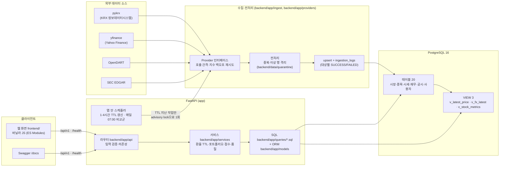
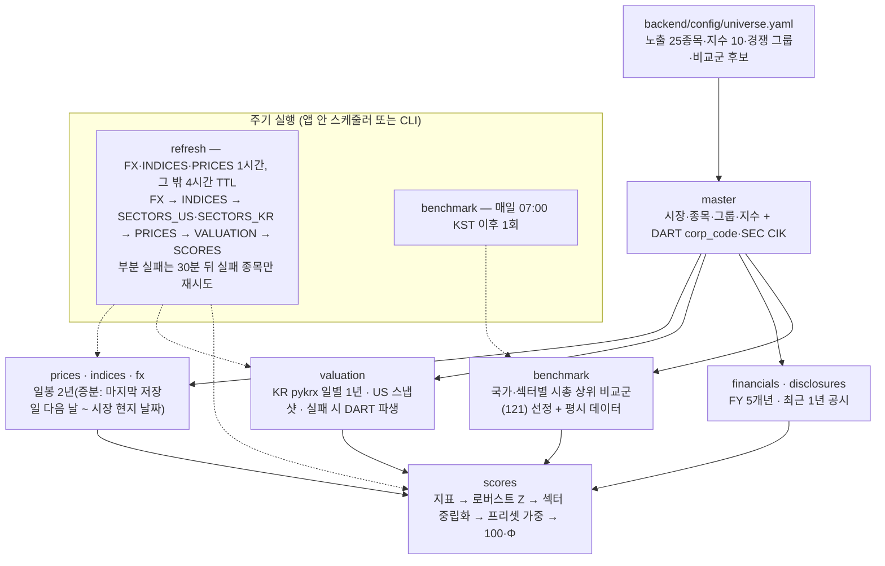
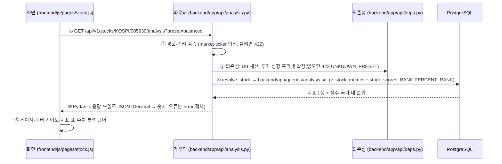

# 아키텍처

StockMind의 구성 요소, 데이터 적재 흐름, 요청 하나가 처리되는 순서, 주요 설계 결정을 한 장에 모은 문서다. 상세는 각 절에 링크한 문서를 따른다.

## 1. 전체 구성도

- **외부 호출은 수집 쪽에서만** 한다. 조회 API는 DB에 저장된 값을 읽고, 환율 현재값만 TTL(1시간)이 지났을 때 한 번 외부를 부른다(`개발산출물/06` 1절 "외부 소스 장애 시 동작"). 대시보드 홈의 섹터 히트맵은 갱신 작업이 받아 둔 값을, 시장 심리 지수는 저장된 지수·VIX 일봉으로 계산한 값을 읽으므로 홈을 몇 번 열어도 새 외부 호출이 없다(A-135·A-136).
- **같은 작업이 겹치지 않게** PostgreSQL advisory lock을 쓴다: 갱신(`REFRESH_LOCK_KEY`), 환율 조회, 비교군 갱신(`BENCHMARK_LOCK_KEY`), 스케줄러.
- **재무·공시 수집은 회사 단위·국가별 키로 잠근다**(`DART_LOCK_KEY` 국내, `SEC_LOCK_KEY` 미국). DART·SEC를 부르는 동안만 회사 1개씩 잡고 풀어서, 상세 화면 요청이 07:00 비교군 재무 묶음 전체가 아니라 처리 중인 회사 하나만 기다린다. 잠금 연결 1개를 반복문 동안 재사용하고(`LockSession`), DB 쓰기는 `ingest.flush_every`(20)개 회사마다 한 트랜잭션으로 모은다(`BatchWriter` — 행 저장과 `data_freshness`는 같은 트랜잭션, `ingestion_logs`는 별도). DART 분당 한도는 프로세스마다 45회(API 서비스 + Job 합계 90 이하).
- **07:00 비교군 갱신은 공시 목록 증분부터** 한다(`jobs.load_dart_feed`): 회사 지정 없는 사업보고서 목록(DART list.json A001)을 기준점(`ingest_cursor`)부터 받아, 새 사업보고서·정정을 낸 DB 종목의 재무 유효기간을 끝낸다. 국내 재무 첫 적재는 OpenDART 재무정보 일괄다운로드 파일로 한 번에 넣는다(`python -m app.ingest dart-bulk`, API 호출 없음).
- **08:00 백그라운드 재무 적재**(`app/ingest/background.py`): 재무 기록이 없는 국내 listed 종목을 거래대금 → 시가총액 순으로, 오늘 남긴 DART 재무·공시 로그 행이 `background.dart_calls_per_day`(2,000)에 닿을 때까지 받는다. 미국은 순위 소스(D11)를 정한 뒤.
- **07:00 비교군 재무는 하루 예산**(`benchmark.fin_daily_budget`, 100종목)까지만 유효기간이 가장 오래 지난 순으로 받는다. 노출·관심·포트폴리오 종목은 예산과 무관하다.
- 컨테이너는 `db`(PostgreSQL)와 `api`(uvicorn + 스케줄러) 두 개다(`compose.yml`). `api`의 HEALTHCHECK는 `/health/db`.

## 2. 데이터 적재 흐름

- 대상마다 `ingestion_logs`에 1행을 남기고 한 종목이 실패해도 나머지는 계속 적재한다. 이상 행은 버리지 않고 `backend/data/quarantine/*.csv`에 사유와 함께 보관한다.
- 갱신 TTL은 작업 단위 기록(`source = 'REFRESH'`)으로 판단한다(A-109). 적재 상태는 `GET /api/v1/statistics/data-quality`·`python -m app.ingest status`로 확인한다.

## 3. 요청 흐름 예시 — 종목 상세의 매력도·수치 분석

| 단계 | 하는 일 | 코드 |
|---|---|---|
| ① 요청 | 화면이 `api.js`로 호출, 모든 응답에 `X-Request-ID` | `frontend/js/api.js`, `backend/app/main.py` 미들웨어 |
| ② 검증 | 경로·쿼리·본문의 형식·범위(A-112). 틀리면 DB에 가기 전에 422 | `backend/app/api/deps.py` `MarketPath`·`TickerPath` |
| ③ 의존성 | DB 세션·프리셋 확정. **사용자 데이터 API(관심종목·포트폴리오)는 같은 자리에서 `get_current_user_id()`로 요청 사용자를 확정**하고 소유자만 조회(남의 리소스는 404) | `get_db`, `get_preset`, `get_current_user_id` |
| ④ SQL | 원문 SQL을 `text()`로 실행. 지표는 VIEW `v_stock_metrics`(CTE·윈도우 함수), 순위는 `RANK()` | `backend/app/queries/analysis.sql`, `backend/db/views.sql` |
| ⑤ 응답 | Pydantic 모델로 직렬화, 금액·비율은 Decimal 계산 후 숫자. 예외는 `AppError` 계열 → `{"error": {"code","message","detail"}}` | `backend/app/schemas`, `backend/app/core/errors.py` |
| ⑥ 화면 | 로딩·빈 상태·오류 상태는 공통 컴포넌트(`load()`) | `frontend/js/components/ui.js` |

## 4. 주요 설계 결정

| 결정 | 내용 | 상세 |
|---|---|---|
| 도메인·데이터 선택 | 국내(KOSPI·KOSDAQ)·미국(NASDAQ) 주식은 공개 데이터로 시세·재무·공시를 모두 얻을 수 있고, 통화·시간대·회계기준이 달라 **정규화·JOIN·집계·윈도우 함수**를 보여 주기 좋다 | `개발산출물/01`, `개발산출물/03` |
| `markets` 분리(3NF) | 국가·통화·시간대는 종목이 아니라 시장에 종속 → `stocks.market_id`로 이행적 종속 제거 | `개발산출물/05` 4-3 |
| 의도적 비정규화 ① | `portfolio_items.ref_price·ref_fx_rate·ref_date` — 담은 시점의 불변 사실이라 시세가 갱신돼도 원가가 바뀌지 않게 복사 저장 | `개발산출물/05` 5-1 |
| 의도적 비정규화 ② | `stock_metric_values`·`stock_scores` — 매력도 파생 결과를 저장해 순위·설명을 매번 다시 계산하지 않음 | `개발산출물/05` 5-2 |
| TTL 갱신 정책 | 같은 종류 외부 호출은 4시간(주가·지수·환율은 1시간)에 1회, 일봉·지수는 장 마감된 날까지만 요청(장중 호출 0), 작업 단위 기록으로 판단, 부분 실패는 30분 뒤 실패 종목만 재시도, 시장 현지 날짜까지만 요청 | README 갱신 정책, A-109·A-110 |
| 예외처리 원칙 | 응답 형식 하나(`{"error": {...}}`), 형식 오류는 DB 전에 422, 남의 리소스는 404로 숨김, 처리하지 못한 예외는 내부 정보 없이 500(요청 ID로 로그 추적), 외부 장애는 마지막 값·stale 표시 | `개발산출물/06` 1절·5절 |
| 대시보드 지표 선정 | 국내·미국 대표 지수 + USD/KRW(미국 종목의 원화 환산·환율 효과 분리에 필요), 사용자가 지수 10개 중 고름. 홈 순위는 리스트와 겹치지 않게 거래량 급증(20거래일 평균 대비)·매력도 순위, 매력도는 같은 시장 안 상대 위치(5개 팩터). 섹터 히트맵·시장 심리 지수는 이미 받는 시세 경로와 저장된 지수 일봉으로 만든다 | A-111·A-130·A-135·A-136, `개발산출물/09` |
| 인증 | 1차는 단일 사용자(데모) 모드, 로컬·시연 전용. 2차에서 `get_current_user_id()`만 JWT 검증으로 교체 | A-57·A-82 |

- **LLM 연동**: 1차 범위 제외(세미프로젝트 규격). 3차 예정 — `GET /api/v1/statistics/data-quality`와 `stock_scores.data_quality`의 JSON 구조가 입력으로 쓰일 예정이다.
